<div align="center">

# Trust, Pixel by Pixel

### Uncertainty Quantification for 6-Band Multispectral Land-Cover Classification

[](LICENSE)


</div>

> **Abstract.** A land-cover classifier labels every pixel, including the ones it should not be sure about.
> We train **11 deep classifiers** (CNN, Fourier, Transformer, state-space, graph and wavelength-aware
> foundation-style models) on a 330 × 307-pixel, 6-band multispectral scene with 7 land-cover classes. We
> then attach **11 uncertainty-quantification (UQ) methods**: five flavours of conformal prediction,
> spatially-smoothed and multi-head conformal prediction, credal ensembles and their distilled student, and a
> diffusion-based model with a statistical test.
>
> This scene is more informative than an "every model is perfect" benchmark, because accuracy ranges from
> **68.8% to 99.9%**. That range shows how uncertainty methods behave across the whole spectrum of model
> quality:
> 1. The calibrated conformal methods keep their 95% promise on all 11 backbones (0.949–0.972).
> 2. Accurate models *abstain* on ~5% of pixels.
> 3. The two weaker models instead **list alternatives**, up to 2.65 classes per pixel.
> 4. A 95% average can hide a class covered only **73.5%** of the time.
>
> Every number in this document is read from the result files committed in this repository.

---

## Contents

1. [Key findings](#1-key-findings)
2. [Why uncertainty matters for land-cover maps](#2-why-uncertainty-matters-for-land-cover-maps)
3. [The data](#3-the-data)
4. [Experimental set-up](#4-experimental-set-up)
5. [Model architectures](#5-model-architectures)
6. [Classification results](#6-classification-results)
7. [Uncertainty quantification: methods in plain words](#7-uncertainty-quantification-methods-in-plain-words)
8. [Uncertainty results](#8-uncertainty-results)
9. [Discussion and recommendations](#9-discussion-and-recommendations)
10. [Limitations and threats to validity](#10-limitations-and-threats-to-validity)
11. [Repository map and reproducibility](#11-repository-map-and-reproducibility)
12. [Citation, licence and references](#12-citation-licence-and-references)

---

## 1. Key findings

| # | Finding | Evidence | Details |
|:-:|---|---|---|
| F1 | **The 95% guarantee holds.** Split, class-conditional, clustered and RC3P conformal prediction reach 0.949–0.972 coverage on all 11 backbones | [Fig. 12](#81-rq1--does-the-95-guarantee-hold) | [baseline/](baseline/README.md) |
| F2 | **The form of the answer follows model quality.** Accurate models (≥ 99.3%) give one class or abstain (3–5% empty sets). SpatialGCN (84.6%) lists 2+ classes for 38–53% of pixels, DOFA-Spectral (68.8%) for 74–78% | [Fig. 13–14](#82-rq2--what-do-the-prediction-sets-look-like) | [spatialgcn/](spatialgcn/README.md), [dofa/](dofa/README.md) |
| F3 | **"95% on average" can hide a failing class.** Split CP covers AlexNet's rarest class (class 7) only 73.5% of the time; class-conditional CP restores 95.6% | [Fig. 16](#83-rq3--is-coverage-fair-across-classes) | [baseline/](baseline/README.md) |
| F4 | **RC3P over-delivers.** It covers 0.957–0.972 (up to ~4.7 standard errors above 95%): safe, but with larger sets than needed | [Fig. 12](#81-rq1--does-the-95-guarantee-hold) | [baseline/](baseline/README.md#3-the-five-methods-step-by-step) |
| F5 | **The rule decides how much of the map is "uncertain":** 0.09–0.25% (DAPM) vs 9–13% (CREDIT, MultiCP) vs 32–38% (SCMCP 9×9) | [Fig. 19](#85-rq5--how-much-of-the-map-does-each-method-call-uncertain) | [§8.5](#85-rq5--how-much-of-the-map-does-each-method-call-uncertain) |
| F6 | **Intersecting heads multiplies the misses.** MultiCP's 7 heads give 0.718 joint coverage, close to 0.95⁷ = 0.698 | [Fig. 20](#86-rq6--multi-head-and-spatial-variants) | [multicp/](multicp/README.md) |
| F7 | **Disagreement lives off the labels.** 98.2–99.7% of the pixels CREDIT flags are unlabelled; ensemble epistemic uncertainty is 17–823× higher across the scene than on test pixels | [Fig. 23](#87-rq7--what-do-ensembles-say-about-the-two-kinds-of-uncertainty) | [ensemble/](ensemble/README.md) |
| F8 | **Accuracy is inflated by the split.** 100% of test patches contain training pixels (40.2 of 81 on average) | [Fig. 10](#43-how-pixels-are-split-and-why-it-matters) | [§10](#10-limitations-and-threats-to-validity) |

---

## 2. Why uncertainty matters for land-cover maps

Land-cover maps feed crop statistics, irrigation planning and environmental reporting. A classifier gives a
label to every pixel: to the interior of a well-known field, to the mixed pixel on a field boundary, and to a
surface type it has never been shown. Without an uncertainty layer all three look equally trustworthy.

A useful uncertainty layer is:

| Property | Meaning | Who provides it here |
|---|---|---|
| **Valid** | "95%" really means 95% of the time | Conformal prediction (§7.2) |
| **Fair** | The promise holds for every class, not only on average | Class-conditional CP, RC3P |
| **Informative** | It singles out the pixels that are actually wrong or ambiguous | Depends on model accuracy (§8.2) |
| **Interpretable** | It separates "ambiguous pixel" from "unfamiliar surface" | Credal ensembles, CREDIT (§8.7) |
| **Spatially coherent** | Uncertainty forms regions and edges, not speckle | SACP / SCMCP (§8.6) |

---

## 3. The data

### 3.1 What the files contain

| Property | Value | Status |
|---|---|---|
| Files | `data.csv` (101,310 rows × 6 band columns), `ref.csv` (101,310 labels); Kaggle copies `k001.csv`, `k002.csv` | confirmed |
| Size | **330 × 307 pixels × 6 bands** (row-major: the notebooks `reshape(330, 307, 6)`) | confirmed |
| Labelled pixels | **17,239** (17.0% of the scene); 84,071 unlabelled (label 0) | confirmed |
| Classes | **7** (labels 1–7) | confirmed |
| Stored values | integers 12–209 (8-bit digital numbers, no saturation, no missing values) | confirmed |
| Band layout | Blue, green, red, near-infrared, SWIR-1, SWIR-2, i.e. Landsat TM/ETM+ bands 1–5 and 7. The DOFA notebook assigns 0.485 / 0.56 / 0.66 / 0.83 / 1.65 / 2.22 µm | **inferred**, supported by the spectra (§3.3) |
| Location, date, class names | Not recorded in the files | **unknown** |

**Provenance.** The data are distributed as the Kaggle dataset `dias-6-bands-data` and mirrored on
[Hugging Face](https://huggingface.co/datasets/DaneshSelwal/Classification-6Bands-Data). The Hugging Face
card lists example class types ("Water, Vegetation, Soil, Built-up, Agriculture, etc.") but does not map them
to labels. This document therefore uses **Class 1–7** and describes each class by its spectral behaviour
only.

### 3.2 The scene and its classes

The scene (**Figure 1**, top of page) is an intensively farmed landscape of rectangular parcels crossed by
a canal or river from north-west to south-east. In the false-colour view (Figure 1b) vigorous vegetation
appears red. The reference labels (Figure 1c) cover 17% of the scene, concentrated in the centre.

<p align="center"></p>

*__Figure 2.__ Labelled pixels per class.*

**Reading Figure 2.** Class 1 alone holds 42% of the labels, and the three smallest classes (5, 6 and 7)
hold 12.6% together. With a 25% test split and a further 50/50 calibration/evaluation split, class 7 has
only **68 evaluation pixels**. Per-class coverage for it is therefore accurate to about ±5 points (one
standard error ≈ 2.6 points), and this caveat applies to every per-class number below.

> ⚠️ **Class numbering in notebook figures.** The reference file uses labels **1–7**. The notebooks
> subtract 1, so their maps and tables say **"Class 0 … Class 6"**. *Class k* in a notebook figure =
> *label k + 1* here. All figures made for this documentation use 1–7.

### 3.3 Spectral behaviour

<p align="center">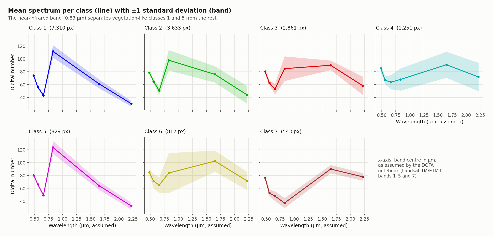</p>

*__Figure 3.__ Mean spectrum (line) ± 1 standard deviation (band) per class.*

<p align="center">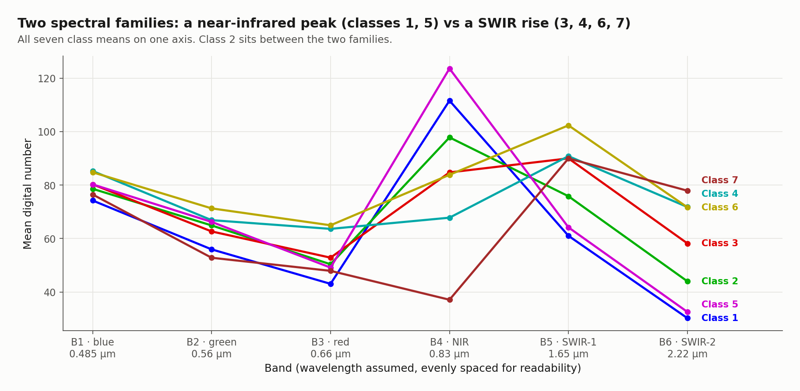</p>

*__Figure 4.__ All seven class means on one axis.*

**Reading Figures 3–4.** The classes fall into two spectral families:
- **Classes 1 and 5** (and, more weakly, 2) have a sharp **near-infrared peak** and low SWIR. This is the
  signature of green, actively growing vegetation.
- **Classes 3, 4, 6 and 7** rise into the **SWIR** instead. This is typical of bare soil, senescent or
  harvested crops, or built surfaces. Class 7 is the extreme case: the lowest NIR of all (37) and high SWIR.

The width of the bands matters too. Classes 1, 5 and 7 are tight (standard deviation 1–10 DN), while classes
4 and 6 spread very widely (up to 31 DN). Wide classes are likely mixtures of surface conditions, and they
are where models and uncertainty methods struggle.

<p align="center">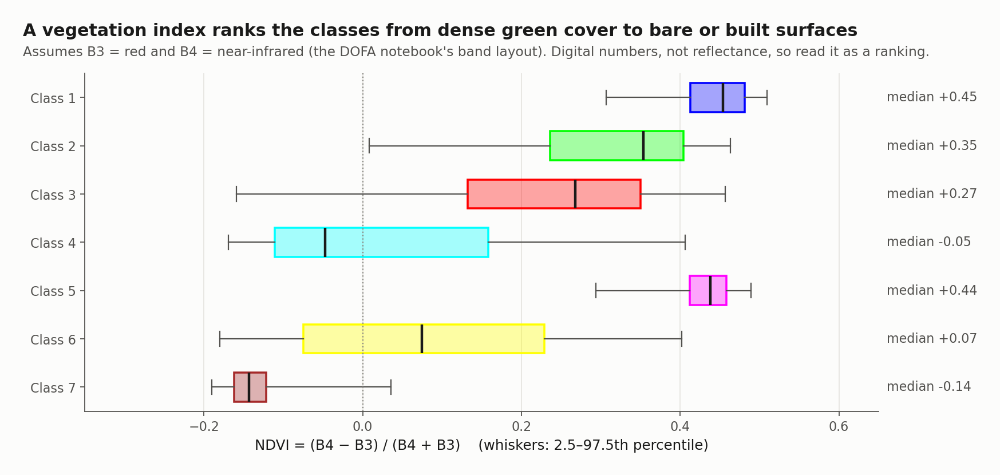</p>

*__Figure 5.__ A vegetation index per class (assuming B3 = red, B4 = near-infrared).*

**Reading Figure 5.** NDVI (normalised difference vegetation index) is the standard one-number summary of
"how green". It ranks the classes from class 1 (+0.45) and class 5 (+0.44) down to class 7 (−0.14). Classes
4 and 6 have very wide boxes: each spans from bare to moderately vegetated surfaces. Because the input
values are digital numbers rather than calibrated reflectance, read NDVI as a ranking, not as absolute
values.

| | |
|:-:|:-:|
|  |  |
| *__Figure 6a.__ Spectral angle between class means* | *__Figure 6b.__ Red vs near-infrared, per pixel* |

**Reading Figure 6.**
- **Spectral angle (6a)** compares spectral *shape* and ignores brightness. The closest pair is classes
  **1 & 5 at 1.9°**: the same green-vegetation shape, separated only by brightness (class 5 is brighter
  in the NIR). Classes **3 & 6 (4.3°)** and **4 & 6 (4.4°)** are the next closest. The most different pair
  is 5 & 7 (34°).
- **The red–NIR scatter (6b)** is the classic two-band view. Class 7 sits alone at the bottom left. Every
  other class shares space with at least one neighbour: 1, 2, 3 and 5 crowd the high-NIR corner, and 4 and 6
  spread across the bottom right.

<p align="center">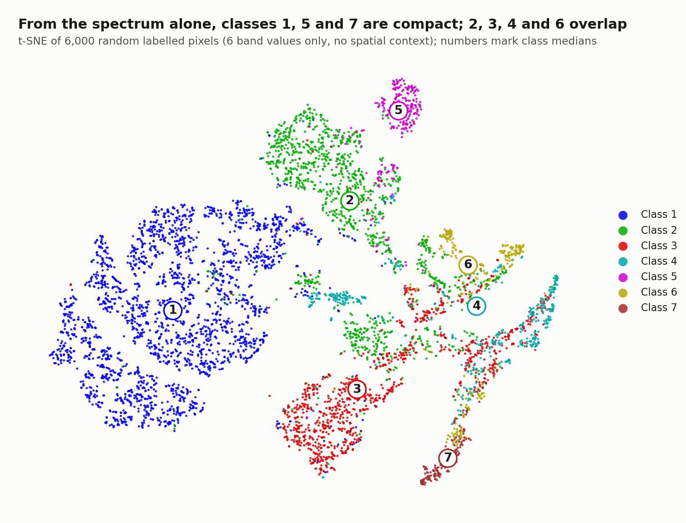</p>

*__Figure 7.__ t-SNE of 6,000 labelled pixels, using the six band values only.*

**Reading Figure 7.** Each dot is one pixel placed by spectral similarity. Classes 1, 5 and 7 form compact
islands. Classes 2, 3, 4 and 6 interleave in a long chain: from the spectrum alone, they cannot be
separated cleanly. Spatial context (the 9 × 9 patch) has to do the rest, which is why the train/test split
(§4.3) matters so much.

### 3.4 How much independent information do six bands carry?

| | |
|:-:|:-:|
|  |  |
| *__Figure 8.__ Band-to-band correlation* | *__Figure 9.__ Principal components* |

**Reading Figures 8–9.**
- The visible and SWIR bands are strongly positively correlated (0.66–0.94).
- The near-infrared band is **negatively** correlated with all of them (−0.13 to −0.68). It carries the
  vegetation signal on its own.
- Two principal components explain **94.6%** of the variance (73.2% + 21.4%). PC1 contrasts SWIR against
  NIR (bare vs vegetated), and PC2 is overall brightness led by NIR.

The scene is effectively two-dimensional spectrally, which is why spatial context matters so much for the
classes inside each family.

---

## 4. Experimental set-up

### 4.1 Pipeline

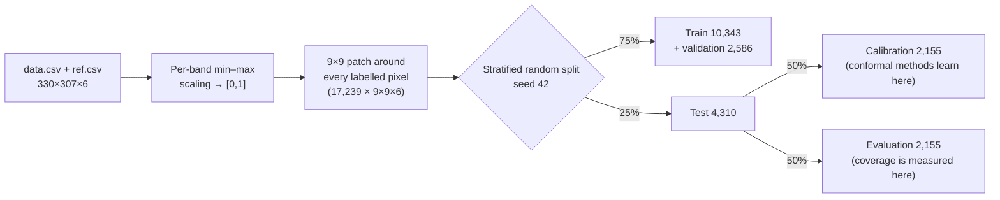

1. **Normalise.** Each band is min–max scaled to [0, 1] over the whole scene.
2. **Patch.** The image is edge-padded by 4 pixels, and a 9 × 9 × 6 cube is cut around every labelled
   pixel. The centre pixel's label is the target.
3. **Split.** Stratified 75/25 train/test (seed 42), with 20% of train held out for validation. For
   uncertainty, the test pool is split 50/50 again into calibration and evaluation.
4. **Full-scene maps.** Every one of the 101,310 pixels gets a patch and a prediction.

Two deviations matter later:
- **AlexNet** uses a "legacy" recipe: Adagrad, split seed 10, no validation set.
- **MultiCP** uses its own 75 / 12.5 / 12.5 split with seed 10.

### 4.2 Training recipe

| Setting | Value |
|---|---|
| Optimiser | AdamW-style, lr 3 × 10⁻⁴ with cosine decay (α = 0.05); AlexNet: Adagrad with a cosine schedule from 0.01 to 0.02 |
| Regularisation | label smoothing 0.05, weight decay 10⁻⁴, dropout 0.25, gradient clipping 1.0 |
| Batch / epochs | 128 / **100** (all models ran the full 100 epochs) |
| Hardware | Kaggle GPU |

### 4.3 How pixels are split, and why it matters

<p align="center"></p>

*__Figure 10.__ The notebooks' random pixel split, reproduced exactly.*

**Reading Figure 10.** Train (green) and test (red) pixels are drawn from the same parcels (10a). A
test pixel's 9 × 9 input therefore contains many training pixels (10b). Counted over all 4,310 test
pixels (10c): **every test patch contains training pixels, 40.2 of 81 on average** (median 41).

**Why it matters.** The models are mostly asked about places whose surroundings they were trained on.
Accuracy, and every coverage number computed from it, is optimistic compared with predicting a new
field or a new scene (§10).

### 4.4 Metrics glossary

| Metric | Plain meaning | Good value |
|---|---|---|
| **Accuracy, Cohen's κ, macro-F1** | Share correct; agreement beyond chance; per-class F1 averaged so small classes count equally | high |
| **NLL, Brier, ECE** | Penalty for confident mistakes; squared probability error; gap between stated confidence and accuracy (15 bins) | low |
| **Coverage** | Share of evaluation pixels whose set contains the true class | ≈ 95% |
| **Average set size** | Mean number of classes per set | small, given coverage |
| **Singleton / empty rate** | Share of sets with exactly one / no class | see §8.2 |
| **Per-class coverage** | Coverage inside each class | ≈ 95% for *every* class |
| **AU / EU / TU** | Aleatoric / epistemic / total uncertainty (credal methods) | relative |

---

## 5. Model architectures

Three **baseline backbones** are used by every UQ method. Eight **extended backbones** test whether the
conclusions survive a change of architecture.


| Model | Idea in one line | Folder |
|---|---|---|
| **AlexNet-CNN** | Stacked small convolutions learn local spatial-spectral texture | [`baseline/`](baseline/README.md) |
| **GFNet** | A learnable filter in the Fourier domain mixes all tokens cheaply | [`baseline/`](baseline/README.md) |
| **ViT-UNet** | A Vision Transformer whose layers are linked like a U-Net | [`baseline/`](baseline/README.md) |
| **DOFA-Spectral, Hiera-ViT, DOFA+Hiera Fusion** | A wavelength-conditioned hypernetwork (DOFA), a hierarchical ViT (Hiera), and both together | [`dofa/`](dofa/README.md) |
| **GeoRSCLIP-TextHead** | Image features matched by cosine similarity to one text embedding per class | [`georsclip/`](georsclip/README.md) |
| **MambaHSI Small / Base / Large** | A selective state-space model scans the patch as a sequence | [`mambahsi/`](mambahsi/README.md) |
| **SpatialGCN** | 81 pixel-nodes on a 4-neighbour graph, mixed by graph convolutions | [`spatialgcn/`](spatialgcn/README.md) |

---

## 6. Classification results

| Model | Test accuracy | Cohen's κ | Macro-F1 | NLL | Brier | ECE (15 bins) | Train time |
|---|--:|--:|--:|--:|--:|--:|--:|
| MambaHSI-Large | **99.88%** | 0.9984 | 0.9989 | 0.0229 | 0.0025 | 0.0197 | 16.1 min |
| MambaHSI-Base | 99.84% | 0.9978 | 0.9987 | 0.0236 | 0.0028 | 0.0205 | 6.2 min |
| MambaHSI-Small | 99.74% | 0.9965 | 0.9974 | 0.0229 | 0.0054 | 0.0174 | 2.1 min |
| AlexNet-CNN | 99.70% | 0.9959 | 0.9955 | 0.0085 | 0.0044 | **0.0013** | 11.4 min |
| DOFA+Hiera Fusion | 99.70% | 0.9959 | 0.9966 | 0.0361 | 0.0054 | 0.0256 | 5.4 min |
| GFNet | 99.63% | 0.9950 | 0.9954 | 0.0228 | 0.0057 | 0.0089 | 12.4 min |
| GeoRSCLIP-TextHead | 99.63% | 0.9950 | 0.9952 | 0.0459 | 0.0074 | 0.0353 | 6.3 min |
| Hiera-ViT | 99.44% | 0.9925 | 0.9921 | 0.0527 | 0.0102 | 0.0342 | 4.9 min |
| ViT-UNet | 99.28% | 0.9902 | 0.9904 | 0.0643 | 0.0136 | 0.0388 | 21.6 min |
| **SpatialGCN** | **84.57%** | 0.7883 | 0.7825 | 0.4534 | 0.2242 | 0.0597 | 1.1 min |
| **DOFA-Spectral** | **68.84%** | 0.5678 | 0.6476 | 0.7916 | 0.4198 | 0.0504 | 0.9 min |

*__Table 1.__ Test-set classification (4,310 pixels). Sources: `*/results/classification_summary.csv`.*

**What Table 1 shows.**
- **Nine models are near-perfect (99.3–99.9%).** Part of this is the random split (§4.3).
- **Two models make real mistakes.** DOFA-Spectral (68.8%) averages its patch into a single spectrum and
  so cannot separate the overlapping classes of Figure 7. SpatialGCN (84.6%) over-smooths: its maps show
  rounded blobs instead of rectangular parcels ([spatialgcn/](spatialgcn/README.md)).
- **Calibration differs even among accurate models.** AlexNet's ECE (0.0013) is 30× lower than ViT-UNet's
  (0.0388). The transformer-style models are systematically *under*-confident, a typical effect of label
  smoothing.

| Ground truth | AlexNet-CNN | GFNet | ViT-UNet |
|:-:|:-:|:-:|:-:|
|  |  |  |  |

*__Figure 11.__ Full-scene predictions of the baselines (notebook numbering 0–6).*

**Reading Figure 11.** Inside the labelled centre the three models agree. In the unlabelled 83% of the scene
they draw the same parcel structure but sometimes assign different classes. That disagreement cannot show
up in any accuracy number, and it is exactly what the uncertainty maps of §8.4 and §8.7 reveal.

---

## 7. Uncertainty quantification: methods in plain words

### 7.1 Three families

| Family | Everyday analogy | Output per pixel | Guarantee? |
|---|---|---|---|
| **Conformal prediction**: Split, Class-conditional, Clustered, RC3P, RAPS, SACP, MultiCP, SCMCP | A forecaster who keeps score: *"on days I said this, I was right 95% of the time"* | A **set** of classes | **Yes**: the true class is in the set ≥ 95% of the time, if calibration and test pixels are exchangeable |
| **Credal / ensemble**: CreDE, CREDIT | Ask five experts and keep the range of their opinions | Lower/upper probability per class → AU / EU | No |
| **Generative + test**: DAPM | Redraw the answer 30 times and test whether the top two classes really differ | p-value → certain / uncertain | No |

> **Two kinds of uncertainty.** *Aleatoric*: the pixel itself is ambiguous (a field edge, a mixed surface),
> and more data would not help. *Epistemic*: the model has not learned this case, and more or better data
> would help.

### 7.2 Conformal prediction in three steps

<p align="center"></p>

*__Box 1.__ How conformal prediction works, with illustrative (made-up) numbers.*

1. **Score.** On each calibration pixel, measure the model's surprise at the true answer:
   $`s_i = 1 - \hat p_{y_i}(x_i)`$.
2. **Cut-off.** Take the value that 95% of the scores stay under (with a small finite-sample correction):

```math
\hat q = \text{Quantile}\left(s_1,\dots,s_n;\ \frac{\lceil (n+1)(1-\alpha)\rceil}{n}\right),\qquad \alpha = 0.05
```

3. **Set.** Keep every class whose probability clears the bar:
   $`C(x) = \{\,k : \hat p_k(x) \ge 1 - \hat q\,\}`$.

Each method folder changes one ingredient: the **score** (RAPS, SAPS), the **grouping** used for the
cut-off (class-conditional, clustered, RC3P), the **neighbourhood** (SACP, SCMCP), or the **number of
heads** that must agree (MultiCP).

### 7.3 Method map

| Folder | Method | What it changes | Output |
|---|---|---|---|
| [`baseline/`](baseline/README.md) ⭐ | Split, Class-conditional, Clustered CP, RC3P, RAPS | Score and grouping | Prediction sets |
| [`sacp/`](sacp/README.md) | Spatially-Aggregated CP | Averages each pixel's score with its neighbours' | Prediction sets |
| [`multicp/`](multicp/README.md) | Multi-head CP | 7 heads; a class must pass all 7 | Prediction sets |
| [`multicp_sacp/`](multicp_sacp/README.md) | Spatial MultiCP (SCMCP) | Smooths each head's probabilities, then MultiCP | Prediction sets |
| [`ensemble/`](ensemble/README.md) | Deep ensembles + CreDE | 5 members → credal intervals | AU / EU / TU |
| [`credit/`](credit/README.md) | CREDIT | One student learns the ensemble's intervals | AU / EU / TU |
| [`dapm/`](dapm/README.md) | DAPM | VAE + domain alignment + diffusion + Welch t-test | p-value per pixel |
| [`dofa/`](dofa/README.md), [`georsclip/`](georsclip/README.md), [`mambahsi/`](mambahsi/README.md), [`spatialgcn/`](spatialgcn/README.md) | Baseline CP methods | New backbones | Prediction sets |

---

## 8. Uncertainty results

### 8.1 RQ1 · Does the 95% guarantee hold?

<p align="center"></p>

*__Figure 12.__ Empirical coverage of the five baseline conformal methods on all 11 backbones.*

**How to read it.** Each dot is one backbone. The shaded band is 95% ± 2 standard errors for 2,155
evaluation pixels (±0.9 points): dots inside it are statistically indistinguishable from exactly 95%.

**What it shows.**
- **Split, class-conditional and clustered CP** sit at 0.949–0.966, inside or just above the band, on every
  backbone. This includes DOFA-Spectral, which is wrong on 31% of pixels.
- **RC3P** is the most conservative (0.957–0.972). Its extra "top-k" rule makes sets slightly larger than
  necessary, which is safe but a little wasteful.
- **RAPS** sits at 0.994–0.999 on the accurate models, i.e. at their accuracy: as implemented it always
  returns the top-1 class ([baseline/ §3.5](baseline/README.md#raps)). Only on the two weaker models,
  where the true class is often not ranked first, does it land near 95% (0.945–0.953).

> **Takeaway RQ1.** The guarantee is real and model-independent. RAPS as implemented is the exception.

### 8.2 RQ2 · What do the prediction sets look like?

<p align="center"></p>

*__Figure 13.__ (a) Split CP on every backbone, ordered by accuracy; (b) SpatialGCN and (c) DOFA-Spectral
under all five methods.*

**How to read it.** Each bar is 100% of evaluation pixels: blue = sets with exactly one class,
grey = empty sets, orange = sets with 2+ classes.

**What it shows: three regimes.**

| Regime | Models | What the 95% sets do |
|---|---|---|
| Accurate (≥ 99.3%) | nine backbones | 95–97% one class, **3.4–5.0% empty**, no 2-class sets |
| Imperfect (84.6%) | SpatialGCN | no empty sets; **38–53%** of sets hold 2+ classes (avg 1.46–1.83) |
| Weak (68.8%) | DOFA-Spectral | no empty sets; **74–78%** hold 2+ classes (avg 2.16–2.65) |

<p align="center">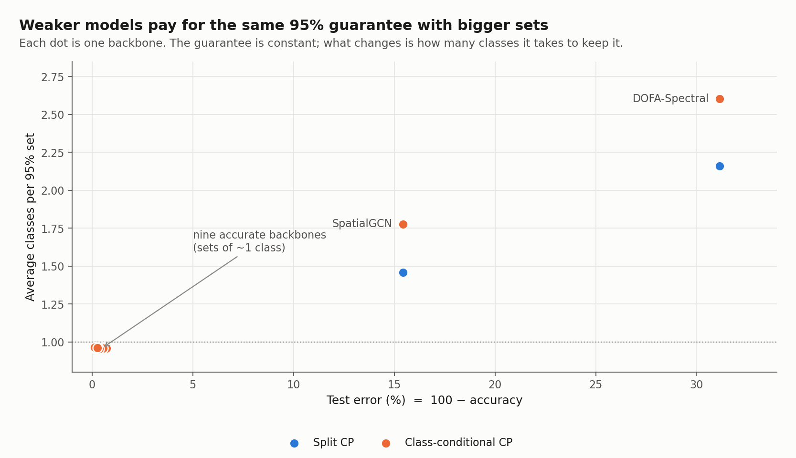</p>

*__Figure 14.__ Average set size against test error, for every backbone.*

**Reading Figure 14.** The guarantee stays at 95%, so a weaker model pays for it with larger sets. Set size
grows roughly in proportion to the error rate. Class-conditional CP (orange) asks for more than Split CP
(blue) because it also protects the weak classes (§8.3).

**Why accurate models give empty sets.**

<p align="center"></p>

*__Figure 15.__ Illustration with simulated scores (not repository data).*

A 99.7%-accurate model is wrong on only ~0.3% of pixels. To "use" its 5% error budget, the cut-off must
fall among **correct but less-confident** predictions. Those ~5% of pixels then clear the bar for no class
and receive an **empty set**: the method abstains. On accurate models, an empty set therefore means *"among
the least confident 5%"*, not *"probably wrong"*.

> **Takeaway RQ2.** Conformal prediction adapts the form of its answer to the model. It abstains when the
> model is nearly always right, and lists candidate classes when the model genuinely confuses them.

### 8.3 RQ3 · Is coverage fair across classes?

<p align="center">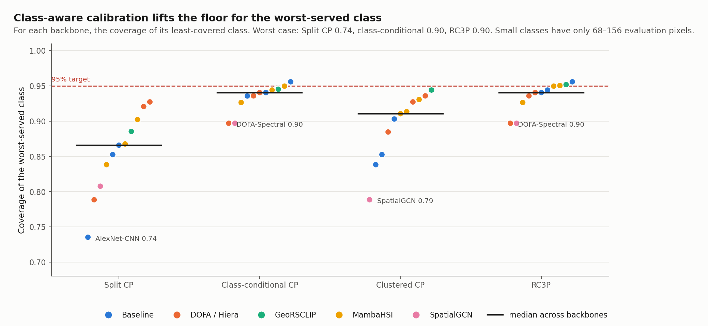</p>

*__Figure 16a.__ For each backbone, the coverage of its least-covered class.*

<p align="center"></p>

*__Figure 16b.__ Coverage inside each class under Split CP (orange) and class-conditional CP (blue).*

**What it shows.**
- **Split CP**: the median worst class sits at 0.87, and the worst case is **AlexNet's class 7 at 0.735**:
  more than one in four of those pixels is missed, while the 95% average looks perfect.
- **Clustered CP** helps on average but can drop a class further (SpatialGCN class 4: 0.79) when a weak
  class is grouped with easy ones.
- **Class-conditional CP and RC3P** raise the floor to **≥ 0.90** for every backbone (median 0.94). The
  remaining shortfalls are in classes with 68–101 evaluation pixels, within about two standard errors of 95%.
- **The most extreme case is outside these backbones.** Fed through Split CP, the classifier head of
  [DAPM](dapm/README.md#5-results-dapms-classifier-through-conformal-prediction) covers label 7 only
  **0.309** (ViT-UNet) and 0.603 (GFNet). Class-conditional CP lifts both to ≥ 0.94.

<p align="center">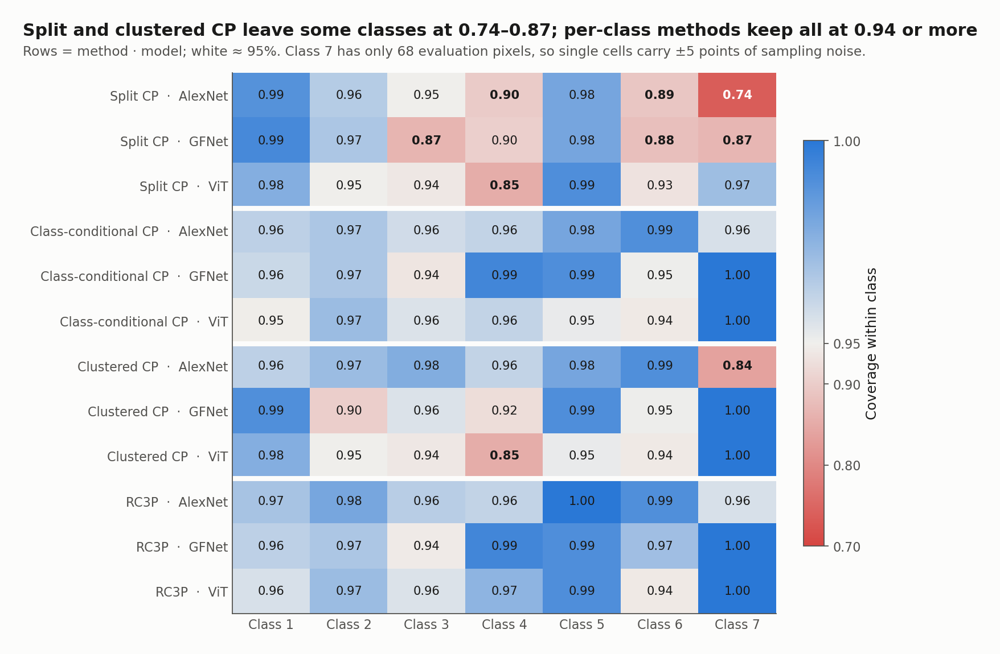</p>

*__Figure 17.__ Every class × method × baseline model; white ≈ 95%, red = under-covered.*

> **Takeaway RQ3.** Report per-class coverage, always. For land-cover maps, where small classes are often the
> point, use class-conditional CP or RC3P. They cost nothing extra at test time.

### 8.4 RQ4 · Where on the map is the uncertainty?

| GFNet · Split CP (99.6%) | SpatialGCN · Split CP (84.6%) | DOFA-Spectral · Split CP (68.8%) |
|:-:|:-:|:-:|
| 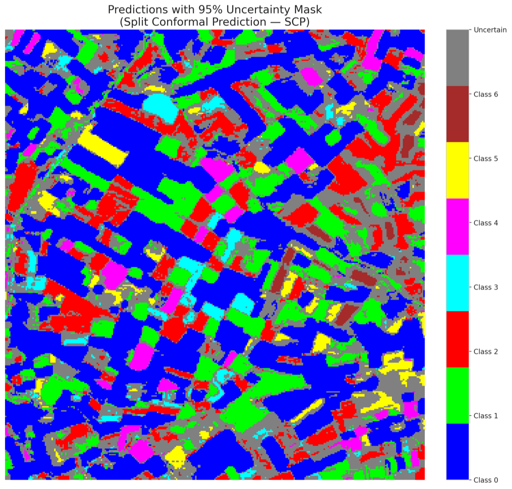 |  | 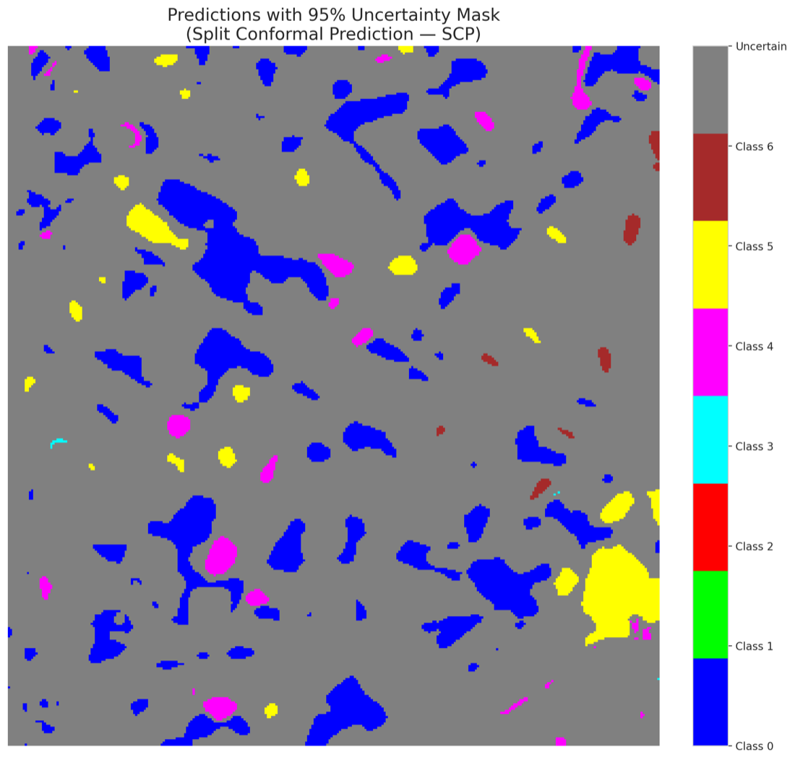 |

*__Figure 18.__ Full-scene prediction maps with "uncertain" pixels (set ≠ one class) in grey. Notebook
numbering 0–6. Extracted from each folder's `conformal_reports_all_models.xlsx`.*

**Reading Figure 18.**
- **GFNet:** grey traces **parcel boundaries** and a few whole parcels in the unlabelled east. These are mixed
  pixels and unfamiliar surfaces. Parcel interiors are confident.
- **SpatialGCN:** the prediction itself is blobby (graph smoothing). Grey forms wide **halos around every
  blob**, so the uncertainty correctly marks where the model's smoothing invented boundaries.
- **DOFA-Spectral:** almost the whole scene is grey. Only spectrally unique patches stay certain, such as the
  vegetation classes 1 and 5 (blue and magenta) and parts of class 6 (yellow). This is honest: the model
  really cannot tell the other classes apart.

> **Takeaway RQ4.** The maps show *where* to trust a land-cover map. Uncertainty concentrates on edges,
> unfamiliar parcels and spectrally ambiguous classes, and it scales with the model's real weakness.

### 8.5 RQ5 · How much of the map does each method call uncertain?

<p align="center">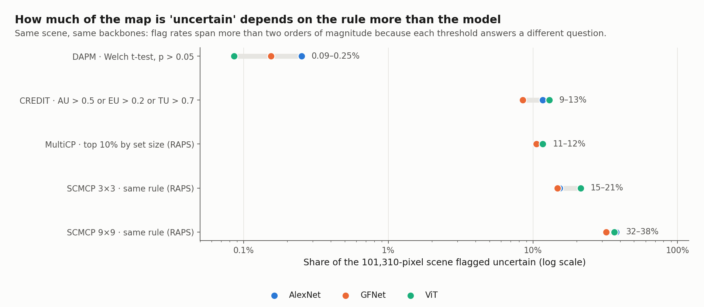</p>

*__Figure 19.__ Share of the 101,310-pixel scene flagged uncertain, per method (log scale).*

| Method | Its rule | What the rule really asks |
|---|---|---|
| DAPM (0.09–0.25%) | Welch t-test p > 0.05 between the top-2 classes over 30 samples | "Are the top two *statistically* tied?" Almost never, with 30 samples |
| CREDIT (9–13%) | AU > 0.5 or EU > 0.2 or TU > 0.7 | "Is the cautious distribution spread out?" Mostly true off the labels; every flag comes from AU |
| CreDE ensembles (17–23%, not in Fig. 19) | same thresholds | "Do the five members disagree?" Mostly EU, almost entirely on unlabelled land |
| MultiCP / SCMCP (11–38%) | **Top 10%** of pixels by set size (plus ties), smoothing widens it | A quota, not a test |

> **Takeaway RQ5.** "% of the map uncertain" is not comparable across methods unless the threshold has a
> calibrated meaning. Only conformal sets carry one.

### 8.6 RQ6 · Multi-head and spatial variants

<p align="center"></p>

*__Figure 20.__ MultiCP joint coverage as more heads must agree.*

**Reading Figure 20.** One head alone is valid (0.953). Each additional head costs 4–5 points, ending at
**0.718 with 7 heads**, just above the independence prediction 0.95⁷ = 0.698. A per-head budget of α/K
would restore 95% ([multicp/](multicp/README.md)).

<p align="center">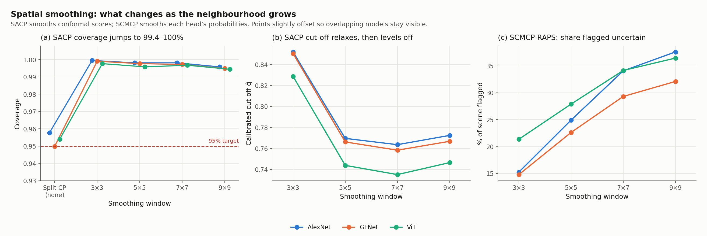</p>

*__Figure 21.__ Spatial methods as the smoothing window grows.*

**Reading Figure 21.**
- **(a)** SACP raises coverage from Split CP's ~95% to **99.4–100%**: empty sets are forced to hold the best
  class, and neighbours' scores pull doubtful pixels towards their parcel.
- **(b)** The cut-off drops from 3×3 to 5×5 and then levels off.
- **(c)** SCMCP flags a growing share of the scene: **15–21% at 3×3 → 32–38% at 9×9**.

| Split CP (GFNet) | SACP 3×3 (GFNet) |
|:-:|:-:|
|  |  |

*__Figure 22.__ Spatial smoothing turns broad grey zones into coherent parcels with thin uncertain edges.*

### 8.7 RQ7 · What do ensembles say about the two kinds of uncertainty?

<p align="center"></p>

*__Figure 23.__ Mean AU and EU: CREDIT student on labelled test pixels vs CreDE ensemble over the whole scene.*

**Reading Figure 23.**
- On **labelled test pixels** the learned disagreement is small (EU 7 × 10⁻⁵ to 0.004).
- Over the **whole scene**, 83% of it unlabelled, the five members disagree **17–823× more** (EU 0.058–0.075).
- Consistently, **98.2–99.7%** of the 8,613–13,161 pixels that CREDIT flags are unlabelled.
- ViT-UNet has the highest AU on both pixel sets, mirroring its high ECE in Table 1.

> **Takeaway RQ7.** Epistemic uncertainty is a detector of *surfaces the model was never taught*. The
> flagged pixels are a ready-made list of where to label next.

### 8.8 Method scorecard

| Method | Valid 95%? | Fair per class? | Informative on accurate models? | Informative on weak models? | Spatially coherent? |
|---|:-:|:-:|:-:|:-:|:-:|
| Split CP | ✅ | ❌ (worst 0.74) | ❌ abstains | ✅ lists alternatives | ❌ |
| Class-conditional CP | ✅ | ✅ (≥ 0.90) | ❌ abstains | ✅ | ❌ |
| Clustered CP | ✅ | ⚠️ (worst 0.79) | ❌ abstains | ✅ | ❌ |
| RC3P | ✅ (conservative) | ✅ (≥ 0.90) | ❌ abstains | ✅ (largest sets) | ❌ |
| RAPS (as implemented) | ❌ = accuracy | — | ❌ top-1 only | ⚠️ ≈ 95% | ❌ |
| SACP | ⚠️ ≈ 99.5%, assumption bent | ✅ | ❌ | not tested | ✅ |
| MultiCP / SCMCP | ❌ ≈ 72% | ❌ | ⚠️ quota | not tested | ⚠️ |
| CreDE / CREDIT | no guarantee | ✅ measured ≥ 97% | ✅ flags unlabelled land | not tested | ✅ |
| DAPM | no guarantee | — | ❌ flags ~0.1% | not tested | ❌ |

---

## 9. Discussion and recommendations

1. **A weak model is the best test of an uncertainty method.** On the nine accurate backbones all
   conformal methods look alike. SpatialGCN and DOFA-Spectral reveal the real differences: how many classes
   each method needs, and which classes it under-protects.
2. **Use class-aware conformal prediction by default.** It costs nothing at test time and removes the worst
   per-class failures.
3. **Do not compare "% uncertain" across methods**, unless the thresholds have been calibrated to the same
   meaning.
4. **Use epistemic maps to guide labelling.** The ensembles disagree almost only on unlabelled surfaces.
5. **Evaluate spatially.** Random pixel splits (F8) flatter every number here. Spatially blocked splits
   (whole parcels held out) are the next step.

---

## 10. Limitations and threats to validity

| # | Issue | Effect | Where |
|:-:|---|---|---|
| 1 | **Random pixel split**: every test patch contains training pixels (40.2 of 81 on average) | Accuracy and coverage are optimistic for new fields or scenes | [§4.3](#43-how-pixels-are-split-and-why-it-matters) |
| 2 | Small classes: class 7 has 68 evaluation pixels | Per-class coverage carries ±5 points of noise | [§3.2](#32-the-scene-and-its-classes) |
| 3 | AlexNet trained on split seed 10; conformal calibration uses seed 42 | **74.5%** of AlexNet's calibration/evaluation pixels were in its training set | [baseline/](baseline/README.md#7-caveats) |
| 4 | RAPS implemented without randomisation | Collapses to top-1 on accurate models | [baseline/](baseline/README.md#raps) |
| 5 | MultiCP intersects independently calibrated heads | Joint coverage ≈ 0.72 | [multicp/](multicp/README.md) |
| 6 | MultiCP / SCMCP maps mark every **label-7** pixel as uncertain (`y == 7`) | Real class-7 parcels are greyed out regardless of the model | [multicp/](multicp/README.md#33-maps) |
| 7 | MultiCP, SCMCP and DAPM results come from an earlier Google Colab run; the Kaggle run log marks the MultiCP (k06, k07), SCMCP (k08) and ensemble-training (k04) kernels as cancelled or failed | Those results cannot be regenerated from the committed notebooks alone without the original weights | [multicp/](multicp/README.md), [multicp_sacp/](multicp_sacp/README.md), [dapm/](dapm/README.md), [ensemble/](ensemble/README.md) |
| 8 | CREDIT selects its checkpoint on the test set | Slight optimism in CREDIT's metrics | [credit/](credit/README.md) |
| 9 | Band wavelengths and class names are inferred, not documented | DOFA's wavelength conditioning and the class interpretations are approximate | [§3.1](#31-what-the-files-contain) |
| 10 | SACP / SCMCP smooth across calibration and test pixels | Exchangeability is bent; the formal guarantee does not strictly apply | [sacp/](sacp/README.md#4-caveats) |
| 11 | Several "foundation-style" models are simplified and trained from scratch: DOFA without pretraining, GeoRSCLIP with placeholder prompts, MambaHSI with an approximate selective scan | They test the architectural idea, not the published pretrained models | [dofa/](dofa/README.md), [georsclip/](georsclip/README.md), [mambahsi/](mambahsi/README.md) |
| 12 | One scene, one split, no repeated seeds | No confidence intervals across runs | — |

---

## 11. Repository map and reproducibility

```
Classification_Uncertainty_Quantification_Kaggle/
├── README.md              ← you are here (the paper)
├── LICENSE                ← Apache 2.0
├── docs/figures/          ← figures made for this documentation
│   ├── dataset/           ←   data analysis (Figures 1–10)
│   ├── uncertainty/       ←   cross-method results (Figures 12–23)
│   └── maps/              ←   uncertainty maps extracted from the result workbooks
├── baseline/  credit/  ensemble/  dapm/
├── multicp/   sacp/    multicp_sacp/
├── dofa/  georsclip/  mambahsi/  spatialgcn/
│   ├── README.md          ← method write-up: intuition, maths, results, caveats
│   ├── *.ipynb            ← executed notebooks
│   └── results/           ← CSV / JSON / PNG / XLSX outputs (the source of every number)
└── scripts/surveillance_monitor.py  ← helper that tracked the Kaggle kernel runs
```

| Resource | Link |
|---|---|
| Data (`data.csv`, `ref.csv`) | 🤗 [datasets/DaneshSelwal/Classification-6Bands-Data](https://huggingface.co/datasets/DaneshSelwal/Classification-6Bands-Data) |
| Trained weights | 🤗 [DaneshSelwal/Classification-6Bands-Models](https://huggingface.co/DaneshSelwal/Classification-6Bands-Models) |
| 65-band companion study | [classification_dias](https://github.com/DaneshSelwal/classification_dias) |
| Umbrella project | [Classification_Uncertainty_Quantification_Analysis](https://github.com/DaneshSelwal/Classification_Uncertainty_Quantification_Analysis) |

**Kaggle notebooks** (one per step; status from the repository's run log):

| Folder | Training | Uncertainty |
|---|---|---|
| baseline | [cuq6-baseline-k01](https://www.kaggle.com/code/daneshselwal/cuq6-baseline-k01) ✅ | [cuq6-uncertainty-k02](https://www.kaggle.com/code/daneshselwal/cuq6-uncertainty-k02) ✅ |
| credit | [cuq6-credit-k03](https://www.kaggle.com/code/daneshselwal/cuq6-credit-k03) ✅ | — |
| ensemble | [cuq6-ensemble-k04](https://www.kaggle.com/code/daneshselwal/cuq6-ensemble-k04) ⚠️ not re-run | [cuq6-crede-k05](https://www.kaggle.com/code/daneshselwal/cuq6-crede-k05) ✅ |
| multicp | [cuq6-multicp-k06](https://www.kaggle.com/code/daneshselwal/cuq6-multicp-k06) ⚠️ cancelled | [cuq6-multicp-uq-k07](https://www.kaggle.com/code/daneshselwal/cuq6-multicp-uq-k07) ❌ failed |
| multicp_sacp | — | [cuq6-multicp-sacp-k08](https://www.kaggle.com/code/daneshselwal/cuq6-multicp-sacp-k08) ❌ failed |
| sacp | — | [cuq6-sacp-k09](https://www.kaggle.com/code/daneshselwal/cuq6-sacp-k09) ✅ |
| mambahsi | [cuq6-mambahsi-k10](https://www.kaggle.com/code/daneshselwal/cuq6-mambahsi-k10) ✅ | [cuq6-mambahsi-uq-k11](https://www.kaggle.com/code/daneshselwal/cuq6-mambahsi-uq-k11) ✅ |
| dofa | [cuq6-dofa-k12](https://www.kaggle.com/code/daneshselwal/cuq6-dofa-k12) ✅ | [cuq6-dofa-uq-k13](https://www.kaggle.com/code/daneshselwal/cuq6-dofa-uq-k13) ✅ |
| georsclip | [cuq6-georsclip-k14](https://www.kaggle.com/code/daneshselwal/cuq6-georsclip-k14) ✅ | [cuq6-georsclip-uq-k15](https://www.kaggle.com/code/daneshselwal/cuq6-georsclip-uq-k15) ✅ |
| dapm | — (Colab only) | — (Colab only) |
| spatialgcn | [cuq6-spatialgcn-k16](https://www.kaggle.com/code/daneshselwal/cuq6-spatialgcn-k16) ✅ | [cuq6-spatialgcn-uq-k17](https://www.kaggle.com/code/daneshselwal/cuq6-spatialgcn-uq-k17) ✅ |

**To reproduce:** run each folder's training notebook, then its uncertainty notebook, on a GPU. Seeds are
fixed (42; AlexNet 10). The notebooks find `data.csv`/`ref.csv` (or `k001.csv`/`k002.csv`) under
`/kaggle/input`, `data/` or the working directory.

---

## 12. Citation, licence and references

**Licence.** [Apache License 2.0](LICENSE).

```bibtex
@misc{selwal2026sixband_uq,
  author       = {Selwal, Danesh},
  title        = {Trust, Pixel by Pixel: Uncertainty Quantification for 6-Band
                  Multispectral Land-Cover Classification},
  year         = {2026},
  howpublished = {\url{https://github.com/DaneshSelwal/Classification_Uncertainty_Quantification_Kaggle}}
}
```

**References.**

1. Angelopoulos, A. N., & Bates, S. (2023). *Conformal Prediction: A Gentle Introduction.* Foundations and Trends in ML.
2. Vovk, V., Gammerman, A., & Shafer, G. (2005). *Algorithmic Learning in a Random World.* Springer.
3. Angelopoulos, A. N., et al. (2021). *Uncertainty Sets for Image Classifiers using Conformal Prediction* (RAPS). ICLR.
4. Romano, Y., Sesia, M., & Candès, E. (2020). *Classification with Valid and Adaptive Coverage* (APS). NeurIPS.
5. Ding, T., et al. (2023). *Class-Conditional Conformal Prediction with Many Classes* (Clustered CP). NeurIPS.
6. Shi, Y., et al. (2024). *Conformal Prediction for Class-wise Coverage via Augmented Label Rank Calibration* (RC3P). NeurIPS.
7. Huang, J., et al. (2024). *Conformal Prediction for Deep Classifier via Label Ranking* (SAPS). ICML.
8. Lakshminarayanan, B., Pritzel, A., & Blundell, C. (2017). *Deep Ensembles.* NeurIPS.
9. Hüllermeier, E., & Waegeman, W. (2021). *Aleatoric and Epistemic Uncertainty in Machine Learning.* Machine Learning 110.
10. Ganin, Y., et al. (2016). *Domain-Adversarial Training of Neural Networks.* JMLR.
11. Ho, J., Jain, A., & Abbeel, P. (2020). *Denoising Diffusion Probabilistic Models.* NeurIPS.
12. Rao, Y., et al. (2021). *Global Filter Networks for Image Classification.* NeurIPS.
13. Dosovitskiy, A., et al. (2021). *An Image is Worth 16×16 Words.* ICLR.
14. Xiong, Z., et al. (2024). *Neural Plasticity-Inspired Foundation Model for Observing the Earth Crossing Modalities* (DOFA). arXiv:2403.15356.
15. Ryali, C., et al. (2023). *Hiera: A Hierarchical Vision Transformer without the Bells-and-Whistles.* ICML. arXiv:2306.00989.
16. Li, Y., et al. (2024). *MambaHSI: Spatial-Spectral Mamba for Hyperspectral Image Classification.* arXiv:2404.18401.
17. Kipf, T. N., & Welling, M. (2017). *Semi-Supervised Classification with Graph Convolutional Networks.* ICLR.
18. Tucker, C. J. (1979). *Red and photographic infrared linear combinations for monitoring vegetation.* Remote Sensing of Environment 8 (NDVI).
19. Roberts, D. R., et al. (2017). *Cross-validation strategies for data with temporal, spatial, hierarchical, or phylogenetic structure.* Ecography 40.
20. Multi-CP reference implementation: [github.com/yamtawa/Multi-CP](https://github.com/yamtawa/Multi-CP).
