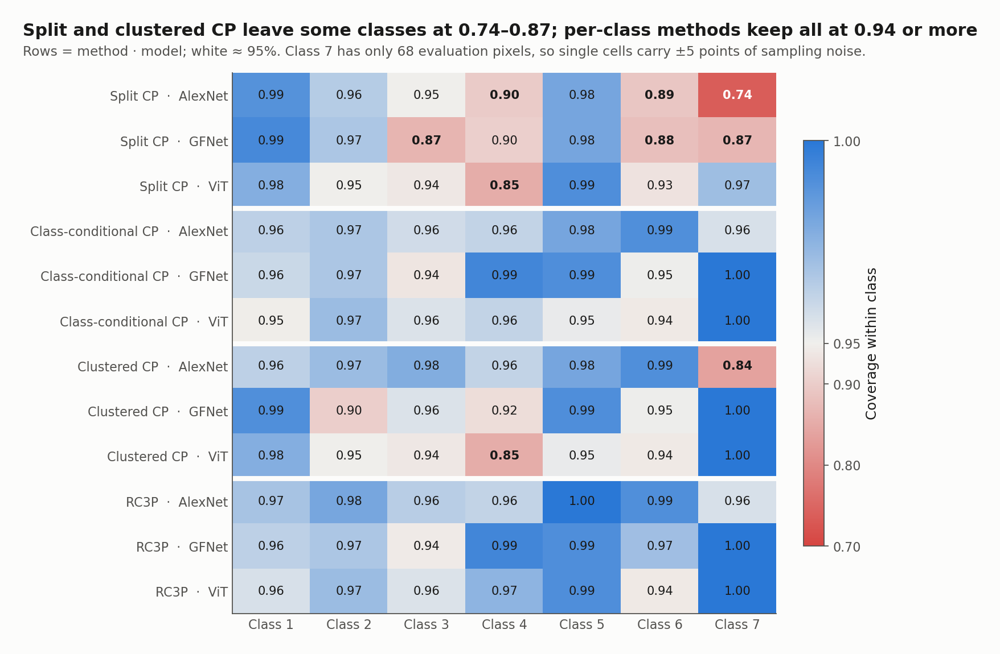
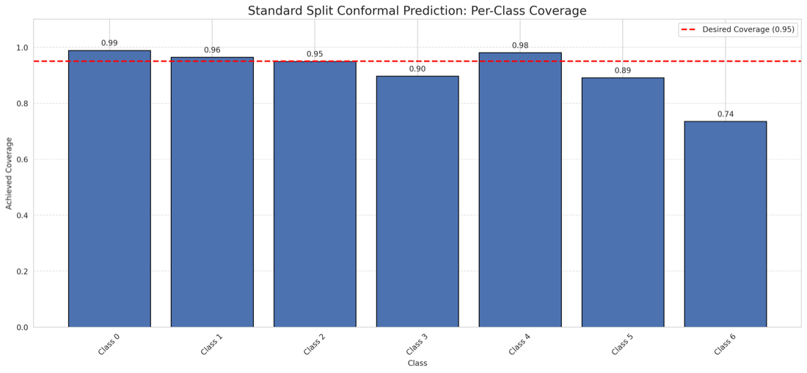
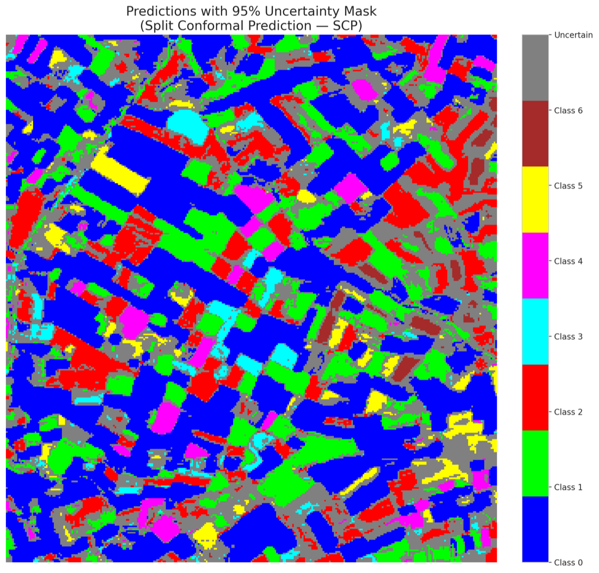
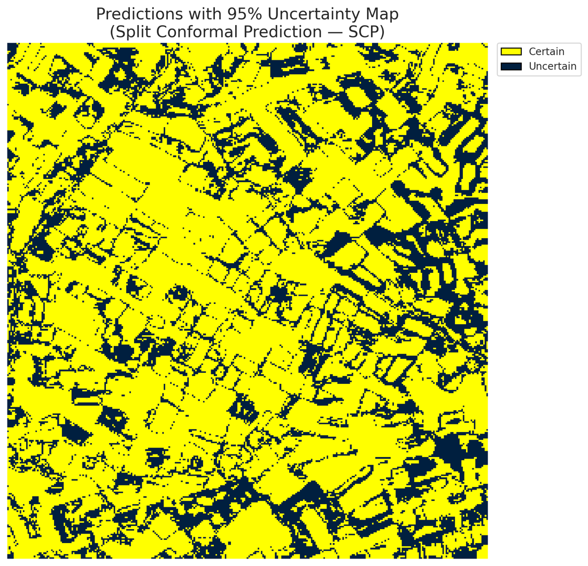
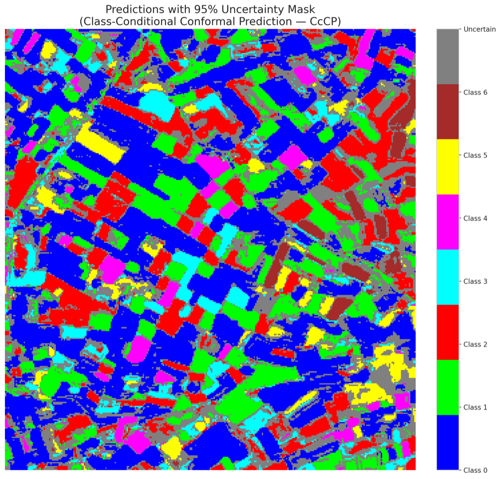

# Baseline: three backbones and five conformal methods

[← back to main README](../README.md)

| | |
|---|---|
| **What** | AlexNet-CNN, GFNet and ViT-UNet trained on 9 × 9 × 6 patches. Five conformal-prediction methods (Split, Class-conditional, Clustered, RC3P, RAPS) turn each model's probabilities into **prediction sets with a 95% guarantee** |
| **Key result** | Every calibrated method covers 95.0–97.2% of evaluation pixels. On these near-perfect models (99.3–99.7% accurate) the sets are one class or **empty (2.8–5.0%)**, never two |
| **The lesson** | The 95% is an *average*. Split CP covers AlexNet's rarest class only **73.5%** of the time; class-conditional CP restores **95.6%** at no extra cost |
| **Notebooks** | [`Model_training.ipynb`](Model_training.ipynb) · [`Model_uncertainty_comparison.ipynb`](Model_uncertainty_comparison.ipynb) |

Every other conformal folder ([dofa](../dofa/README.md), [georsclip](../georsclip/README.md),
[mambahsi](../mambahsi/README.md), [spatialgcn](../spatialgcn/README.md), [dapm](../dapm/README.md))
re-uses the five methods explained here. This page is therefore the reference for them.

---

## 1. The three backbones

| Model | How it reads a 9 × 9 × 6 patch | Configuration (from the notebook) | Test accuracy | ECE |
|---|---|---|--:|--:|
| **AlexNet-CNN** | Stacked 3 × 3 convolutions learn local texture, then dense layers decide | 5 conv layers + max-pool + dense/dropout; Adagrad, cosine LR 0.01→0.02→0.005; **split seed 10** ("legacy" recipe) | 99.70% | **0.0013** |
| **GFNet** | Cuts the patch into 3 × 3 tokens; a learned filter in the **Fourier domain** mixes all tokens at once | global-filter blocks + MLP; AdamW-style, lr 3 × 10⁻⁴, cosine decay | 99.63% | 0.0089 |
| **ViT-UNet** | 3 × 3 tokens + a class token; Transformer layers with U-Net-style skip links | multi-head self-attention; same optimiser as GFNet | 99.28% | 0.0388 |

*Common recipe: 100 epochs, batch 128, label smoothing 0.05, dropout 0.25, gradient clipping 1.0.
Source: [`results/classification_summary.csv`](results/classification_summary.csv).*

| AlexNet-CNN | GFNet | ViT-UNet |
|:-:|:-:|:-:|
|  |  |  |

*__Figure 1.__ Training curves (loss and accuracy, train vs validation).*

**Reading Figure 1.** Accuracy rises above 95% within ~15 epochs and flattens by ~30. The validation
accuracy tracks the training accuracy almost exactly, and validation loss stays only slightly above training
loss: there is no visible over-fitting. That closeness is also a symptom of the random split (main README
§4.3), since validation pixels sit next to training pixels and are not really "new" places.

<p align="center"></p>

*__Figure 2.__ Test confusion matrices (4,310 pixels; axes use labels 1–7).*

**Reading Figure 2.** Nearly all mass sits on the diagonal: AlexNet makes 13 errors, GFNet 16 and ViT-UNet
31. The errors concentrate on **label 3**, confused with labels 2 and 4 (GFNet: 9 label-4 pixels called
label 3; ViT-UNet: 6 label-2 pixels called label 3). These are neighbours in the spectral chain of main
README Figure 7 (spectral angles 7.7–7.8°).

---

## 2. Conformal prediction: the shared recipe

**The idea in one sentence.** Use a held-out set of pixels to learn *how wrong the model usually is*,
then, for every new pixel, list all classes that are not more surprising than that.

**Data roles.** The 4,310 test pixels are split 50/50 (seed 42):

| Role | Pixels | Used for |
|---|--:|---|
| Calibration | 2,155 | learning the cut-off $`\hat q`$ |
| Evaluation | 2,155 | measuring coverage and set size, the numbers in §4 |
| Full scene | 101,310 | the uncertainty maps (no labels needed) |

**The guarantee.** If calibration and evaluation pixels are *exchangeable* (drawn the same way), then

```math
\Pr\big(y_{\text{new}} \in C(x_{\text{new}})\big) \;\ge\; 1-\alpha = 0.95 .
```

*In words: whatever the model, at least 95% of new pixels get a set that contains their true class.* The
guarantee is about the average over pixels. It says nothing about a particular class, which is what §4.2
is about.

**The cut-off** (code: `conformal_qhat`):

```math
\hat q = \text{the } \frac{\lceil (n+1)(1-\alpha) \rceil}{n}\text{-th quantile of } s_1,\dots,s_n
\quad(\text{'higher' interpolation})
```

*In words: sort the calibration scores and take the one just above the 95% mark. The "+1" is a tiny
safety margin that makes the guarantee exact for finite $`n`$. With n = 2,155 it is about the 2,050th of the 2,155 sorted
scores.*

---

## 3. The five methods, step by step

### 3.1 Split conformal prediction (Split CP)

**Score:** $`s = 1 - \hat p_{y}(x)`$, i.e. *how little probability the model gave the true class*.
**Set:** $`C(x) = \{k : \hat p_k(x) \ge 1-\hat q\}`$.

*Worked example.* Suppose $`\hat q = 0.30`$, so a class needs ≥ 0.70 probability. A pixel with
probabilities (0.92, 0.05, 0.03) gets {class 1}. A pixel with (0.55, 0.40, 0.05) gets **∅**: no class is
convincing enough.

**Why empty sets appear here.** These models are wrong on only 0.3–0.7% of pixels. To "spend" a 5% error
budget, $`\hat q`$ must be so small that the least-confident ~5% of pixels (mostly *correct*) clear the bar
for no class. An empty set therefore means *"one of the 5% least confident pixels"*, i.e. an abstention, not
*"probably wrong"* ([main README Figure 15](../docs/04_uncertainty_results.md#82-rq2--what-do-the-prediction-sets-look-like)).

### 3.2 Class-conditional CP

The same score, but a **separate $`\hat q_k`$ for every class**, each from the calibration pixels of that
class only:

```math
C(x) = \{\,k : \hat p_k(x) \ge 1-\hat q_k\,\}
```

*In words: each class gets its own bar. A class the model finds hard gets a lower bar, so it is not
under-covered.* The guarantee becomes ≥ 95% **for every class**. The cost is noisier cut-offs for small
classes (label 7 has only ~68 calibration pixels).

### 3.3 Clustered CP

A compromise. Classes are grouped with **k-means (k = 4) on their mean penultimate-layer embedding**, and
one $`\hat q`$ is calibrated per group. Small classes borrow calibration data from similar classes. This
helps only when the grouping really puts classes with similar scores together.

### 3.4 RC3P (rank-calibrated class-conditional CP)

Class-conditional CP plus a second test: class $`k`$ is only allowed into the set if it is among the
model's top-$`r_k`$ classes for this pixel.

```math
C(x) = \{\,k : \hat p_k(x) \ge 1-\hat q_k \ \text{ and } \ \operatorname{rank}_k(x) \le r_k\,\}
```

The notebook searches over the rank limits $`r_k`$ for the smallest average set, and tightens each class's
$`\alpha`$ by the top-$`r_k`$ error rate and a small-sample margin $`0.1/\sqrt{n/K}`$. The margin is why
RC3P is the **most conservative** method (0.963–0.972 here).

<a id="raps"></a>

### 3.5 RAPS (regularised adaptive prediction sets)

Score = probability mass of the classes ranked *above* the true class, plus a penalty for deep ranks:

```math
s = \sum_{j \,\text{ranked above } y} \hat p_j(x) \;+\; \lambda \cdot \max(0,\ \operatorname{rank}(y) - k_{\text{reg}}),
\qquad \lambda = 0.01,\ k_{\text{reg}} = 1 .
```

**Why RAPS collapses to top-1 here.** If the true class is ranked first, the score is exactly **0**.
That holds for > 99% of calibration pixels, so $`\hat q = 0`$. The set-building loop then adds the top class
(cumulative mass 0 ≤ 0) and stops at the second. Every set holds exactly one class, and **coverage equals
accuracy** (0.994–0.999), not 95%. The original RAPS adds a random tie-break (`u · p_y`) that would avoid
this; the notebook omits it. On a weaker model (DOFA-Spectral, SpatialGCN) the true class is often not
ranked first, and RAPS behaves as intended (≈ 0.95).

---

## 4. Results

### 4.1 Coverage and set size

| Model | Method | Coverage | Avg. set size | Singletons | Empty | 2+ classes | Mean per-class cov. |
|---|---|--:|--:|--:|--:|--:|--:|
| **AlexNet** | Split CP | 0.958 | 0.96 | 95.8% | 4.2% | 0.0% | 0.915 |
|  | Class-cond. CP | 0.965 | 0.96 | 96.5% | 3.5% | 0.0% | 0.968 |
|  | Clustered CP | 0.965 | 0.97 | 96.5% | 3.5% | 0.0% | 0.955 |
|  | RC3P | 0.972 | 0.97 | 97.2% | 2.8% | 0.0% | 0.974 |
|  | RAPS | 0.999 | 1.00 | 100.0% | 0.0% | 0.0% | 0.998 |
| **GFNet** | Split CP | 0.950 | 0.95 | 95.0% | 5.0% | 0.0% | 0.923 |
|  | Class-cond. CP | 0.962 | 0.96 | 96.2% | 3.8% | 0.0% | 0.971 |
|  | Clustered CP | 0.960 | 0.96 | 96.0% | 4.0% | 0.0% | 0.959 |
|  | RC3P | 0.966 | 0.97 | 96.6% | 3.4% | 0.0% | 0.975 |
|  | RAPS | 0.998 | 1.00 | 100.0% | 0.0% | 0.0% | 0.996 |
| **ViT** | Split CP | 0.954 | 0.96 | 95.5% | 4.5% | 0.0% | 0.944 |
|  | Class-cond. CP | 0.956 | 0.96 | 95.8% | 4.2% | 0.0% | 0.961 |
|  | Clustered CP | 0.954 | 0.96 | 95.5% | 4.5% | 0.0% | 0.944 |
|  | RC3P | 0.963 | 0.96 | 96.5% | 3.5% | 0.0% | 0.970 |
|  | RAPS | 0.994 | 1.00 | 100.0% | 0.0% | 0.0% | 0.993 |

*__Table 1.__ Evaluation pixels: 2,155. "2+ classes" = 1 − singletons − empty. Source:
[`results/uncertainty_results/summary_metrics.csv`](results/uncertainty_results/summary_metrics.csv).*

**Reading Table 1.**
- **Validity.** Split, class-conditional and clustered CP sit at 0.950–0.966. With 2,155 pixels, one
  standard error is ±0.47 points, so all of these are consistent with "at least 95%".
- **RC3P over-delivers** (0.963–0.972, up to ~4.7 standard errors above target). This is the price of its
  safety margin.
- **No set ever holds two classes.** The "average set size" below 1 is simply 1 − (empty rate).
- **RAPS** = accuracy, as explained in [§3.5](#raps).

### 4.2 Is the guarantee fair to every class?

| Model | Method | Label 1 | Label 2 | Label 3 | Label 4 | Label 5 | Label 6 | Label 7 | Worst |
|---|---|--:|--:|--:|--:|--:|--:|--:|--:|
| *eval pixels* | | *914* | *454* | *358* | *156* | *104* | *101* | *68* | |
| **AlexNet** | Split CP | 0.989 | 0.965 | 0.950 | 0.897 | 0.981 | 0.891 | **0.735** | 0.735 |
|  | Class-cond. CP | 0.963 | 0.967 | 0.958 | 0.962 | 0.981 | 0.990 | 0.956 | 0.956 |
|  | Clustered CP | 0.963 | 0.971 | 0.978 | 0.962 | 0.981 | 0.990 | **0.838** | 0.838 |
|  | RC3P | 0.968 | 0.980 | 0.964 | 0.962 | 1.000 | 0.990 | 0.956 | 0.956 |
|  | RAPS | 1.000 | 0.998 | 1.000 | 1.000 | 1.000 | 1.000 | 0.985 | 0.985 |
| **GFNet** | Split CP | 0.992 | 0.967 | **0.866** | 0.904 | 0.981 | 0.881 | 0.868 | 0.866 |
|  | Class-cond. CP | 0.960 | 0.967 | 0.936 | 0.994 | 0.990 | 0.950 | 1.000 | 0.936 |
|  | Clustered CP | 0.990 | 0.903 | 0.955 | 0.923 | 0.990 | 0.950 | 1.000 | 0.903 |
|  | RC3P | 0.963 | 0.967 | 0.944 | 0.994 | 0.990 | 0.970 | 1.000 | 0.944 |
|  | RAPS | 1.000 | 1.000 | 0.992 | 0.994 | 1.000 | 0.990 | 1.000 | 0.990 |
| **ViT** | Split CP | 0.977 | 0.949 | 0.939 | **0.853** | 0.990 | 0.931 | 0.971 | 0.853 |
|  | Class-cond. CP | 0.946 | 0.971 | 0.955 | 0.962 | 0.952 | 0.941 | 1.000 | 0.941 |
|  | Clustered CP | 0.977 | 0.949 | 0.939 | **0.853** | 0.952 | 0.941 | 1.000 | 0.853 |
|  | RC3P | 0.956 | 0.971 | 0.955 | 0.974 | 0.990 | 0.941 | 1.000 | 0.941 |
|  | RAPS | 0.998 | 0.993 | 0.986 | 1.000 | 0.990 | 0.980 | 1.000 | 0.980 |

*__Table 2.__ Coverage inside each class; bold = worst class below 0.90. Source:
[`results/uncertainty_results/per_class_coverage.csv`](results/uncertainty_results/per_class_coverage.csv).*

<p align="center"></p>

*__Figure 3.__ Table 2 as a heatmap: white ≈ 95%, red = under-covered, blue = over-covered.*

**Reading Table 2 and Figure 3.**
- **Split CP spends its error budget unevenly.** Large, easy classes are over-covered (label 1: 0.98–0.99).
  The budget is used up in the small classes: AlexNet's label 7 is covered only **0.735** (50 of 68
  pixels), and GFNet's label 3 only **0.866**.
- **Clustered CP is unreliable:** it fixes GFNet's label 7 (1.000) but leaves AlexNet's at 0.838, and
  drops GFNet's label 2 to 0.903.
- **Class-conditional CP and RC3P** bring every class of every model to **≥ 0.936**. The remaining
  shortfalls are within about one standard error of 95% for classes of 100–400 pixels.

<p align="center"></p>

*__Figure 4.__ The notebook's own per-class coverage plot for AlexNet / Split CP (notebook numbering:
"class 6" = label 7). Extracted from
[`results/uncertainty_results/conformal_reports_all_models.xlsx`](results/uncertainty_results/conformal_reports_all_models.xlsx).*

> **Takeaway.** Always look at per-class coverage. For land-cover maps, use class-conditional CP or RC3P.

### 4.3 Where on the map is the uncertainty?

| GFNet · Split CP: class map + uncertain | GFNet · Split CP: certain vs uncertain | GFNet · Class-conditional CP |
|:-:|:-:|:-:|
|  |  |  |

*__Figure 5.__ Full-scene maps, grey = "uncertain" (set is not a single class). Notebook numbering 0–6.*

**Reading Figure 5.**
- Uncertainty traces **parcel boundaries**, where a 9 × 9 patch mixes two fields, and a few **whole
  parcels** in the unlabelled east and south-east whose spectra the model has rarely seen.
- **Class-conditional CP** greys out more in some places and less in others: the per-class cut-offs move
  pixels of hard classes into "uncertain" and release confident pixels of easy ones.
- On the 83% of the scene without labels, the conformal guarantee does not formally apply. The calibration
  pixels come from the labelled centre, so read the map as *relative* confidence there.

---

## 5. Classification maps

<p align="center"></p>

*__Figure 6.__ Ground truth and full-scene predictions.*

---

## 6. Discussion

- **On near-perfect models conformal prediction abstains rather than hedges.** That is a valid but limited
  form of uncertainty. It cannot say *which* alternative class is plausible. See the
  [SpatialGCN](../spatialgcn/README.md) and [DOFA-Spectral](../dofa/README.md) folders for the informative case.
- **Calibration quality (ECE) does not decide coverage.** ViT-UNet has 30× AlexNet's ECE, yet both reach
  95%. Conformal prediction corrects miscalibration by construction. Calibration does change *which*
  pixels end up uncertain.

<a id="7-caveats"></a>

## 7. Caveats

1. **AlexNet's split.** AlexNet was trained on a seed-10 split, while the conformal notebook uses seed 42.
   **74.5%** of AlexNet's calibration/evaluation pixels were therefore in its training set, so its
   coverage numbers describe partly-seen data.
2. **Random pixel split.** Every test patch overlaps training pixels (main README §4.3).
3. **Small classes.** Label 7 has 68 evaluation pixels; its coverage is accurate to ±5 points.
4. **RAPS without randomisation** (see [§3.5](#raps)).

## References

Angelopoulos & Bates (2023), *A Gentle Introduction to Conformal Prediction*; Vovk et al. (2005);
Ding et al. (2023), *Class-Conditional Conformal Prediction with Many Classes*; Shi et al. (2024), *RC3P*;
Angelopoulos et al. (2021), *RAPS*; Rao et al. (2021), *GFNet*; Dosovitskiy et al. (2021), *ViT*.
