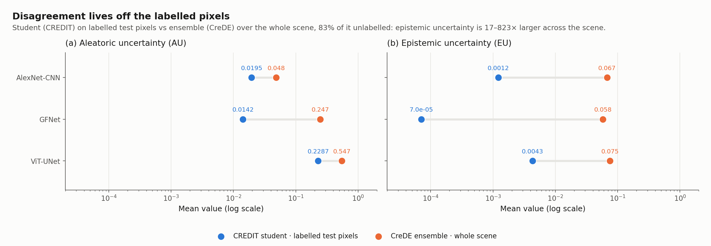

# CREDIT: one network that learns the ensemble's uncertainty

[← back to main README](../README.md) · teacher ensembles in [ensemble/](../ensemble/README.md)

| | |
|---|---|
| **What** | A single "student" network with two heads, trained to reproduce the [CreDE](../ensemble/README.md) ensemble's cautious probabilities **p\*** and interval widths **Δp**. AU / EU / TU from one forward pass |
| **Key result** | Students are as accurate as their baselines (**99.56 / 99.74 / 98.91%**) with credal coverage 0.989–0.997. They flag **8.5–13.0%** of the scene, and **98.2–99.7%** of flagged pixels are unlabelled |
| **The lesson** | The student learns AU well but **not EU**: its epistemic estimate on test pixels is 17–823× smaller than the ensemble's over the scene, and no pixel ever passes EU > 0.2. Every flag comes from AU |
| **Notebook** | [`Model_training_credit.ipynb`](Model_training_credit.ipynb) |
| **Results** | [`results/credit_evaluation_summary.csv`](results/credit_evaluation_summary.csv) · [`results/credit_credal_coverage_classwise.csv`](results/credit_credal_coverage_classwise.csv) · `results/*_uncertain_pixels.csv` · [`results/CREDIT_Results.xlsx`](results/CREDIT_Results.xlsx) |

---

## 1. The idea in plain words

An ensemble of five networks is expensive to run over a whole scene. CREDIT ("credal distillation")
trains **one** network to imitate what the five would say: not just their answer, but how cautious they
are and how much they disagree. One forward pass then gives both kinds of uncertainty.

## 2. The maths, step by step

**Targets from the teachers** (code: `generate_credit_targets`), exactly as in CreDE:

```math
p^\ast_k = \frac{\min_m p^{(m)}_k}{\sum_j \min_m p^{(m)}_j}, \qquad \Delta p_k = \max_m p^{(m)}_k - \min_m p^{(m)}_k
```

**Student** (code: `build_credit_student`): the baseline architecture's penultimate features feed two heads,

```math
\hat p^\ast = \operatorname{softmax}(W_1 h), \qquad \widehat{\Delta p} = \sigma(W_2 h)
```

*In words: one head predicts the cautious class distribution (it sums to 1), the other predicts how wide
each class's interval is (each between 0 and 1).* After training, AU, EU and TU are computed from the
student's outputs with the CreDE formulas, and the credal set uses bounds $`[\hat p^\ast,\ \min(1, \hat p^\ast + \widehat{\Delta p})]`$.

| Setting | Value |
|---|---|
| Teachers | the 5-member ensembles of [ensemble/](../ensemble/README.md) |
| Students | AlexNet-CNN, GFNet, ViT-UNet with two heads |
| Recipe | baseline (100 epochs, batch 128, lr 3 × 10⁻⁴); training 11–22 min per student |
| Flag thresholds | AU > 0.5, EU > 0.2, TU > 0.7 |

---

## 3. Results

| Student | Accuracy | Macro-F1 | ECE | Credal coverage | Worst class cov. | Mean AU | Mean EU |
|---|--:|--:|--:|--:|--:|--:|--:|
| AlexNet-CNN | 99.56% | 0.9950 | 0.0026 | 0.9956 | 0.987 | 0.0195 | 0.0012 |
| GFNet | 99.74% | 0.9961 | 0.0013 | 0.9974 | 0.990 | 0.0142 | 0.00007 |
| ViT-UNet | 98.91% | 0.9826 | 0.0342 | 0.9891 | 0.971 | 0.2287 | 0.0043 |

*__Table 1.__ On the 4,310 test pixels. Sources: [`credit_evaluation_summary.csv`](results/credit_evaluation_summary.csv),
[`credit_credal_coverage_classwise.csv`](results/credit_credal_coverage_classwise.csv).*

| Student | Pixels flagged | Share of scene | …by AU | …by EU | Flagged without a label |
|---|--:|--:|--:|--:|--:|
| AlexNet-CNN | 11,803 | 11.7% | 11,803 | **0** | 99.3% |
| GFNet | 8,613 | 8.5% | 8,613 | **0** | 99.7% |
| ViT-UNet | 13,161 | 13.0% | 13,161 | **0** | 98.2% |

*__Table 2.__ Computed from `results/*_uncertain_pixels.csv`.*

**Reading Tables 1–2.**
- **Credal sets are always single-class** (average size 1.0), so credal coverage equals accuracy.
- **EU collapses.** The ensemble's mean EU over the scene is 0.058–0.075 ([ensemble/](../ensemble/README.md#3-results));
  the students' EU on test pixels is 0.00007–0.004. On test pixels the teachers agreed almost
  perfectly, so the Δp targets were ≈ 0 and the sigmoid head learned to output ≈ 0. It never saw the
  disagreement that occurs on unfamiliar land.
- **AU still finds the unlabelled land.** 98–99.7% of the AU-flagged pixels are unlabelled. This is a
  reasonable proxy, but it comes from the cautious-probability head, not from a learned notion of novelty.

<p align="center"></p>

*__Figure 1.__ Mean AU and EU: CREDIT on test pixels vs CreDE on the whole scene (log scale).*

<p align="center"></p>

*__Figure 2.__ GFNet student: prediction, AU / EU / TU masks, overlays and counts (notebook numbering
0–6). The EU mask (third column) is empty. Also: [AlexNet](results/AlexNet_CNN_CREDIT_spatial_maps.png),
[ViT-UNet](results/ViT_UNet_CREDIT_spatial_maps.png).*

**Reading Figure 2.** AU flags thin boundary lines and scattered pixels, sparser than the
[ensemble's map](../ensemble/README.md#3-results). The EU panel is entirely "certain".

<p align="center"></p>

*__Figure 3.__ Students' test confusion matrices.*

---

## 4. Discussion

- **Distillation needs teacher disagreement in the training data.** Training the Δp head on unlabelled
  pixels too (teacher targets need no labels) would expose it to the high-EU regions it is meant to detect.
- **CREDIT is the cheapest uncertainty in the study.** At one network's cost it gives a sensible AU map. It
  is not yet an EU substitute for the ensemble.

## 5. Caveats

1. **Checkpoint selection on the test set.** Training monitors `val_loss` with `validation_data=test_ds`,
   so the reported metrics are slightly optimistic.
2. No coverage guarantee (credal sets are heuristic).
3. AlexNet student and teachers follow the legacy seed-10 split ([baseline caveat 1](../baseline/README.md#7-caveats)).

## References

Wang et al. (2024), *Credal Deep Ensembles for Uncertainty Quantification* (the teacher construction);
Hinton, Vinyals & Dean (2015), *Distilling the Knowledge in a Neural Network*. The notebook does not cite a
specific paper for the two-head CREDIT student.
