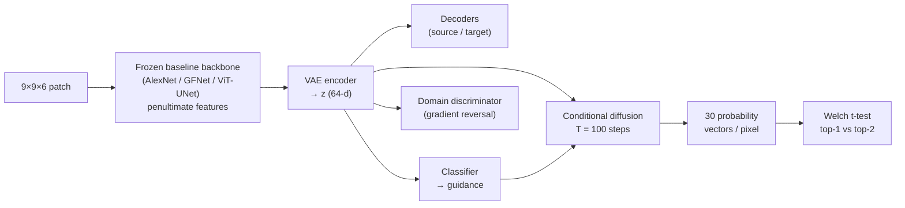
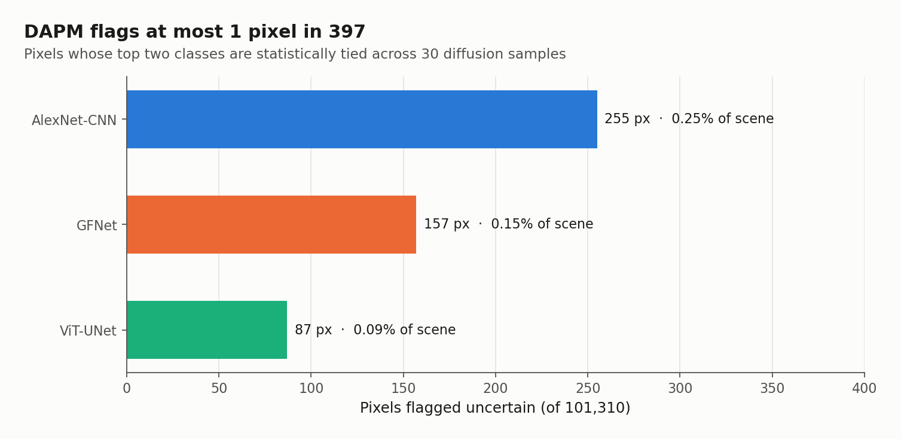

# DAPM: a domain-adapted diffusion model with a statistical test per pixel

[← back to main README](../README.md)

| | |
|---|---|
| **What** | On top of each frozen baseline backbone: a variational encoder that aligns labelled and unlabelled pixels, a classifier, and a **conditional diffusion model** that draws 30 plausible probability vectors per pixel. A **Welch t-test** then asks whether the top two classes really differ |
| **Key result** | Only **0.09–0.25%** of the scene is flagged uncertain (87–255 pixels), the smallest share of any method. The t-test almost always finds a difference |
| **Second result** | Run through conformal prediction instead, DAPM's classifier head shows the **worst class coverage in the study**: Split CP covers label 7 only **0.309** (ViT-UNet) and **0.603** (GFNet); class-conditional CP restores ≥ 0.94 |
| **Notebooks** | [`Model_training_dapm_full.ipynb`](Model_training_dapm_full.ipynb) · [`Model_uncertainty_dapm_full.ipynb`](Model_uncertainty_dapm_full.ipynb) · [`Model_uncertainty_dapm_cp.ipynb`](Model_uncertainty_dapm_cp.ipynb) |
| **Results** | [`results/dapm_full/`](results/dapm_full/) (t-test) · [`results/conformal_uncertainty_results/`](results/conformal_uncertainty_results/) (conformal) |

> **Provenance.** The run configurations point to Google Drive paths (`/content/drive/...`), so these
> results come from a Colab run. DAPM has no Kaggle kernel in the run log.

---

## 1. The idea in plain words

Instead of one probability vector per pixel, DAPM generates **many plausible ones** by running a
diffusion model 30 times with different random noise. If the winning class wins clearly in all 30 draws,
the pixel is certain. If the top two classes trade places across draws, it is uncertain. A t-test makes
"clearly" precise.

The **domain-adaptation** part targets a specific problem: the model is trained on labelled pixels (the
*source*, 17% of the scene) but must map the unlabelled 83% (the *target*). An adversarial discriminator
pushes the encoder to give both kinds of pixel similar latent codes, so the classifier transfers.

## 2. Architecture and training



**Stage 1 (20 epochs)** trains encoder, decoders, classifier and discriminator together:

```math
\mathcal L_1 = \underbrace{\mathcal L^{\text{src}}_{\text{rec}} + \mathcal L^{\text{tgt}}_{\text{rec}}}_{\text{reconstruct features}}
+ 0.01\,\underbrace{(\mathrm{KL}^{\text{src}} + \mathrm{KL}^{\text{tgt}})}_{\text{keep } z \text{ well-behaved}}
+ \underbrace{\mathcal L_{\text{CE}}}_{\text{classify labelled}}
+ 0.2\,\underbrace{\mathcal L_{\text{domain}}}_{\text{confuse the discriminator}}
```

**Stage 2 (20 epochs)** trains the diffusion model to denoise class vectors, conditioned on $`z`$ and the
classifier's output: $`\mathcal L_2 = \mathcal L^{\text{src}}_{\epsilon} + 0.5\,\mathcal L^{\text{tgt}}_{\epsilon}`$
(standard DDPM noise-prediction loss, 100 steps, linear β from 10⁻⁴ to 0.02).

*In words: stage 1 learns a compact code that works for labelled and unlabelled pixels alike; stage 2
learns to "imagine" class-probability vectors for a given code.*

| Setting | Value |
|---|---|
| Backbones | baseline AlexNet-CNN, GFNet, ViT-UNet (frozen) |
| Latent / hidden dims | 64 / encoder 256, classifier 128, discriminator 128, diffusion 256 |
| Unlabelled pixels used | up to 20,000 |
| Samples per pixel, test | N = 30, Welch t-test, p > 0.05 → uncertain |

## 3. The test, step by step

For pixel $`i`$, collect the 30 sampled probabilities of the two classes with the highest mean,
$`\{a_s\}`$ and $`\{b_s\}`$:

```math
t = \frac{\bar a - \bar b}{\sqrt{s_a^2/30 + s_b^2/30}}, \qquad \text{uncertain} \iff p\text{-value}(t) > 0.05
```

*In words: is the average gap between the winner and the runner-up large compared with how much the draws
wobble?* **Worked example (illustrative):** a mean gap of 0.18 with standard deviations of 0.15 per class
gives $`t = 0.18 / \sqrt{2 \cdot 0.0225/30} \approx 4.6`$, so p < 0.001 and the pixel counts as certain.
With 30 draws, even a modest but consistent gap is "significant".

---

## 4. Results: the t-test

| Backbone | Accuracy (all labelled px) | Uncertain pixels | Share of scene | Mean top-1/top-2 gap | Median p-value | Runtime |
|---|--:|--:|--:|--:|--:|--:|
| AlexNet-CNN | 99.92% | 255 | 0.25% | 0.174 | 0.0 | 3.7 min |
| GFNet | 99.90% | 157 | 0.15% | 0.183 | 0.0 | 3.5 min |
| ViT-UNet | 99.79% | 87 | 0.09% | 0.186 | ≈ 0 | 3.6 min |

*__Table 1.__ Source: [`results/dapm_full/dapm_full_summary_metrics.csv`](results/dapm_full/dapm_full_summary_metrics.csv).
Accuracy is over all 17,239 labelled pixels, **including training pixels**.*

<p align="center"></p>

*__Figure 1.__ Where DAPM's uncertain pixels are.*

| p-value distribution (GFNet) | top-1 / top-2 gap (GFNet) | class map + uncertain (GFNet) |
|:-:|:-:|:-:|
|  |  |  |

*__Figure 2.__ From [`results/dapm_full/maps/`](results/dapm_full/maps/) (same plots exist for AlexNet and ViT-UNet).*

**Reading Table 1 and Figures 1–2.**
- **The sampled probabilities are not very confident.** The mean winner-vs-runner-up gap is only
  0.17–0.19, much smaller than the baseline softmax gaps. The diffusion output is a soft vector.
- **But they are consistent,** so with 30 draws the t-test almost always rejects "no difference". The
  median p-value is 0, and only 87–255 pixels in the whole scene pass p > 0.05.
- **The rule measures the sampler's noise, not the pixel's ambiguity.** With more draws the t-test would
  flag even fewer pixels; with fewer, more. N, not the data, sets how many pixels are uncertain.
- Per class, the uncertain rate is 0 for every labelled class except two ViT-UNet pixels in label 1. The
  few flagged pixels lie in unlabelled areas.

## 5. Results: DAPM's classifier through conformal prediction

The second notebook skips the diffusion and passes the **classifier's probabilities** (`encoder(z_mu) →
classifier`) through the five [baseline conformal methods](../baseline/README.md#3-the-five-methods-step-by-step).

| Model | Method | Coverage | Avg. set size | Singletons | Empty | 2+ classes | Mean per-class cov. |
|---|---|--:|--:|--:|--:|--:|--:|
| **AlexNet** | Split CP | 0.955 | 0.95 | 95.5% | 4.5% | 0.0% | 0.934 |
|  | Class-cond. CP | 0.964 | 0.96 | 96.4% | 3.6% | 0.0% | 0.962 |
|  | Clustered CP | 0.955 | 0.95 | 95.5% | 4.5% | 0.0% | 0.943 |
|  | RC3P | 0.970 | 0.97 | 97.0% | 3.0% | 0.0% | 0.971 |
|  | RAPS | 1.000 | 1.00 | 100.0% | 0.0% | 0.0% | 1.000 |
| **GFNet** | Split CP | 0.957 | 0.96 | 95.7% | 4.3% | 0.0% | 0.900 |
|  | Class-cond. CP | 0.961 | 0.96 | 96.2% | 3.8% | 0.0% | 0.959 |
|  | Clustered CP | 0.950 | 0.95 | 95.0% | 5.0% | 0.0% | 0.929 |
|  | RC3P | 0.968 | 0.97 | 96.8% | 3.2% | 0.0% | 0.971 |
|  | RAPS | 0.998 | 1.00 | 100.0% | 0.0% | 0.0% | 0.997 |
| **ViT** | Split CP | 0.954 | 0.96 | 95.6% | 4.4% | 0.0% | 0.862 |
|  | Class-cond. CP | 0.961 | 0.96 | 96.2% | 3.8% | 0.0% | 0.957 |
|  | Clustered CP | 0.957 | 0.96 | 95.7% | 4.3% | 0.0% | 0.939 |
|  | RC3P | 0.964 | 0.97 | 96.5% | 3.5% | 0.0% | 0.959 |
|  | RAPS | 0.993 | 1.00 | 100.0% | 0.0% | 0.0% | 0.990 |

*__Table 2.__ Source: [`results/conformal_uncertainty_results/dapm_conformal_summary_metrics.csv`](results/conformal_uncertainty_results/dapm_conformal_summary_metrics.csv).*

| Model | Method | Label 1 | Label 2 | Label 3 | Label 4 | Label 5 | Label 6 | Label 7 | Worst |
|---|---|--:|--:|--:|--:|--:|--:|--:|--:|
| *eval pixels* | | *914* | *454* | *358* | *156* | *104* | *101* | *68* | |
| **AlexNet** | Split CP | 0.979 | 0.965 | 0.925 | 0.917 | 0.981 | **0.861** | 0.912 | 0.861 |
|  | Class-cond. CP | 0.957 | 0.969 | 0.975 | 0.994 | 1.000 | 0.901 | 0.941 | 0.901 |
|  | Clustered CP | 0.977 | 0.960 | 0.919 | 0.904 | 1.000 | 0.901 | 0.941 | 0.901 |
|  | RC3P | 0.963 | 0.971 | 0.980 | 0.994 | 1.000 | 0.950 | 0.941 | 0.941 |
|  | RAPS | 1.000 | 0.998 | 1.000 | 1.000 | 1.000 | 1.000 | 1.000 | 0.998 |
| **GFNet** | Split CP | 0.993 | 0.985 | 0.930 | 0.897 | 0.990 | 0.901 | **0.603** | 0.603 |
|  | Class-cond. CP | 0.964 | 0.985 | 0.919 | 0.981 | 0.990 | 0.921 | 0.956 | 0.919 |
|  | Clustered CP | 0.989 | 0.960 | 0.905 | **0.782** | 0.990 | 0.921 | 0.956 | 0.782 |
|  | RC3P | 0.967 | 0.987 | 0.927 | 0.987 | 0.990 | 0.980 | 0.956 | 0.927 |
|  | RAPS | 1.000 | 1.000 | 0.989 | 0.994 | 1.000 | 1.000 | 1.000 | 0.989 |
| **ViT** | Split CP | 0.996 | 0.965 | 0.969 | 0.974 | 0.962 | 0.861 | **0.309** | 0.309 |
|  | Class-cond. CP | 0.967 | 0.960 | 0.953 | 0.987 | 0.971 | **0.861** | 1.000 | 0.861 |
|  | Clustered CP | 0.995 | 0.921 | 0.966 | **0.859** | 0.971 | 0.861 | 1.000 | 0.859 |
|  | RC3P | 0.970 | 0.960 | 0.961 | 0.987 | 0.971 | **0.861** | 1.000 | 0.861 |
|  | RAPS | 0.998 | 0.989 | 0.989 | 0.994 | 1.000 | 0.960 | 1.000 | 0.960 |

*__Table 3.__ Source: [`results/conformal_uncertainty_results/dapm_conformal_per_class_coverage.csv`](results/conformal_uncertainty_results/dapm_conformal_per_class_coverage.csv).*

**Reading Tables 2–3.**
- Overall coverage is valid (0.950–0.970), exactly as for the baselines.
- **Split CP fails label 7 badly:** 0.309 for ViT-UNet (21 of 68 pixels) and 0.603 for GFNet. These are
  the lowest class coverages anywhere in the study. The DAPM classifier is apparently less confident on
  label 7 than on the large classes, so the shared cut-off excludes it.
- **Class-conditional CP and RC3P fix it** (0.94–1.00 for label 7). The general lesson of
  [baseline §4.2](../baseline/README.md#42-is-the-guarantee-fair-to-every-class) holds even more strongly here.

---

## 6. Discussion

- **A significance test is not a calibrated uncertainty.** "p > 0.05" answers "is the gap
  distinguishable from zero with 30 samples?", which nearly always holds. A threshold on the gap itself,
  or a conformal step on the sampled probabilities, would give a controllable error rate.
- **The domain-adaptation idea fits this problem well.** 83% of the scene is unlabelled, and the ensembles
  show that this is where uncertainty lives. Whether the alignment actually helped cannot be judged without
  labels in the target area.

## 7. Caveats

1. Accuracy in Table 1 includes training pixels.
2. Colab-era results (box at the top).
3. Backbones are the baseline weights, with the same split caveats as [baseline](../baseline/README.md#7-caveats).

## References

Ho, Jain & Abbeel (2020), *Denoising Diffusion Probabilistic Models*; Ganin et al. (2016),
*Domain-Adversarial Training of Neural Networks*; Kingma & Welling (2014), *Auto-Encoding Variational
Bayes*; Welch (1947), *The generalization of "Student's" problem when several different population
variances are involved*.
