# Data and experimental set-up

*Full report, chapter 1 of 6 (§2–§4).* [Overview](../README.md) · [Report contents](README.md)

---

## 2. Why uncertainty matters for land-cover maps

Land-cover maps feed crop statistics, irrigation planning and environmental reporting. A classifier gives a
label to every pixel: to the interior of a well-known field, to the mixed pixel on a field boundary, and to a
surface type it has never been shown. Without an uncertainty layer all three look equally trustworthy.

A useful uncertainty layer is:

| Property | Meaning | Who provides it here |
|---|---|---|
| **Valid** | "95%" really means 95% of the time | Conformal prediction (§7.2) |
| **Fair** | The promise holds for every class, not only on average | Class-conditional CP, RC3P |
| **Informative** | It singles out the pixels that are actually wrong or ambiguous | Depends on model accuracy (§8.2) |
| **Interpretable** | It separates "ambiguous pixel" from "unfamiliar surface" | Credal ensembles, CREDIT (§8.7) |
| **Spatially coherent** | Uncertainty forms regions and edges, not speckle | SACP / SCMCP (§8.6) |

---

## 3. The data

### 3.1 What the files contain

| Property | Value | Status |
|---|---|---|
| Files | `data.csv` (101,310 rows × 6 band columns), `ref.csv` (101,310 labels); Kaggle copies `k001.csv`, `k002.csv` | confirmed |
| Size | **330 × 307 pixels × 6 bands** (row-major: the notebooks `reshape(330, 307, 6)`) | confirmed |
| Labelled pixels | **17,239** (17.0% of the scene); 84,071 unlabelled (label 0) | confirmed |
| Classes | **7** (labels 1–7) | confirmed |
| Stored values | integers 12–209 (8-bit digital numbers, no saturation, no missing values) | confirmed |
| Band layout | Blue, green, red, near-infrared, SWIR-1, SWIR-2, i.e. Landsat TM/ETM+ bands 1–5 and 7. The DOFA notebook assigns 0.485 / 0.56 / 0.66 / 0.83 / 1.65 / 2.22 µm | **inferred**, supported by the spectra (§3.3) |
| Location, date, class names | Not recorded in the files | **unknown** |

**Provenance.** The data are distributed as the Kaggle dataset `dias-6-bands-data` and mirrored on
[Hugging Face](https://huggingface.co/datasets/DaneshSelwal/Classification-6Bands-Data). The Hugging Face
card lists example class types ("Water, Vegetation, Soil, Built-up, Agriculture, etc.") but does not map them
to labels. This document therefore uses **Class 1–7** and describes each class by its spectral behaviour
only.

### 3.2 The scene and its classes

The scene (**Figure 1**, top of page) is an intensively farmed landscape of rectangular parcels crossed by
a canal or river from north-west to south-east. In the false-colour view (Figure 1b) vigorous vegetation
appears red. The reference labels (Figure 1c) cover 17% of the scene, concentrated in the centre.

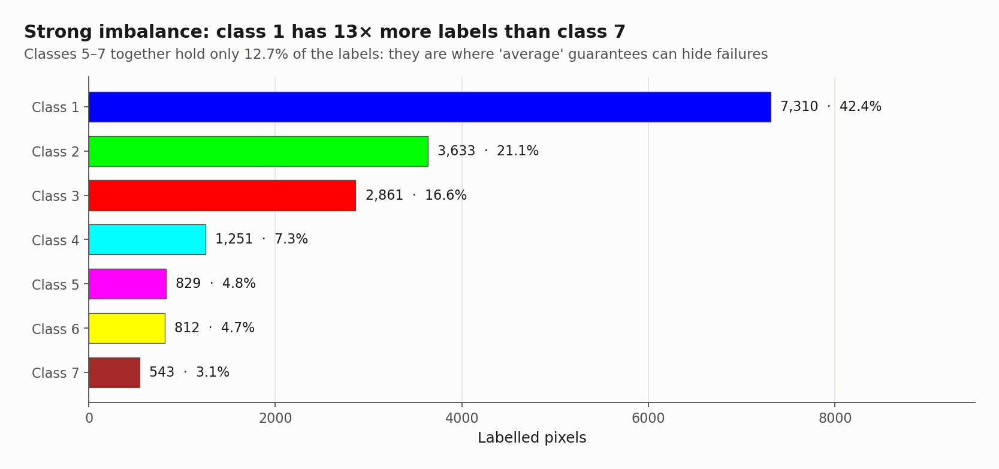

*__Figure 2.__ Labelled pixels per class.*

**Reading Figure 2.** Class 1 alone holds 42% of the labels, and the three smallest classes (5, 6 and 7)
hold 12.6% together. With a 25% test split and a further 50/50 calibration/evaluation split, class 7 has
only **68 evaluation pixels**. Per-class coverage for it is therefore accurate to about ±5 points (one
standard error ≈ 2.6 points), and this caveat applies to every per-class number below.

> ⚠️ **Class numbering in notebook figures.** The reference file uses labels **1–7**. The notebooks
> subtract 1, so their maps and tables say **"Class 0 … Class 6"**. *Class k* in a notebook figure =
> *label k + 1* here. All figures made for this documentation use 1–7.

### 3.3 Spectral behaviour

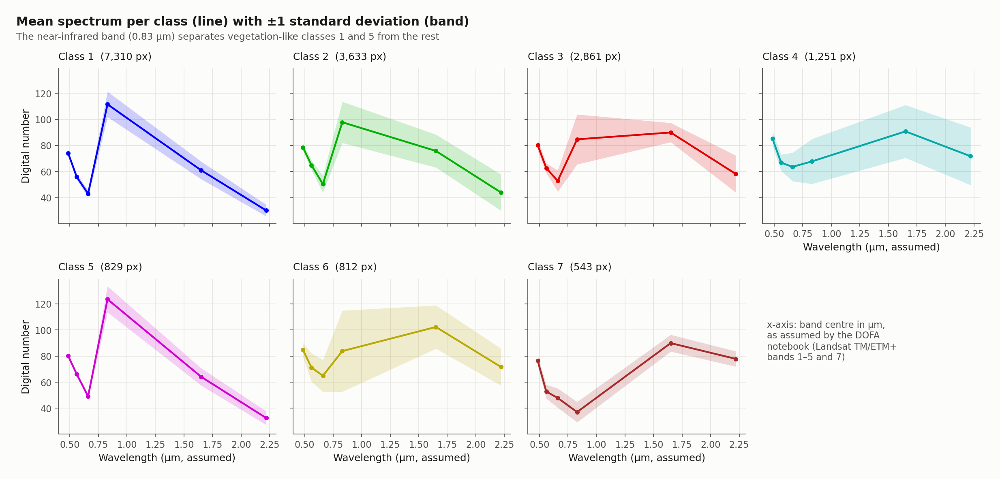

*__Figure 3.__ Mean spectrum (line) ± 1 standard deviation (band) per class.*

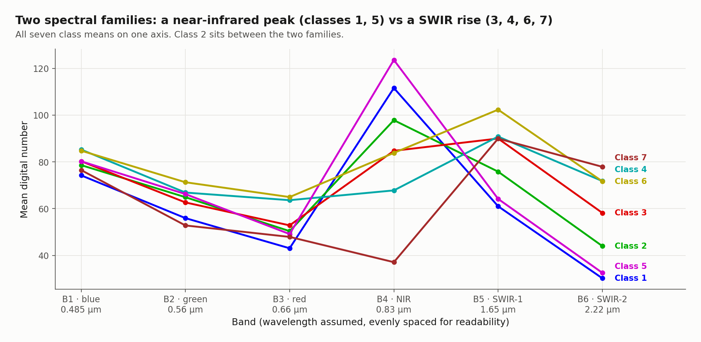

*__Figure 4.__ All seven class means on one axis.*

**Reading Figures 3–4.** The classes fall into two spectral families:
- **Classes 1 and 5** (and, more weakly, 2) have a sharp **near-infrared peak** and low SWIR. This is the
  signature of green, actively growing vegetation.
- **Classes 3, 4, 6 and 7** rise into the **SWIR** instead. This is typical of bare soil, senescent or
  harvested crops, or built surfaces. Class 7 is the extreme case: the lowest NIR of all (37) and high SWIR.

The width of the bands matters too. Classes 1, 5 and 7 are tight (standard deviation 1–10 DN), while classes
4 and 6 spread very widely (up to 31 DN). Wide classes are likely mixtures of surface conditions, and they
are where models and uncertainty methods struggle.

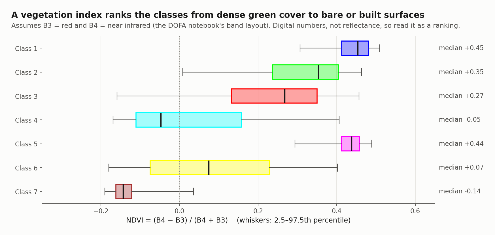

*__Figure 5.__ A vegetation index per class (assuming B3 = red, B4 = near-infrared).*

**Reading Figure 5.** NDVI (normalised difference vegetation index) is the standard one-number summary of
"how green". It ranks the classes from class 1 (+0.45) and class 5 (+0.44) down to class 7 (−0.14). Classes
4 and 6 have very wide boxes: each spans from bare to moderately vegetated surfaces. Because the input
values are digital numbers rather than calibrated reflectance, read NDVI as a ranking, not as absolute
values.

| | |
|:-:|:-:|
| 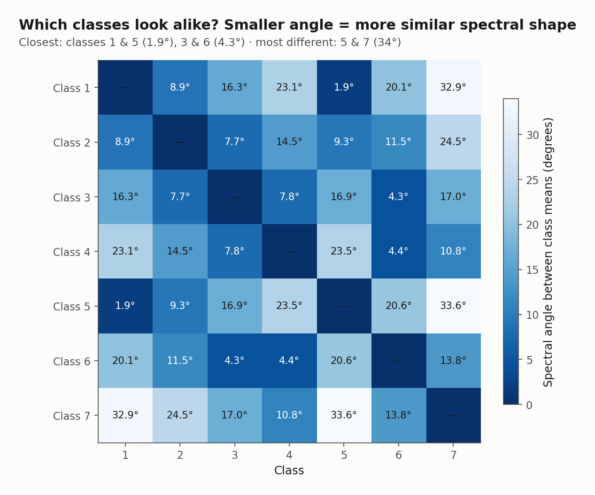 | 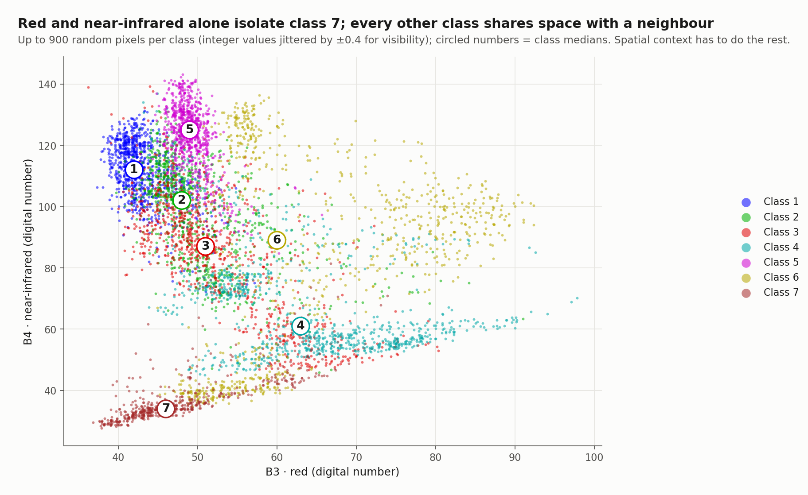 |
| *__Figure 6a.__ Spectral angle between class means* | *__Figure 6b.__ Red vs near-infrared, per pixel* |

**Reading Figure 6.**
- **Spectral angle (6a)** compares spectral *shape* and ignores brightness. The closest pair is classes
  **1 & 5 at 1.9°**: the same green-vegetation shape, separated only by brightness (class 5 is brighter
  in the NIR). Classes **3 & 6 (4.3°)** and **4 & 6 (4.4°)** are the next closest. The most different pair
  is 5 & 7 (34°).
- **The red–NIR scatter (6b)** is the classic two-band view. Class 7 sits alone at the bottom left. Every
  other class shares space with at least one neighbour: 1, 2, 3 and 5 crowd the high-NIR corner, and 4 and 6
  spread across the bottom right.

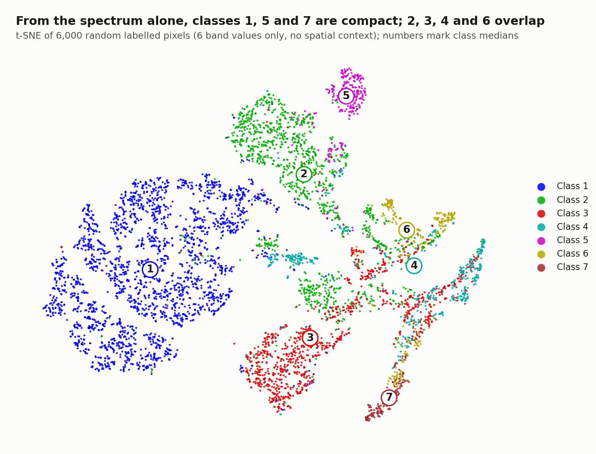

*__Figure 7.__ t-SNE of 6,000 labelled pixels, using the six band values only.*

**Reading Figure 7.** Each dot is one pixel placed by spectral similarity. Classes 1, 5 and 7 form compact
islands. Classes 2, 3, 4 and 6 interleave in a long chain: from the spectrum alone, they cannot be
separated cleanly. Spatial context (the 9 × 9 patch) has to do the rest, which is why the train/test split
(§4.3) matters so much.

### 3.4 How much independent information do six bands carry?

| | |
|:-:|:-:|
| 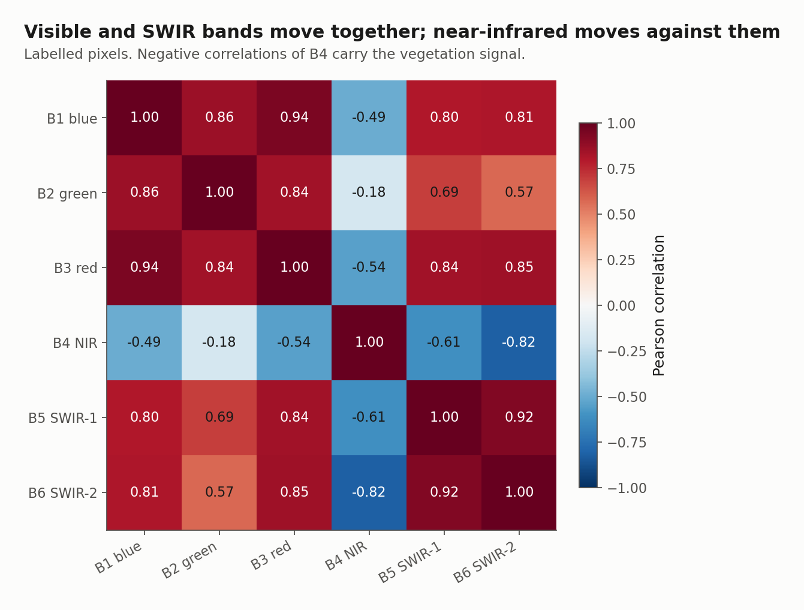 | 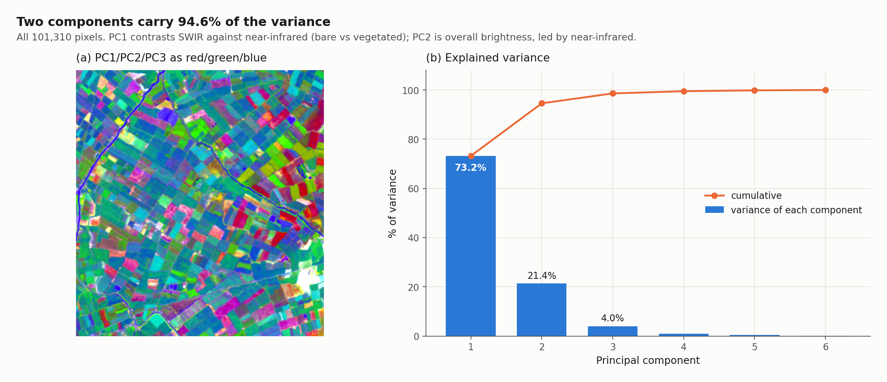 |
| *__Figure 8.__ Band-to-band correlation* | *__Figure 9.__ Principal components* |

**Reading Figures 8–9.**
- The visible and SWIR bands are strongly positively correlated (0.66–0.94).
- The near-infrared band is **negatively** correlated with all of them (−0.13 to −0.68). It carries the
  vegetation signal on its own.
- Two principal components explain **94.6%** of the variance (73.2% + 21.4%). PC1 contrasts SWIR against
  NIR (bare vs vegetated), and PC2 is overall brightness led by NIR.

The scene is effectively two-dimensional spectrally, which is why spatial context matters so much for the
classes inside each family.

---

## 4. Experimental set-up

### 4.1 Pipeline

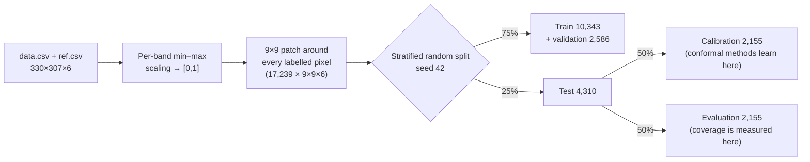

1. **Normalise.** Each band is min–max scaled to [0, 1] over the whole scene.
2. **Patch.** The image is edge-padded by 4 pixels, and a 9 × 9 × 6 cube is cut around every labelled
   pixel. The centre pixel's label is the target.
3. **Split.** Stratified 75/25 train/test (seed 42), with 20% of train held out for validation. For
   uncertainty, the test pool is split 50/50 again into calibration and evaluation.
4. **Full-scene maps.** Every one of the 101,310 pixels gets a patch and a prediction.

Two deviations matter later:
- **AlexNet** uses a "legacy" recipe: Adagrad, split seed 10, no validation set.
- **MultiCP** uses its own 75 / 12.5 / 12.5 split with seed 10.

### 4.2 Training recipe

| Setting | Value |
|---|---|
| Optimiser | AdamW-style, lr 3 × 10⁻⁴ with cosine decay (α = 0.05); AlexNet: Adagrad with a cosine schedule from 0.01 to 0.02 |
| Regularisation | label smoothing 0.05, weight decay 10⁻⁴, dropout 0.25, gradient clipping 1.0 |
| Batch / epochs | 128 / **100** (all models ran the full 100 epochs) |
| Hardware | Kaggle GPU |

### 4.3 How pixels are split, and why it matters

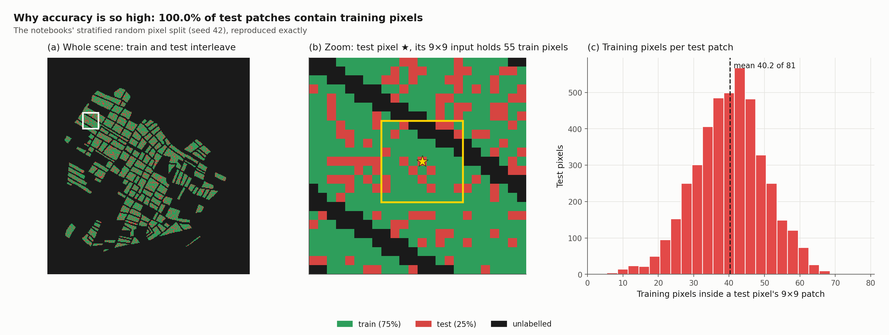

*__Figure 10.__ The notebooks' random pixel split, reproduced exactly.*

**Reading Figure 10.** Train (green) and test (red) pixels are drawn from the same parcels (10a). A
test pixel's 9 × 9 input therefore contains many training pixels (10b). Counted over all 4,310 test
pixels (10c): **every test patch contains training pixels, 40.2 of 81 on average** (median 41).

**Why it matters.** The models are mostly asked about places whose surroundings they were trained on.
Accuracy, and every coverage number computed from it, is optimistic compared with predicting a new
field or a new scene (§10).

### 4.4 Metrics glossary

| Metric | Plain meaning | Good value |
|---|---|---|
| **Accuracy, Cohen's κ, macro-F1** | Share correct; agreement beyond chance; per-class F1 averaged so small classes count equally | high |
| **NLL, Brier, ECE** | Penalty for confident mistakes; squared probability error; gap between stated confidence and accuracy (15 bins) | low |
| **Coverage** | Share of evaluation pixels whose set contains the true class | ≈ 95% |
| **Average set size** | Mean number of classes per set | small, given coverage |
| **Singleton / empty rate** | Share of sets with exactly one / no class | see §8.2 |
| **Per-class coverage** | Coverage inside each class | ≈ 95% for *every* class |
| **AU / EU / TU** | Aleatoric / epistemic / total uncertainty (credal methods) | relative |

---

[← Overview](../README.md) · [Report contents](README.md) · [Models and classification results →](02_models_and_classification.md)
