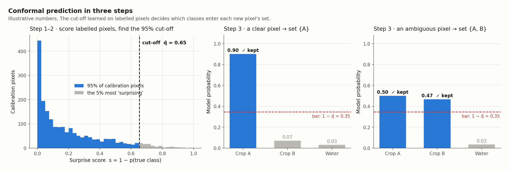

# Uncertainty methods in plain words

*Full report, chapter 3 of 6 (§7).* [Overview](../README.md) · [Report contents](README.md)

---

## 7. Uncertainty quantification: methods in plain words

### 7.1 Three families

| Family | Everyday analogy | Output per pixel | Guarantee? |
|---|---|---|---|
| **Conformal prediction**: Split, Class-conditional, Clustered, RC3P, RAPS, SACP, MultiCP, SCMCP | A forecaster who keeps score: *"on days I said this, I was right 95% of the time"* | A **set** of classes | **Yes**: the true class is in the set ≥ 95% of the time, if calibration and test pixels are exchangeable |
| **Credal / ensemble**: CreDE, CREDIT | Ask five experts and keep the range of their opinions | Lower/upper probability per class → AU / EU | No |
| **Generative + test**: DAPM | Redraw the answer 30 times and test whether the top two classes really differ | p-value → certain / uncertain | No |

> **Two kinds of uncertainty.** *Aleatoric*: the pixel itself is ambiguous (a field edge, a mixed surface),
> and more data would not help. *Epistemic*: the model has not learned this case, and more or better data
> would help.

### 7.2 Conformal prediction in three steps

<p align="center"></p>

*__Box 1.__ How conformal prediction works, with illustrative (made-up) numbers.*

1. **Score.** On each calibration pixel, measure the model's surprise at the true answer:
   $`s_i = 1 - \hat p_{y_i}(x_i)`$.
2. **Cut-off.** Take the value that 95% of the scores stay under (with a small finite-sample correction):

```math
\hat q = \text{Quantile}\left(s_1,\dots,s_n;\ \frac{\lceil (n+1)(1-\alpha)\rceil}{n}\right),\qquad \alpha = 0.05
```

3. **Set.** Keep every class whose probability clears the bar:
   $`C(x) = \{\,k : \hat p_k(x) \ge 1 - \hat q\,\}`$.

Each method folder changes one ingredient: the **score** (RAPS, SAPS), the **grouping** used for the
cut-off (class-conditional, clustered, RC3P), the **neighbourhood** (SACP, SCMCP), or the **number of
heads** that must agree (MultiCP).

### 7.3 Method map

| Folder | Method | What it changes | Output |
|---|---|---|---|
| [`baseline/`](../baseline/README.md) ⭐ | Split, Class-conditional, Clustered CP, RC3P, RAPS | Score and grouping | Prediction sets |
| [`sacp/`](../sacp/README.md) | Spatially-Aggregated CP | Averages each pixel's score with its neighbours' | Prediction sets |
| [`multicp/`](../multicp/README.md) | Multi-head CP | 7 heads; a class must pass all 7 | Prediction sets |
| [`multicp_sacp/`](../multicp_sacp/README.md) | Spatial MultiCP (SCMCP) | Smooths each head's probabilities, then MultiCP | Prediction sets |
| [`ensemble/`](../ensemble/README.md) | Deep ensembles + CreDE | 5 members → credal intervals | AU / EU / TU |
| [`credit/`](../credit/README.md) | CREDIT | One student learns the ensemble's intervals | AU / EU / TU |
| [`dapm/`](../dapm/README.md) | DAPM | VAE + domain alignment + diffusion + Welch t-test | p-value per pixel |
| [`dofa/`](../dofa/README.md), [`georsclip/`](../georsclip/README.md), [`mambahsi/`](../mambahsi/README.md), [`spatialgcn/`](../spatialgcn/README.md) | Baseline CP methods | New backbones | Prediction sets |

---

[← Models and classification results](02_models_and_classification.md) · [Report contents](README.md) · [Uncertainty results and discussion →](04_uncertainty_results.md)
