# Uncertainty results and discussion

*Full report, chapter 4 of 6 (§8–§9).* [Overview](../README.md) · [Report contents](README.md)

---

## 8. Uncertainty results

### 8.1 RQ1 · Does the 95% guarantee hold?

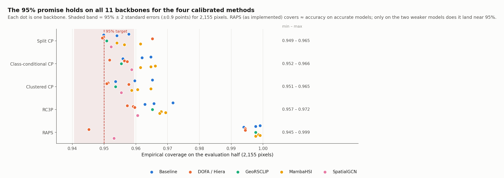

*__Figure 12.__ Empirical coverage of the five baseline conformal methods on all 11 backbones.*

**How to read it.** Each dot is one backbone. The shaded band is 95% ± 2 standard errors for 2,155
evaluation pixels (±0.9 points): dots inside it are statistically indistinguishable from exactly 95%.

**What it shows.**
- **Split, class-conditional and clustered CP** sit at 0.949–0.966, inside or just above the band, on every
  backbone. This includes DOFA-Spectral, which is wrong on 31% of pixels.
- **RC3P** is the most conservative (0.957–0.972). Its extra "top-k" rule makes sets slightly larger than
  necessary, which is safe but a little wasteful.
- **RAPS** sits at 0.994–0.999 on the accurate models, i.e. at their accuracy: as implemented it always
  returns the top-1 class ([baseline/ §3.5](../baseline/README.md#raps)). Only on the two weaker models,
  where the true class is often not ranked first, does it land near 95% (0.945–0.953).

> **Takeaway RQ1.** The guarantee is real and model-independent. RAPS as implemented is the exception.

### 8.2 RQ2 · What do the prediction sets look like?

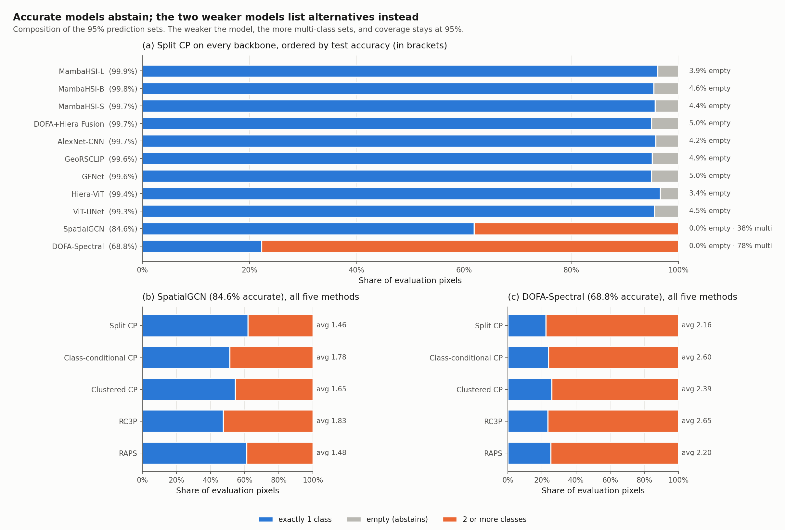

*__Figure 13.__ (a) Split CP on every backbone, ordered by accuracy; (b) SpatialGCN and (c) DOFA-Spectral
under all five methods.*

**How to read it.** Each bar is 100% of evaluation pixels: blue = sets with exactly one class,
grey = empty sets, orange = sets with 2+ classes.

**What it shows: three regimes.**

| Regime | Models | What the 95% sets do |
|---|---|---|
| Accurate (≥ 99.3%) | nine backbones | 95–97% one class, **3.4–5.0% empty**, no 2-class sets |
| Imperfect (84.6%) | SpatialGCN | no empty sets; **38–53%** of sets hold 2+ classes (avg 1.46–1.83) |
| Weak (68.8%) | DOFA-Spectral | no empty sets; **74–78%** hold 2+ classes (avg 2.16–2.65) |

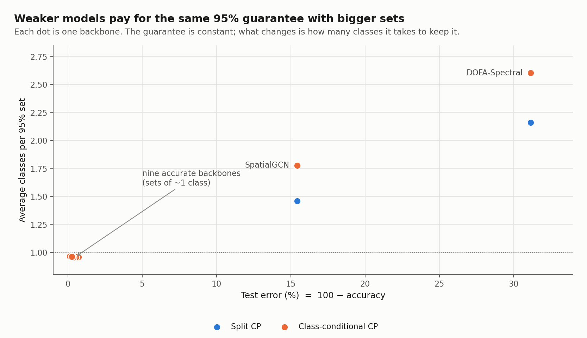

*__Figure 14.__ Average set size against test error, for every backbone.*

**Reading Figure 14.** The guarantee stays at 95%, so a weaker model pays for it with larger sets. Set size
grows roughly in proportion to the error rate. Class-conditional CP (orange) asks for more than Split CP
(blue) because it also protects the weak classes (§8.3).

**Why accurate models give empty sets.**

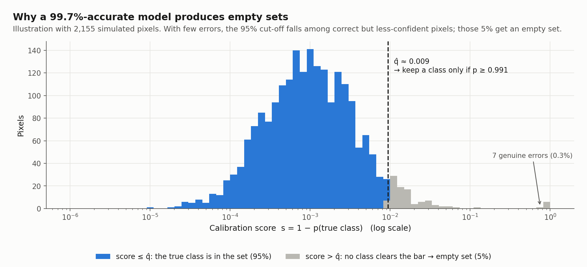

*__Figure 15.__ Illustration with simulated scores (not repository data).*

A 99.7%-accurate model is wrong on only ~0.3% of pixels. To "use" its 5% error budget, the cut-off must
fall among **correct but less-confident** predictions. Those ~5% of pixels then clear the bar for no class
and receive an **empty set**: the method abstains. On accurate models, an empty set therefore means *"among
the least confident 5%"*, not *"probably wrong"*.

> **Takeaway RQ2.** Conformal prediction adapts the form of its answer to the model. It abstains when the
> model is nearly always right, and lists candidate classes when the model genuinely confuses them.

### 8.3 RQ3 · Is coverage fair across classes?

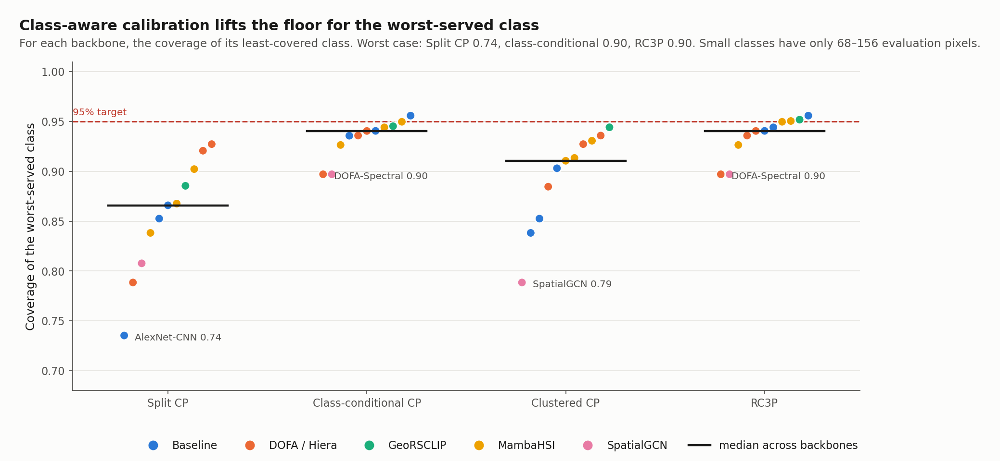

*__Figure 16a.__ For each backbone, the coverage of its least-covered class.*

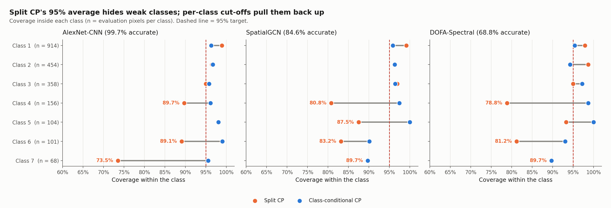

*__Figure 16b.__ Coverage inside each class under Split CP (orange) and class-conditional CP (blue).*

**What it shows.**
- **Split CP**: the median worst class sits at 0.87, and the worst case is **AlexNet's class 7 at 0.735**:
  more than one in four of those pixels is missed, while the 95% average looks perfect.
- **Clustered CP** helps on average but can drop a class further (SpatialGCN class 4: 0.79) when a weak
  class is grouped with easy ones.
- **Class-conditional CP and RC3P** raise the floor to **≥ 0.90** for every backbone (median 0.94). The
  remaining shortfalls are in classes with 68–101 evaluation pixels, within about two standard errors of 95%.
- **The most extreme case is outside these backbones.** Fed through Split CP, the classifier head of
  [DAPM](../dapm/README.md#5-results-dapms-classifier-through-conformal-prediction) covers label 7 only
  **0.309** (ViT-UNet) and 0.603 (GFNet). Class-conditional CP lifts both to ≥ 0.94.

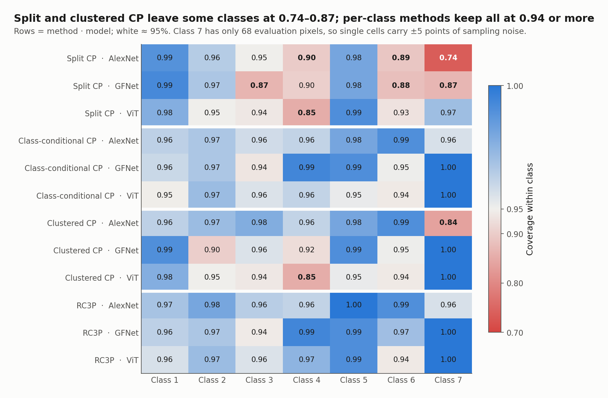

*__Figure 17.__ Every class × method × baseline model; white ≈ 95%, red = under-covered.*

> **Takeaway RQ3.** Report per-class coverage, always. For land-cover maps, where small classes are often the
> point, use class-conditional CP or RC3P. They cost nothing extra at test time.

### 8.4 RQ4 · Where on the map is the uncertainty?

| GFNet · Split CP (99.6%) | SpatialGCN · Split CP (84.6%) | DOFA-Spectral · Split CP (68.8%) |
|:-:|:-:|:-:|
| 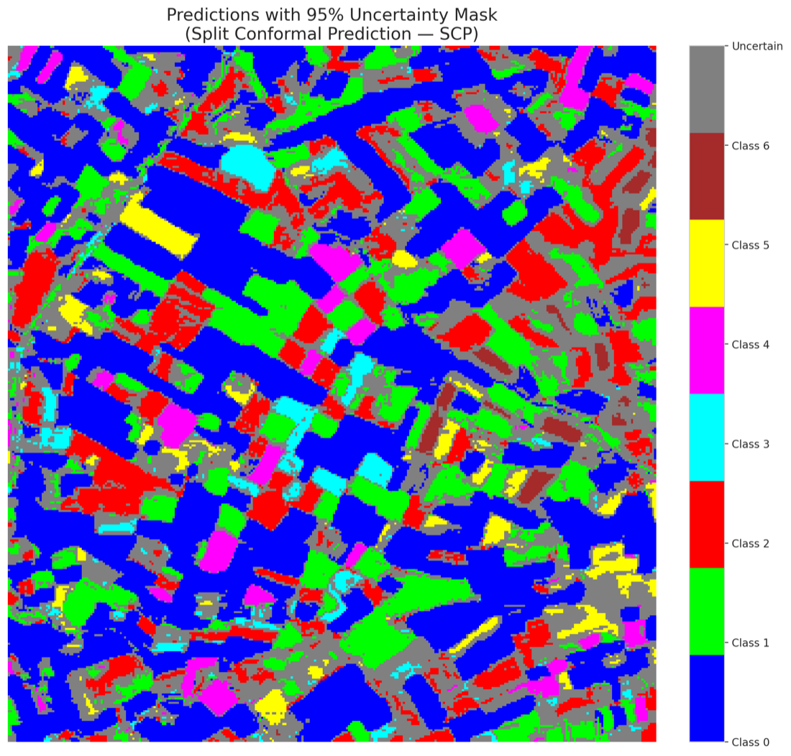 | 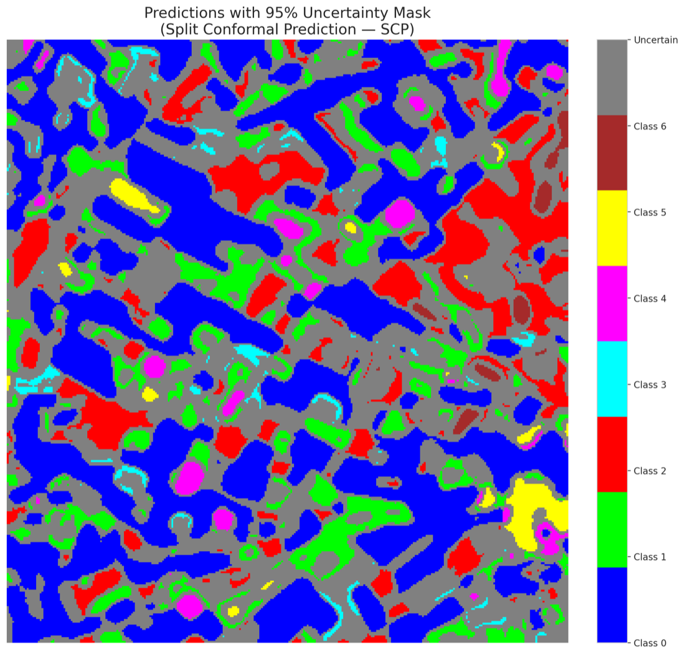 | 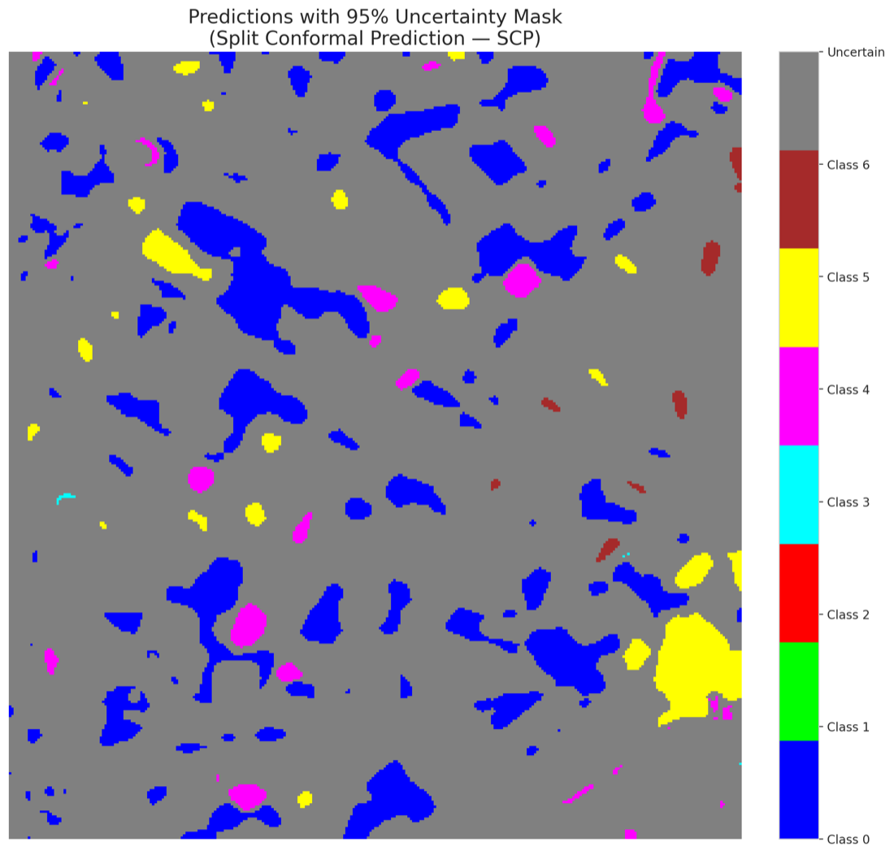 |

*__Figure 18.__ Full-scene prediction maps with "uncertain" pixels (set ≠ one class) in grey. Notebook
numbering 0–6. Extracted from each folder's `conformal_reports_all_models.xlsx`.*

**Reading Figure 18.**
- **GFNet:** grey traces **parcel boundaries** and a few whole parcels in the unlabelled east. These are mixed
  pixels and unfamiliar surfaces. Parcel interiors are confident.
- **SpatialGCN:** the prediction itself is blobby (graph smoothing). Grey forms wide **halos around every
  blob**, so the uncertainty correctly marks where the model's smoothing invented boundaries.
- **DOFA-Spectral:** almost the whole scene is grey. Only spectrally unique patches stay certain, such as the
  vegetation classes 1 and 5 (blue and magenta) and parts of class 6 (yellow). This is honest: the model
  really cannot tell the other classes apart.

> **Takeaway RQ4.** The maps show *where* to trust a land-cover map. Uncertainty concentrates on edges,
> unfamiliar parcels and spectrally ambiguous classes, and it scales with the model's real weakness.

### 8.5 RQ5 · How much of the map does each method call uncertain?

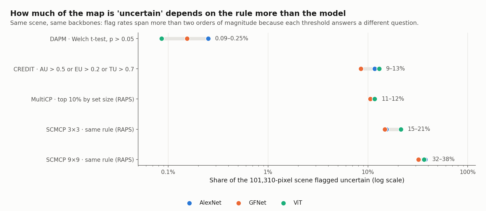

*__Figure 19.__ Share of the 101,310-pixel scene flagged uncertain, per method (log scale).*

| Method | Its rule | What the rule really asks |
|---|---|---|
| DAPM (0.09–0.25%) | Welch t-test p > 0.05 between the top-2 classes over 30 samples | "Are the top two *statistically* tied?" Almost never, with 30 samples |
| CREDIT (9–13%) | AU > 0.5 or EU > 0.2 or TU > 0.7 | "Is the cautious distribution spread out?" Mostly true off the labels; every flag comes from AU |
| CreDE ensembles (17–23%, not in Fig. 19) | same thresholds | "Do the five members disagree?" Mostly EU, almost entirely on unlabelled land |
| MultiCP / SCMCP (11–38%) | **Top 10%** of pixels by set size (plus ties), smoothing widens it | A quota, not a test |

> **Takeaway RQ5.** "% of the map uncertain" is not comparable across methods unless the threshold has a
> calibrated meaning. Only conformal sets carry one.

### 8.6 RQ6 · Multi-head and spatial variants

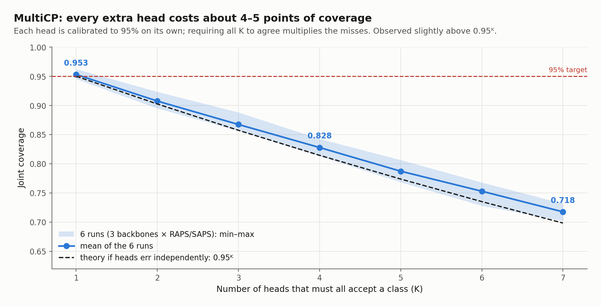

*__Figure 20.__ MultiCP joint coverage as more heads must agree.*

**Reading Figure 20.** One head alone is valid (0.953). Each additional head costs 4–5 points, ending at
**0.718 with 7 heads**, just above the independence prediction 0.95⁷ = 0.698. A per-head budget of α/K
would restore 95% ([multicp/](../multicp/README.md)).

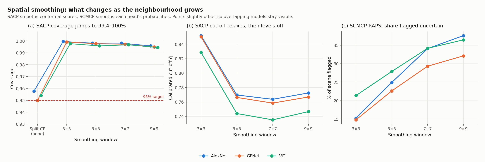

*__Figure 21.__ Spatial methods as the smoothing window grows.*

**Reading Figure 21.**
- **(a)** SACP raises coverage from Split CP's ~95% to **99.4–100%**: empty sets are forced to hold the best
  class, and neighbours' scores pull doubtful pixels towards their parcel.
- **(b)** The cut-off drops from 3×3 to 5×5 and then levels off.
- **(c)** SCMCP flags a growing share of the scene: **15–21% at 3×3 → 32–38% at 9×9**.

| Split CP (GFNet) | SACP 3×3 (GFNet) |
|:-:|:-:|
|  | 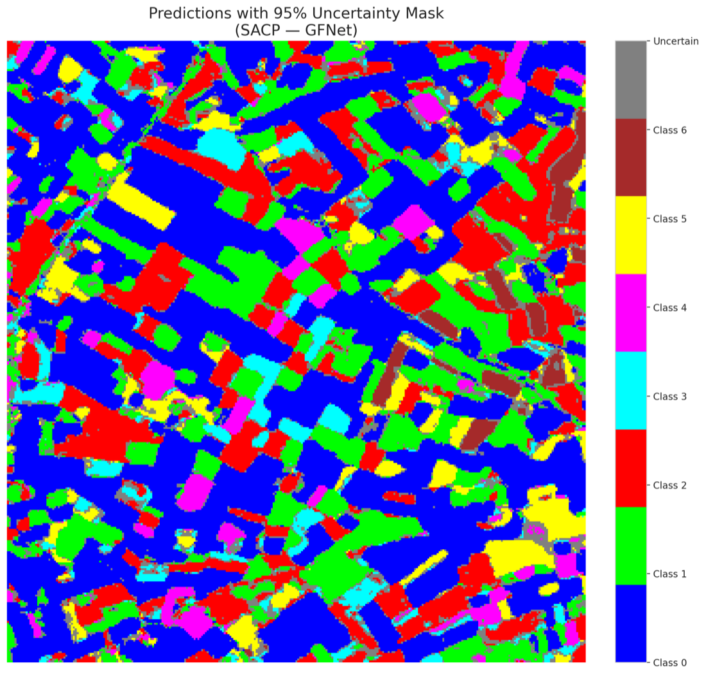 |

*__Figure 22.__ Spatial smoothing turns broad grey zones into coherent parcels with thin uncertain edges.*

### 8.7 RQ7 · What do ensembles say about the two kinds of uncertainty?

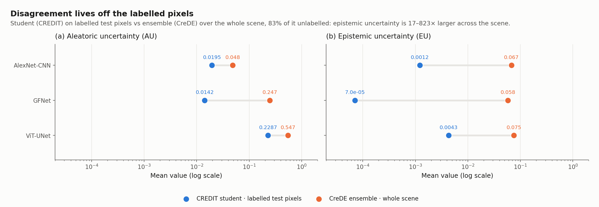

*__Figure 23.__ Mean AU and EU: CREDIT student on labelled test pixels vs CreDE ensemble over the whole scene.*

**Reading Figure 23.**
- On **labelled test pixels** the learned disagreement is small (EU 7 × 10⁻⁵ to 0.004).
- Over the **whole scene**, 83% of it unlabelled, the five members disagree **17–823× more** (EU 0.058–0.075).
- Consistently, **98.2–99.7%** of the 8,613–13,161 pixels that CREDIT flags are unlabelled.
- ViT-UNet has the highest AU on both pixel sets, mirroring its high ECE in Table 1.

> **Takeaway RQ7.** Epistemic uncertainty is a detector of *surfaces the model was never taught*. The
> flagged pixels are a ready-made list of where to label next.

### 8.8 Method scorecard

| Method | Valid 95%? | Fair per class? | Informative on accurate models? | Informative on weak models? | Spatially coherent? |
|---|:-:|:-:|:-:|:-:|:-:|
| Split CP | ✅ | ❌ (worst 0.74) | ❌ abstains | ✅ lists alternatives | ❌ |
| Class-conditional CP | ✅ | ✅ (≥ 0.90) | ❌ abstains | ✅ | ❌ |
| Clustered CP | ✅ | ⚠️ (worst 0.79) | ❌ abstains | ✅ | ❌ |
| RC3P | ✅ (conservative) | ✅ (≥ 0.90) | ❌ abstains | ✅ (largest sets) | ❌ |
| RAPS (as implemented) | ❌ = accuracy | — | ❌ top-1 only | ⚠️ ≈ 95% | ❌ |
| SACP | ⚠️ ≈ 99.5%, assumption bent | ✅ | ❌ | not tested | ✅ |
| MultiCP / SCMCP | ❌ ≈ 72% | ❌ | ⚠️ quota | not tested | ⚠️ |
| CreDE / CREDIT | no guarantee | ✅ measured ≥ 97% | ✅ flags unlabelled land | not tested | ✅ |
| DAPM | no guarantee | — | ❌ flags ~0.1% | not tested | ❌ |

---

## 9. Discussion and recommendations

1. **A weak model is the best test of an uncertainty method.** On the nine accurate backbones all
   conformal methods look alike. SpatialGCN and DOFA-Spectral reveal the real differences: how many classes
   each method needs, and which classes it under-protects.
2. **Use class-aware conformal prediction by default.** It costs nothing at test time and removes the worst
   per-class failures.
3. **Do not compare "% uncertain" across methods**, unless the thresholds have been calibrated to the same
   meaning.
4. **Use epistemic maps to guide labelling.** The ensembles disagree almost only on unlabelled surfaces.
5. **Evaluate spatially.** Random pixel splits (F8) flatter every number here. Spatially blocked splits
   (whole parcels held out) are the next step.

---

[← Uncertainty methods in plain words](03_uncertainty_methods.md) · [Report contents](README.md) · [Limitations and threats to validity →](05_limitations.md)
