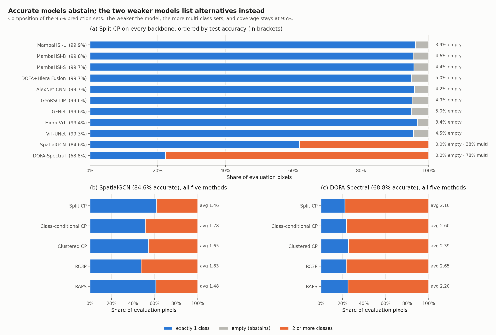
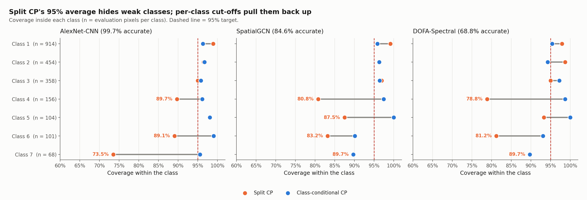
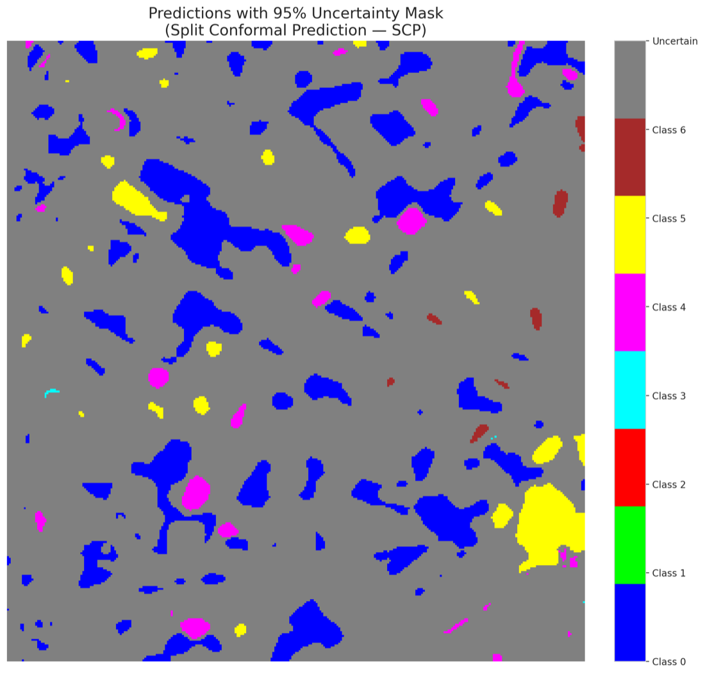
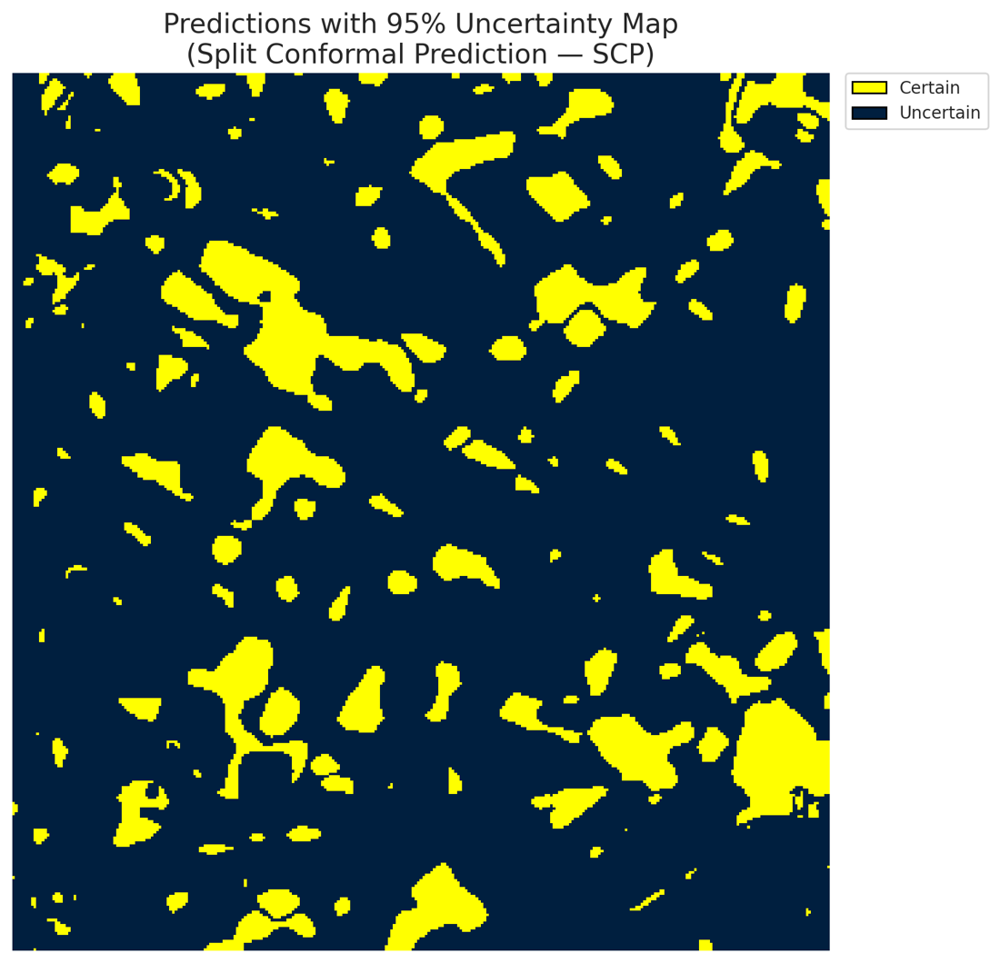
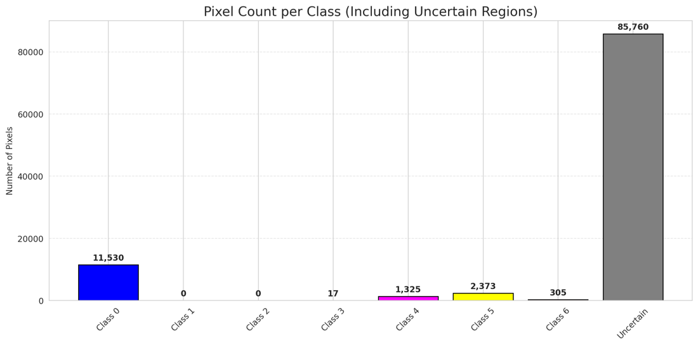

# DOFA & Hiera: wavelength-aware backbones, and the weakest model in the study

[← back to main README](../README.md) · conformal methods explained in [baseline/](../baseline/README.md#3-the-five-methods-step-by-step)

| | |
|---|---|
| **What** | Three backbones (DOFA-Spectral, Hiera-ViT, DOFA+Hiera Fusion) evaluated with the same five conformal methods as the baseline |
| **Key result** | DOFA-Spectral is only **68.8%** accurate, yet every calibrated method still covers **94.9–95.9%**. It does so by listing **2.16–2.65 classes per pixel**, and 74–78% of its sets hold two or more |
| **The lesson** | A weak model shows what conformal prediction is for: the sets widen exactly where the model is confused. Split CP still under-covers labels 4 and 6 (0.79 / 0.81); class-conditional CP raises them to 0.99 / 0.93 |
| **Notebooks** | [`Model_training.ipynb`](Model_training.ipynb) · [`Model_uncertainty_comparison.ipynb`](Model_uncertainty_comparison.ipynb) |
| **Papers in this folder** | [`2403.15356v3.pdf`](2403.15356v3.pdf) (DOFA, Xiong et al. 2024) · [`2306.00989v1.pdf`](2306.00989v1.pdf) (Hiera, Ryali et al. 2023) |

> [`Report_dofa.md`](Report_dofa.md) is an earlier write-up. Its DOFA-Spectral accuracy (68.84%) matches
> the current results, but its fusion accuracy (99.65%) does not: the committed result is **99.70%**. The
> tables below are read from the current `results/*.csv` files and supersede it.

---

## 1. The models in plain words

| Model | Idea | Accuracy | Train time |
|---|---|--:|--:|
| **DOFA-Spectral** | *Dynamic One-For-All.* A small "hypernetwork" receives each band's **wavelength** and generates that band's embedding weights, so one network could in principle read any sensor. Every pixel of the patch is embedded (96 numbers), then the embeddings are **averaged over the 9 × 9 patch**, followed by dense layers 256 → 128 → 64. The model sees a mean spectrum, not the spatial layout | **68.84%** | 0.9 min |
| **Hiera-ViT** | A hierarchical Vision Transformer: 3 × 3 tokens, two stages (128 → 256 channels, 2 blocks each, 4 heads), tokens merged between stages | 99.44% | 4.9 min |
| **DOFA + Hiera Fusion** | Both feature sets concatenated before the classifier | **99.70%** | 5.4 min |

### How the wavelength hypernetwork works

```math
W_b = h_\theta(\lambda_b), \qquad e(x) = \frac{1}{81}\sum_{\text{pixels } p}\Big(\sum_{b=1}^{6} x_{p,b}\, W_b + \beta\Big)
```

*In words: a small network $`h_\theta`$ (hidden width 64) turns the wavelength $`\lambda_b`$ of band
$`b`$ into a 96-number weight vector. Each pixel's embedding is its band values times those weights, plus a
bias $`\beta`$. The patch embedding is the average over its 81 pixels.* The notebook assigns
$`\lambda = (0.485, 0.56, 0.66, 0.83, 1.65, 2.22)`$ µm, the Landsat TM/ETM+ band centres. This
assignment is plausible from the spectra (main README §3.3) but is **not documented** for this scene.

### Why DOFA-Spectral is weak

The [data analysis](../README.md#33-spectral-behaviour) shows that labels 2, 3, 4 and 6 overlap when
judged by spectrum alone (Figure 7 of the main README), and that labels 1 and 5 differ only in brightness.
Patch averaging removes the spatial layout that separates them. Hiera keeps it, which lifts accuracy from
68.8% to 99.4%.

<p align="center"></p>

*__Figure 1.__ Test confusion matrices (labels 1–7).*

**Reading Figure 1.** DOFA-Spectral's errors follow the spectral families exactly:
- **Label 2 is almost lost**: only 261 of 908 pixels are correct. 356 are called label 1 (both vegetated)
  and 254 label 3.
- **Label 4** (103 / 313 correct) is mostly called label 3; **label 6** (106 / 203) leaks to label 7 (38)
  and label 3 (36).
- The spectrally distinct **labels 1 and 7** are recognised well (90% each).

Hiera and Fusion make ≤ 25 errors in 4,310.

---

## 2. Implementation details

| Setting | Value |
|---|---|
| Split, recipe | Same as baseline (seed 42, 100 epochs, batch 128, lr 3 × 10⁻⁴, dropout 0.25) |
| DOFA | embed dim 96, hypernetwork hidden 64, dense [256, 128, 64] |
| Hiera | stage dims [128, 256], blocks [2, 2], 4 heads, MLP ratio 2 |
| Conformal | Split, class-conditional, clustered (k = 4), RC3P, RAPS (λ = 0.01, k_reg = 1); α = 0.05; 2,155 / 2,155 calibration / evaluation |

---

## 3. Results

### 3.1 Coverage and set size

| Model | Method | Coverage | Avg. set size | Singletons | Empty | 2+ classes | Mean per-class cov. |
|---|---|--:|--:|--:|--:|--:|--:|
| **DOFA+Hiera Fusion** | Split CP | 0.950 | 0.95 | 95.0% | 5.0% | 0.0% | 0.955 |
|  | Class-cond. CP | 0.952 | 0.95 | 95.2% | 4.8% | 0.0% | 0.958 |
|  | Clustered CP | 0.951 | 0.95 | 95.1% | 4.9% | 0.0% | 0.958 |
|  | RC3P | 0.957 | 0.96 | 95.7% | 4.3% | 0.0% | 0.965 |
|  | RAPS | 0.994 | 1.00 | 100.0% | 0.0% | 0.0% | 0.993 |
| **DOFA Spectral** | Split CP | 0.949 | 2.16 | 22.2% | 0.0% | 77.8% | 0.907 |
|  | Class-cond. CP | 0.956 | 2.60 | 23.8% | 0.0% | 76.2% | 0.955 |
|  | Clustered CP | 0.951 | 2.39 | 25.7% | 0.0% | 74.3% | 0.931 |
|  | RC3P | 0.959 | 2.65 | 23.4% | 0.0% | 76.6% | 0.957 |
|  | RAPS | 0.945 | 2.20 | 25.2% | 0.0% | 74.8% | 0.901 |
| **Hiera ViT** | Split CP | 0.965 | 0.97 | 96.6% | 3.4% | 0.0% | 0.960 |
|  | Class-cond. CP | 0.957 | 0.96 | 95.8% | 4.2% | 0.0% | 0.963 |
|  | Clustered CP | 0.958 | 0.96 | 95.8% | 4.2% | 0.0% | 0.964 |
|  | RC3P | 0.960 | 0.96 | 96.0% | 4.0% | 0.0% | 0.964 |
|  | RAPS | 0.994 | 1.00 | 100.0% | 0.0% | 0.0% | 0.993 |

*__Table 1.__ Source: [`results/uncertainty_results/summary_metrics.csv`](results/uncertainty_results/summary_metrics.csv).*

<p align="center"></p>

*__Figure 2.__ (a) Split CP on every backbone, ordered by accuracy; (c) DOFA-Spectral under all five
methods.*

**Reading Table 1 and Figure 2.**
- **The guarantee survives a 31% error rate.** Every calibrated method covers 0.949–0.959.
- **The sets widen instead of emptying.** The model's own errors already use up the 5% budget, so no set is
  empty. 74–78% of sets hold 2+ classes, and class-conditional CP and RC3P need the most (2.60–2.65 classes).
- **RAPS behaves as designed** (0.945). The true class is often not ranked first here, so the RAPS score is
  rarely zero ([why that matters](../baseline/README.md#raps)).
- **Hiera and Fusion** look like every near-perfect model: ~95–97% single-class sets, 3–5% empty.

### 3.2 Is coverage fair across classes?

| Model | Method | Label 1 | Label 2 | Label 3 | Label 4 | Label 5 | Label 6 | Label 7 | Worst |
|---|---|--:|--:|--:|--:|--:|--:|--:|--:|
| *eval pixels* | | *914* | *454* | *358* | *156* | *104* | *101* | *68* | |
| **DOFA+Hiera Fusion** | Split CP | 0.953 | 0.927 | 0.958 | 0.942 | 0.990 | 0.970 | 0.941 | 0.927 |
|  | Class-cond. CP | 0.954 | 0.941 | 0.947 | 0.942 | 0.990 | 0.960 | 0.971 | 0.941 |
|  | Clustered CP | 0.955 | 0.927 | 0.958 | 0.942 | 0.990 | 0.960 | 0.971 | 0.927 |
|  | RC3P | 0.957 | 0.941 | 0.958 | 0.962 | 1.000 | 0.970 | 0.971 | 0.941 |
|  | RAPS | 0.999 | 0.987 | 0.992 | 1.000 | 1.000 | 0.990 | 0.985 | 0.985 |
| **DOFA Spectral** | Split CP | 0.979 | 0.987 | 0.950 | **0.788** | 0.933 | 0.812 | 0.897 | 0.788 |
|  | Class-cond. CP | 0.954 | 0.943 | 0.972 | 0.987 | 1.000 | 0.931 | **0.897** | 0.897 |
|  | Clustered CP | 0.966 | 0.936 | 0.975 | 0.929 | **0.885** | 0.931 | 0.897 | 0.885 |
|  | RC3P | 0.955 | 0.943 | 0.986 | 0.987 | 1.000 | 0.931 | **0.897** | 0.897 |
|  | RAPS | 0.980 | 0.963 | 0.955 | 0.808 | 0.913 | **0.792** | 0.897 | 0.792 |
| **Hiera ViT** | Split CP | 0.996 | 0.921 | 0.950 | 0.929 | 0.990 | 0.980 | 0.956 | 0.921 |
|  | Class-cond. CP | 0.946 | 0.965 | 0.969 | 0.936 | 0.990 | 0.980 | 0.956 | 0.936 |
|  | Clustered CP | 0.946 | 0.967 | 0.969 | 0.936 | 0.990 | 0.980 | 0.956 | 0.936 |
|  | RC3P | 0.950 | 0.967 | 0.972 | 0.936 | 0.990 | 0.980 | 0.956 | 0.936 |
|  | RAPS | 0.999 | 0.985 | 0.997 | 0.994 | 1.000 | 0.990 | 0.985 | 0.985 |

*__Table 2.__ Source: [`results/uncertainty_results/per_class_coverage.csv`](results/uncertainty_results/per_class_coverage.csv).*

<p align="center"></p>

*__Figure 3.__ Per-class coverage, Split CP (orange) vs class-conditional CP (blue); DOFA-Spectral is
the right-hand panel.*

**Reading Table 2 and Figure 3.**
- With Split CP, DOFA-Spectral's **labels 4 and 6** (the most confused classes in Figure 1) are covered
  only **0.788 and 0.812**. The easy labels 1 and 2 are over-covered (0.98–0.99) to balance the average.
- **Class-conditional CP and RC3P** lift label 4 to 0.987 and label 6 to 0.931.
- **Label 7 stays at 0.897 under every method.** With 68 evaluation pixels that is 61 of 68 covered,
  within about two standard errors of 95%. It is noise in a small class, not a method failure.

### 3.3 Where the uncertainty is on the map

| Class map + uncertain mask | Certain vs uncertain | Pixel counts |
|:-:|:-:|:-:|
|  |  |  |

*__Figure 4.__ DOFA-Spectral, Split CP; grey = set holds more than one class. Notebook numbering 0–6
(= labels 1–7). Extracted from
[`results/uncertainty_results/conformal_reports_all_models.xlsx`](results/uncertainty_results/conformal_reports_all_models.xlsx).*

**Reading Figure 4.** Most of the scene is grey. The pixels that stay certain are compact blobs of
**label 1** (blue), **label 5** (magenta), **label 6** (yellow) and a few **label 7** (brown). Those are the
classes that are spectrally distinct or bright. Everything in the overlapping middle of the spectral
chain is honestly marked as "could be several classes". The blobby shapes come from patch averaging: the
model has no notion of parcel edges.

### 3.4 Classification maps

<p align="center"></p>

*__Figure 5.__ Ground truth and full-scene predictions of the three models.*

| Model | Accuracy | κ | Macro-F1 | NLL | Brier | ECE |
|---|--:|--:|--:|--:|--:|--:|
| DOFA-Spectral | 68.84% | 0.5678 | 0.6476 | 0.7916 | 0.4198 | 0.0504 |
| Hiera-ViT | 99.44% | 0.9925 | 0.9921 | 0.0527 | 0.0102 | 0.0342 |
| DOFA+Hiera Fusion | 99.70% | 0.9959 | 0.9966 | 0.0361 | 0.0054 | 0.0256 |

*__Table 3.__ Source: [`results/classification_summary.csv`](results/classification_summary.csv).*

---

## 4. Discussion

- **A weak model is the best stress test for uncertainty.** DOFA-Spectral's ECE (0.050) is moderate: its
  probabilities are roughly honest, and conformal prediction turns them into sets that say *which* classes
  are plausible. That is far more useful than the abstentions of the near-perfect models.
- **Spatial context beats wavelength conditioning on this scene.** Fusion adds only 0.26 points over Hiera
  alone. The wavelength embedding contributes little when the spatial branch already separates the classes.
- **Prediction sets as a field-checking list.** With class-conditional CP the 2–3 candidate classes per
  pixel are a short list for an analyst to verify.

## 5. Caveats

- The band wavelengths are inferred (Landsat-like), not documented.
- DOFA is trained **from scratch** here; this is not the pretrained DOFA foundation model.
- The random-split optimism ([main README §10](../README.md#10-limitations-and-threats-to-validity)) applies, most strongly to Hiera and Fusion.

## References

Xiong et al. (2024), *Neural Plasticity-Inspired Foundation Model for Observing the Earth Crossing
Modalities* (DOFA); Ryali et al. (2023), *Hiera*; Ding et al. (2023), *Class-Conditional Conformal
Prediction with Many Classes*.
