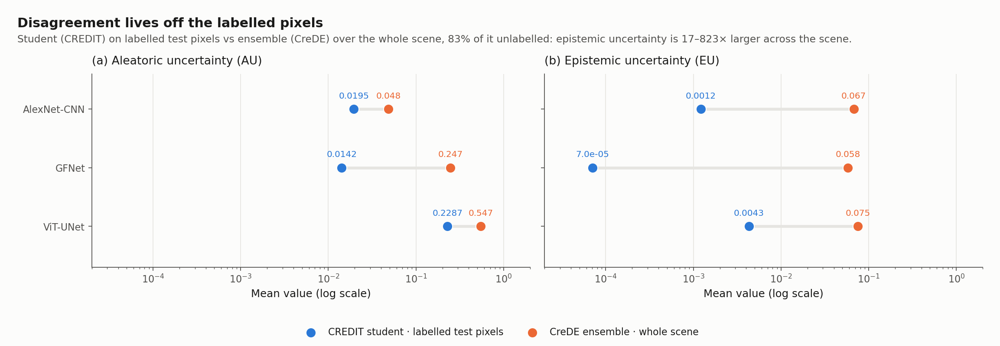

# Deep ensembles and CreDE: two kinds of uncertainty from five opinions

[← back to main README](../README.md)

| | |
|---|---|
| **What** | Five independently-seeded copies of each baseline backbone (AlexNet-CNN, GFNet, ViT-UNet). Their spread of predictions is turned into **credal intervals** (lower/upper probability per class) and split into **aleatoric (AU)** and **epistemic (EU)** uncertainty: *CreDE*, Credal Deep Ensembles |
| **Key result** | Over the whole scene the members disagree (EU 0.058–0.075) **17–823× more** than the distilled [CREDIT](../credit/README.md) student finds on test pixels. **17–23%** of the scene is flagged, and **99.6–99.9%** of the flagged pixels are unlabelled |
| **The lesson** | Epistemic uncertainty is a detector of *surfaces the models were never taught*. It points to where new labels would help most |
| **Notebooks** | [`Model_training_ensembles.ipynb`](Model_training_ensembles.ipynb) · [`Model_uncertainty_CreDE.ipynb`](Model_uncertainty_CreDE.ipynb) |
| **Results** | [`results/CreDE_Master_Summary.csv`](results/CreDE_Master_Summary.csv) · [`results/CreDE_Credal_Coverage_Overall.csv`](results/CreDE_Credal_Coverage_Overall.csv) · [`results/CreDE_Credal_Coverage_ClassWise.csv`](results/CreDE_Credal_Coverage_ClassWise.csv) · `results/*_uncertain_pixels.csv` · [`results/CreDE_Results.xlsx`](results/CreDE_Results.xlsx) |

> **Provenance.** The Kaggle run log marks the ensemble *training* kernel (k04) as not re-run; the CreDE
> *evaluation* kernel (k05) completed using previously trained member weights.

---

## 1. The idea in plain words

Train the same network five times with different random seeds. Where the five copies agree, the answer
is stable. Where they disagree, the training data did not pin the answer down. That disagreement is
**epistemic** uncertainty, which more data would reduce. Separately, even a unanimous ensemble can
spread its probability over two classes, as on a field boundary. That is **aleatoric** uncertainty, built
into the pixel.

## 2. The maths, step by step

With member probabilities $`p^{(1)},\dots,p^{(5)}`$ for a pixel (code: `predict_ensemble_credal_bounds`):

```math
\underline p_k = \min_m p^{(m)}_k, \qquad \overline p_k = \max_m p^{(m)}_k, \qquad \Delta p_k = \overline p_k - \underline p_k
```

*In words: for each class keep the most pessimistic and the most optimistic member. The gap is the credal
interval.*

```math
p^\ast_k = \frac{\underline p_k}{\sum_j \underline p_j}, \qquad
\text{AU} = -\sum_k p^\ast_k \ln p^\ast_k, \qquad
\text{EU} = \frac{1}{C}\sum_k \Delta p_k, \qquad
\text{TU} = \text{AU} + \text{EU}
```

*In words: AU is the entropy of the normalised cautious distribution (0 = certain, max ln 7 ≈ 1.95 nats).
EU is the average interval width (0 = all members agree, max 1). TU is simply their sum.*

**Credal prediction set** (interval dominance): class $`k`$ stays in the set unless another class is
*certainly* better, i.e. $`k \in C(x) \iff \overline p_k \ge \max_j \underline p_j`$. The set is never empty.

**Worked example.** Five members give class A probabilities (0.90, 0.85, 0.40, 0.88, 0.92) and class B
(0.08, 0.12, 0.55, 0.10, 0.06). Then $`\underline p_A = 0.40`$, $`\overline p_B = 0.55 \ge 0.40`$, so
both classes are in the set. The one dissenting member makes B plausible, and Δp ≈ 0.5 for both classes
gives a high EU.

| Setting | Value |
|---|---|
| Members | M = 5 per architecture, distinct seeds, baseline recipe (100 epochs) |
| Split | seed 42 (AlexNet: legacy seed 10) |
| Flag thresholds | AU > 0.5, EU > 0.2, TU > 0.7 (absolute; any one flags the pixel) |

---

## 3. Results

| Ensemble | Credal coverage | Avg. credal set size | Worst class coverage | Mean AU (scene) | Mean EU (scene) | Mean TU (scene) |
|---|--:|--:|--:|--:|--:|--:|
| AlexNet-CNN × 5 | 0.9993 | 1.007 | 0.997 | 0.048 | 0.067 | 0.116 |
| GFNet × 5 | 0.9993 | 1.014 | 0.994 | 0.247 | 0.058 | 0.304 |
| ViT-UNet × 5 | 0.9995 | 1.035 | 0.999 | 0.547 | 0.075 | 0.622 |

*__Table 1.__ Coverage on the 4,310 labelled test pixels; AU/EU/TU averaged over all 101,310 pixels.
Sources: [`CreDE_Master_Summary.csv`](results/CreDE_Master_Summary.csv),
[`CreDE_Credal_Coverage_ClassWise.csv`](results/CreDE_Credal_Coverage_ClassWise.csv).*

| Ensemble | Pixels flagged | Share of scene | …by AU | …by EU | …by TU | Flagged pixels without a label |
|---|--:|--:|--:|--:|--:|--:|
| AlexNet-CNN | 19,632 | 19.4% | 4,259 | 19,554 | 5,442 | 99.9% |
| GFNet | 17,264 | 17.0% | 14,097 | 16,758 | 14,463 | 99.7% |
| ViT-UNet | 22,908 | 22.6% | 22,817 | 22,197 | 22,694 | 99.6% |

*__Table 2.__ Computed from `results/*_uncertain_pixels.csv` (one row per flagged pixel).*

**Reading Tables 1–2.**
- **Credal sets are almost always single-class** (1.007–1.035) and cover ≥ 99.9%. On labelled test pixels
  all members agree, so the intervals are narrow.
- **EU flags the unknown.** AlexNet's flags are almost entirely EU-driven (19,554 of 19,632), and 99.9% of
  them are in the unlabelled 83% of the scene. The five AlexNets never disagree on labelled land but often
  do elsewhere.
- **AU differs by architecture, not by pixel.** ViT-UNet's mean AU (0.547) is 11× AlexNet's (0.048). This
  matches its higher ECE in the baseline (0.039 vs 0.001): the ViT members are individually less
  confident (label smoothing), so the AU threshold of 0.5 flags almost every pixel ViT is unsure about.
  AU here is partly a property of the model's calibration.

<p align="center"></p>

*__Figure 1.__ Mean AU and EU: CREDIT student on labelled test pixels vs CreDE ensemble on the whole scene
(log scale).*

<p align="center"></p>

*__Figure 2.__ GFNet ensemble. Top: prediction and certain/uncertain maps for AU, EU and TU. Middle: grey
overlays. Bottom: pixel counts (notebook numbering 0–6). Maps for
[AlexNet](results/AlexNet_CNN_CreDE_spatial_maps.png) and [ViT-UNet](results/ViT_UNet_CreDE_spatial_maps.png)
look similar.*

**Reading Figure 2.** EU (third column) marks **parcel boundaries and whole unlabelled parcels**, densest in
the east and south-east, where the land-cover types are rare in the labelled centre. AU marks mainly thin
boundary lines (mixed pixels). Read together, the two maps separate "this pixel is a mixture" from "we
have never seen this surface".

---

## 4. Discussion

- **Ensembles give the most interpretable uncertainty in this study**: two maps with distinct meanings.
  The price is 5× the training and inference cost, which [CREDIT](../credit/README.md) tries to remove.
- **Thresholds are not comparable.** AU is in nats (max ≈ 1.95), EU in probability units (max 1), so
  "AU > 0.5" and "EU > 0.2" are not equally strict, and TU = AU + EU mixes units.
- **Use EU for active learning.** The flagged unlabelled pixels form a ranked list of where to collect
  ground truth next.

## 5. Caveats

1. No coverage guarantee: credal sets are heuristic, though empirically conservative here.
2. Five members is a small ensemble; the min/max bounds become wider with more members.
3. The AlexNet members follow the legacy seed-10 split ([baseline caveat 1](../baseline/README.md#7-caveats)).

## References

Lakshminarayanan et al. (2017), *Deep Ensembles*; Hüllermeier & Waegeman (2021), *Aleatoric and Epistemic
Uncertainty in Machine Learning*; Wang et al. (2024), *Credal Deep Ensembles for Uncertainty Quantification*
(CreDE).
