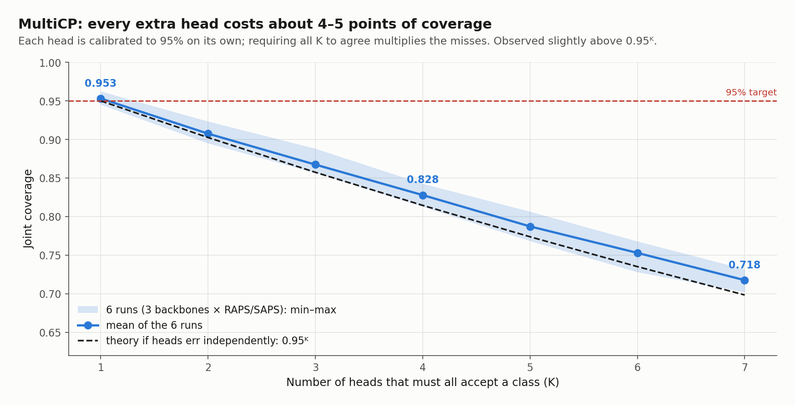
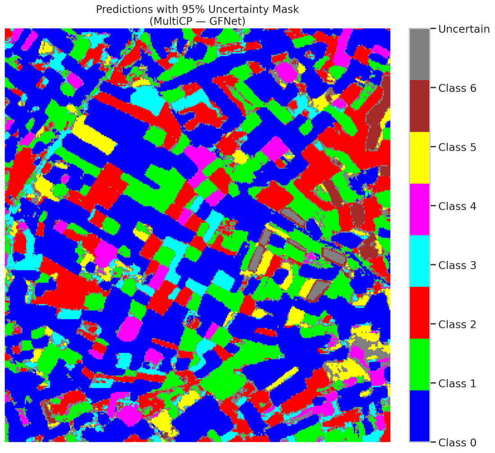
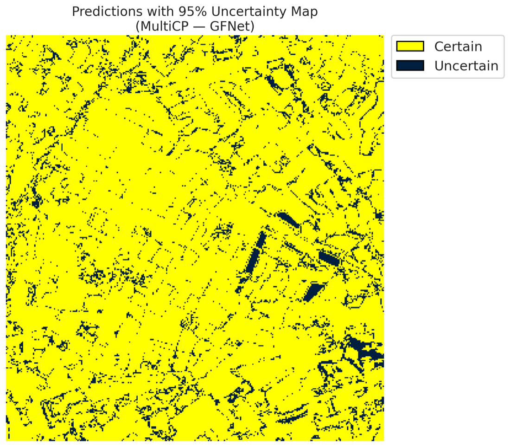

# MultiCP: conformal prediction with seven heads that must all agree

[← back to main README](../README.md) · conformal basics in [baseline/](../baseline/README.md#2-conformal-prediction-the-shared-recipe)

| | |
|---|---|
| **What** | Each backbone gets **7 output heads**. Every head is calibrated separately at 95%, and a class enters the final set only if **all 7 heads** accept it. Scored with RAPS and SAPS |
| **Key result** | One head alone covers **0.945–0.962**. All 7 together cover only **0.702–0.732**, close to the 0.95⁷ = **0.698** expected if the heads missed independently |
| **The lesson** | Intersecting K calibrated sets multiplies the miss rates. To keep 95% jointly, each head needs α/K (a Bonferroni split), which is not applied here |
| **Notebooks** | [`Model_training_multihead.ipynb`](Model_training_multihead.ipynb) · [`Model_uncertainty_multicp.ipynb`](Model_uncertainty_multicp.ipynb) |
| **Results** | [`results/multicp_results.xlsx`](results/multicp_results.xlsx) (summary, head sweeps and maps per model × score) |

> ⚠️ **Provenance.** These results come from an earlier **Google Colab** run (the workbook's model paths
> point to `/content/drive/...`). The repository's Kaggle run log marks the MultiCP training and
> uncertainty kernels (k06, k07) as cancelled or failed. The committed notebooks document the method, but
> the numbers below were not regenerated on Kaggle.

---

## 1. The idea in plain words

Ask seven slightly different experts and keep only the answers that **every** expert finds acceptable.
That gives a cautious, consensus answer. The catch: if each expert alone is right 95% of the time, "all
seven are right" happens less often, unless each is asked to be more careful.

**How the heads differ.** All 7 heads share one backbone (AlexNet-CNN, GFNet or ViT-UNet variants with a
spatial-attention branch). They are trained in stages with a deterministic **channel-shift dropout**
(`Dropout_Train`): each stage zeroes a different slice of channels, and training moves to the next stage
once validation accuracy reaches its target. Each head therefore leans on a different subset of features.

## 2. The maths, step by step

For head $`h = 1,\dots,K`$ with nonconformity score $`s_h(x, y)`$ (RAPS or SAPS, from the reference
implementation's `compute_scores`):

```math
\hat q_h = \text{Quantile}_{0.95}\big(s_h(x_i, y_i)\big)_{i \in \text{cal}}, \qquad
C(x) = \bigcap_{h=1}^{K} \{\,k : s_h(x,k) \le \hat q_h\,\}
```

*In words: each head has its own 95% cut-off, and the final set keeps only the classes that pass every
head's cut-off.* The code uses `np.quantile(·, 0.95)` without the finite-sample $`(n+1)`$ correction, so
each head sits marginally below the baseline guarantee.

**Why coverage collapses.** A pixel is covered only if no head drops its true class. If the heads missed
independently,

```math
\Pr(\text{covered}) = \prod_{h=1}^{K}(1-\alpha) = 0.95^{K}, \qquad 0.95^{7} = 0.698 .
```

*Worked example: with 2 heads the expected coverage is 0.95 × 0.95 = 0.9025, with 3 heads 0.857.*
Splitting the error budget, i.e. calibrating each head at $`1-\alpha/K`$ (≈ 0.993 for K = 7), restores
$`\ge 1-\alpha`$ jointly (union bound).

| Setting | Value |
|---|---|
| Split | 75% train / 12.5% calibration / 12.5% evaluation; **seed 10** for train/test, seed 42 for cal/eval |
| Heads K, α, scores | 7, 0.05, RAPS and SAPS |
| Calibration subset | 5% of calibration pixels set aside as `Dcells` (not used by the final rule) |
| Map rule | top 10% of pixels by mean per-head set size = "uncertain" (`UNCERTAIN_FRACTION = 0.10`) |

---

## 3. Results

### 3.1 The head sweep

<p align="center"></p>

*__Figure 1.__ Joint coverage as more heads must agree (mean over 3 backbones × 2 scores), against the
independence prediction 0.95ᴷ.*

| Heads K | 1 | 2 | 3 | 4 | 5 | 6 | 7 |
|---|--:|--:|--:|--:|--:|--:|--:|
| Mean joint coverage | 0.953 | 0.908 | 0.867 | 0.828 | 0.787 | 0.753 | 0.718 |
| 0.95ᴷ | 0.950 | 0.903 | 0.857 | 0.815 | 0.774 | 0.735 | 0.698 |

*__Table 1.__ Source: head-sweep sheets of `results/multicp_results.xlsx`.*

**Reading Figure 1 and Table 1.** The observed curve sits 0.3–2 points **above** 0.95ᴷ, and the gap grows
with K. The heads share a backbone, so their misses are slightly correlated, which helps a little. But the
trend is the independence law: every extra head costs 4–5 points of coverage.

### 3.2 Final results (K = 7)

| Model | Score | Joint coverage | Mean per-head set size | Share of scene flagged |
|---|---|--:|--:|--:|
| AlexNet-CNN | RAPS | 0.718 | 0.959 | 11.6% |
| | SAPS | 0.727 | 0.959 | 76.3% |
| GFNet | RAPS | 0.703 | 0.952 | 10.6% |
| | SAPS | 0.702 | 0.951 | 72.6% |
| ViT-UNet | RAPS | 0.732 | 1.000 | 11.7% |
| | SAPS | 0.723 | 0.982 | 11.7% |

*__Table 2.__ Source: `Summary` sheet of `results/multicp_results.xlsx`. The workbook's "set size" is the
average over heads of each head's own set size, not the size of the joint set.*

**Reading Table 2.**
- **Joint coverage 0.70–0.73** for every model and score: the multiplication law, not a model problem.
- **Per class it is uniform.** Class coverage ranges 0.66–0.81 across all 42 model × score × class
  combinations. No class is spared, because the loss comes from the intersection, not from any one class.
- **"Share flagged" depends on ties, not on uncertainty.** The rule flags pixels whose mean set size is
  `>=` the 90th percentile. Set sizes take only a few distinct values, so when many pixels tie at that
  percentile all of them are flagged: **73–76%** of the scene for SAPS on AlexNet and GFNet.
- The workbook's `scene_coverage` (0.22–0.24) is **not interpretable**. It is computed over all pixels,
  including unlabelled ones, and the indexing of valid labels does not line up with the prediction array.

<a id="33-maps"></a>

### 3.3 Maps

| GFNet · RAPS: class map + uncertain | GFNet · RAPS: certain vs uncertain |
|:-:|:-:|
|  |  |

*__Figure 2.__ Notebook numbering 0–6 (= labels 1–7). Extracted from `results/multicp_results.xlsx`.*

**Reading Figure 2.**
- Uncertain pixels (grey / dark) form **thin lines along parcel boundaries** plus scattered pixels. That
  is the 10% quota at work.
- The **solid grey/dark parcels** in the east are a rule artefact, not uncertainty. The notebook forces
  every pixel whose raw label equals **7** to "uncertain" (`gt_uncertain = (y_flat == 7)`; its docstring
  calls label 7 "unlabelled"). In this dataset label 7 is a **real class** (543 pixels, the spectrally
  distinct low-NIR class), so those parcels are greyed out whatever the model predicts.

---

## 4. Discussion

- **MultiCP as implemented trades validity for consensus.** Its sets are a subset of every head's set, so
  they are never larger, but they miss the true class ~28% of the time.
- **Easy fix:** calibrate each head at α/K, or calibrate a single combined score (e.g. the maximum of the
  per-head scores). Either restores a valid joint guarantee.
- **Map rule:** replace the top-10% quota with "joint set ≠ one class" so that "uncertain" has a
  probabilistic meaning, and drop the label-7 override.

## 5. Caveats

1. Colab-era results, not regenerated on Kaggle (see box at the top).
2. The label-7 override (§3.3) affects every MultiCP and [SCMCP](../multicp_sacp/README.md) map.
3. The seed-10 split differs from the seed-42 split used in most other folders, so the evaluation pixels
   differ.
4. Head training validates on the test split (`validation_data=(x_test, ...)`), so the stage schedule saw
   test accuracy.

## References

Multi-CP reference implementation: [github.com/yamtawa/Multi-CP](https://github.com/yamtawa/Multi-CP);
Angelopoulos et al. (2021), *RAPS*; Huang et al. (2024), *SAPS*; Vovk et al. (2005).
