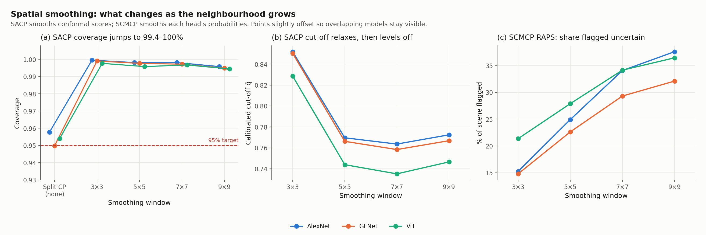
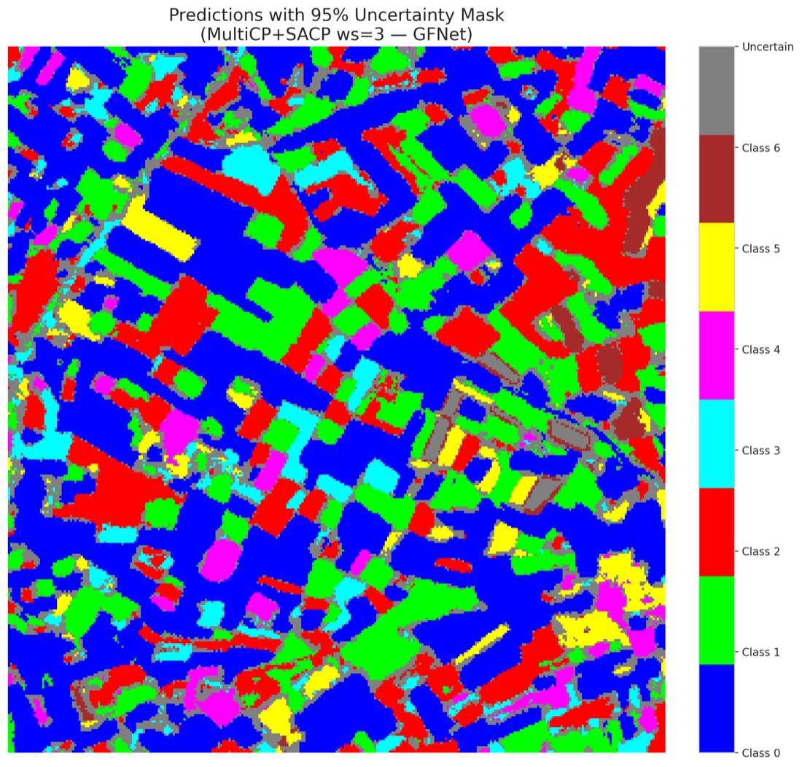
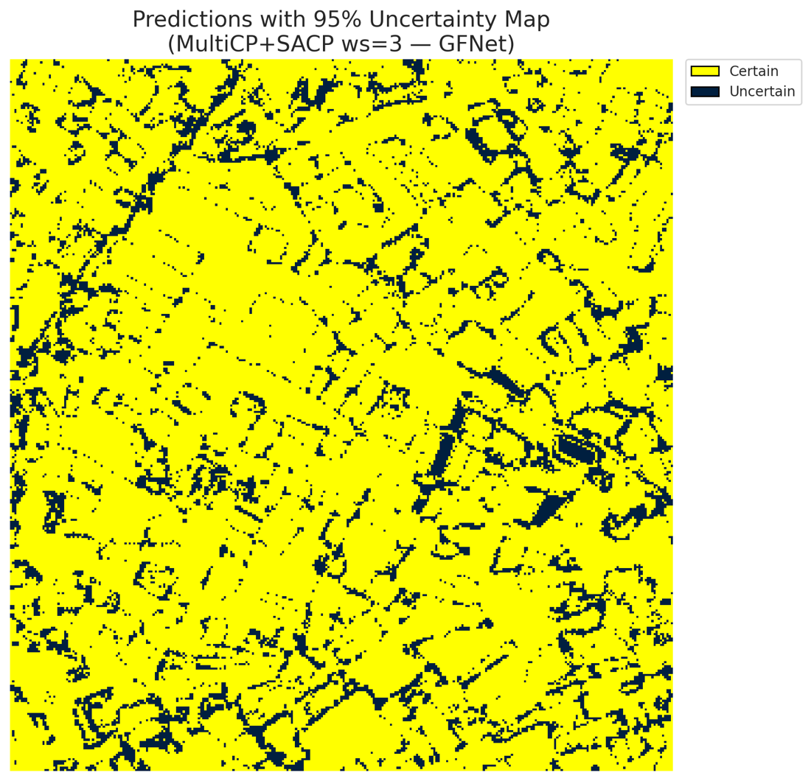

# SCMCP: spatially-smoothed multi-head conformal prediction

[← back to main README](../README.md) · builds on [MultiCP](../multicp/README.md) and [SACP](../sacp/README.md)

| | |
|---|---|
| **What** | MultiCP's 7-head intersection, but each head's **probability map is smoothed over a neighbourhood** (3×3 to 9×9) before the conformal scores are computed. Scored with RAPS and SAPS |
| **Key result** | Joint coverage stays at **0.67–0.72** for every window: smoothing does not undo the 7-way intersection. The share of the scene flagged uncertain grows from **15–21% (3×3) to 32–38% (9×9)** with RAPS |
| **The lesson** | Spatial smoothing changes *where* uncertainty appears (wider bands along parcel edges), not *how valid* it is. The validity problem is MultiCP's intersection and needs the α/K fix |
| **Notebook** | [`Model_uncertainty_multicp_sacp.ipynb`](Model_uncertainty_multicp_sacp.ipynb) |
| **Results** | [`results/combined_summary_all_windows.csv`](results/combined_summary_all_windows.csv) · [`results/combined_per_class_all_windows.csv`](results/combined_per_class_all_windows.csv) · one workbook per window in `results/window_*/` |

> ⚠️ **Provenance.** This notebook re-uses the multi-head weights from [MultiCP](../multicp/README.md),
> which were trained on Google Colab. The Kaggle run log marks this kernel (k08) as failed for that reason,
> so the committed results come from the earlier Colab run.

---

## 1. The idea in plain words

SACP smooths *scores*; SCMCP smooths *probabilities*. For each head, every pixel's 7-class probability
vector is blended with the average vector of its neighbours, then renormalised to sum to 1. Only then are
RAPS/SAPS scores computed, so the scores always see a valid distribution. Afterwards everything follows
MultiCP: one 95% cut-off per head, and the final set is the intersection over 7 heads.

## 2. The maths

For head $`h`$, pixel $`i`$ and window $`\mathcal N_w(i)`$ (code: `spatial_smooth_prob_map`, λ = 0.5,
one pass):

```math
\tilde p^{(h)}_{i} = \operatorname{normalise}\!\Big((1-\lambda)\, p^{(h)}_{i} + \lambda\,\frac{1}{|\mathcal N_w(i)|}\sum_{j\in\mathcal N_w(i)} p^{(h)}_{j}\Big)
```

```math
C(x_i) = \bigcap_{h=1}^{7}\{\,k : s_h(\tilde p^{(h)}_i, k) \le \hat q_h\,\}
```

*In words: average each head's probabilities with the neighbours', score the result, and keep the
classes every head accepts.* With λ = 0.5 a pixel counts as much as all its neighbours together.

| Setting | Value |
|---|---|
| Heads, α, λ, passes | 7, 0.05, 0.5, 1 |
| Windows | 3, 5, 7, 9 |
| Split | seed 42, 75/25, test pool split 50/50 into calibration/evaluation |
| Map rule | as MultiCP: top 10% by mean set size (with ties) = uncertain, plus the label-7 override |

---

## 3. Results

| Window | Model | Score | Joint coverage | Avg. set size | Worst class cov. | Scene: share flagged uncertain | Scene: avg. set size |
|:-:|---|---|--:|--:|--:|--:|--:|
| **3×3** | AlexNet | RAPS | 0.709 | 0.710 | 0.679 | 15.3% | 1.00 |
|  | AlexNet | SAPS | 0.718 | 0.719 | 0.663 | 83.8% | 0.90 |
|  | GFNet | RAPS | 0.704 | 0.704 | 0.682 | 14.8% | 0.99 |
|  | GFNet | SAPS | 0.701 | 0.701 | 0.687 | 81.9% | 0.90 |
|  | ViT | RAPS | 0.719 | 0.735 | 0.683 | 21.4% | 1.11 |
|  | ViT | SAPS | 0.694 | 0.705 | 0.662 | 11.9% | 0.95 |
| **5×5** | AlexNet | RAPS | 0.670 | 0.676 | 0.656 | 24.9% | 1.17 |
|  | AlexNet | SAPS | 0.695 | 0.700 | 0.635 | 88.5% | 0.98 |
|  | GFNet | RAPS | 0.679 | 0.684 | 0.654 | 22.6% | 1.14 |
|  | GFNet | SAPS | 0.692 | 0.695 | 0.663 | 87.9% | 0.98 |
|  | ViT | RAPS | 0.688 | 0.707 | 0.644 | 27.9% | 1.22 |
|  | ViT | SAPS | 0.715 | 0.730 | 0.663 | 14.3% | 1.03 |
| **7×7** | AlexNet | RAPS | 0.700 | 0.715 | 0.653 | 34.1% | 1.34 |
|  | AlexNet | SAPS | 0.704 | 0.718 | 0.644 | 12.2% | 1.03 |
|  | GFNet | RAPS | 0.716 | 0.734 | 0.673 | 29.3% | 1.26 |
|  | GFNet | SAPS | 0.717 | 0.731 | 0.696 | 12.0% | 1.02 |
|  | ViT | RAPS | 0.709 | 0.747 | 0.653 | 34.1% | 1.34 |
|  | ViT | SAPS | 0.695 | 0.721 | 0.644 | 15.7% | 1.06 |
| **9×9** | AlexNet | RAPS | 0.724 | 0.755 | 0.697 | 37.6% | 1.39 |
|  | AlexNet | SAPS | 0.725 | 0.745 | 0.696 | 13.6% | 1.05 |
|  | GFNet | RAPS | 0.706 | 0.736 | 0.678 | 32.1% | 1.30 |
|  | GFNet | SAPS | 0.710 | 0.728 | 0.673 | 12.9% | 1.04 |
|  | ViT | RAPS | 0.704 | 0.749 | 0.636 | 36.4% | 1.37 |
|  | ViT | SAPS | 0.711 | 0.741 | 0.667 | 16.8% | 1.09 |

*__Table 1.__ "Joint coverage" and "avg. set size" on the 2,155 evaluation pixels; set size is the
per-head average, as in MultiCP. The scene columns cover all 101,310 pixels. Source:
[`results/combined_summary_all_windows.csv`](results/combined_summary_all_windows.csv).*

<p align="center"></p>

*__Figure 1.__ Panel (c): share of the scene SCMCP flags as uncertain, by window and score.*

**Reading Table 1 and Figure 1.**
- **Coverage does not depend on the window** (0.67–0.72 everywhere) and matches MultiCP without smoothing
  (0.70–0.73). The 7-way intersection sets the coverage.
- **RAPS: the flagged share grows steadily with the window,** from 15–21% at 3×3 to 32–38% at 9×9.
  Smoothing spreads boundary doubt over more pixels, and set sizes become more varied, so more pixels exceed
  the 90th-percentile threshold.
- **SAPS flags erratically.** For AlexNet and GFNet it flags 82–89% of the scene at 3×3 and 5×5, then
  only 12–14% at 7×7 and 9×9; ViT-UNet stays at 12–17% throughout. The SAPS set sizes take very few
  distinct values, so small changes move whole blocks of tied pixels across the threshold (the tie
  artefact of [MultiCP §3.2](../multicp/README.md#32-final-results-k--7)).
- **Worst-class coverage 0.63–0.70**, and no class exceeds 0.88 under any setting.

### Maps

| GFNet · RAPS · 3×3: class map + uncertain | GFNet · RAPS · 3×3: certain vs uncertain |
|:-:|:-:|
|  |  |

*__Figure 2.__ Extracted from `results/window_3/multicp_sacp_ws3_all_models.xlsx`. Notebook numbering
0–6 (= labels 1–7).*

**Reading Figure 2.** Compared with [MultiCP's map](../multicp/README.md#33-maps), the uncertain pixels
form **thicker, connected bands along parcel boundaries** rather than isolated dots. That is the effect of
smoothing. The label-7 override still greys out the real label-7 parcels.

---

## 4. Discussion

- Smoothing is a good way to make an uncertainty map *look* spatially coherent, but it cannot repair a
  miscalibrated combination rule.
- The recommended order of fixes: (1) α/K per head or a single combined score, (2) a probabilistic map
  rule instead of a 10% quota, (3) then choose the window. The sweep suggests 3×3 or 5×5 keeps the bands
  thin.

## 5. Caveats

1. Colab-era results (box at the top).
2. Smoothing mixes calibration and evaluation pixels, so exchangeability is bent (as in [SACP](../sacp/README.md#4-caveats)).
3. **Split mismatch.** The heads were trained on MultiCP's seed-10 split, but this notebook calibrates and
   evaluates on a seed-42 split. Many calibration/evaluation pixels were therefore in the heads' training set.
4. The label-7 override ([MultiCP §3.3](../multicp/README.md#33-maps)).

## References

Multi-CP ([github.com/yamtawa/Multi-CP](https://github.com/yamtawa/Multi-CP)); Lou et al. (2024),
spatial-aware conformal prediction for hyperspectral classification; Huang et al. (2024), *SAPS*.
