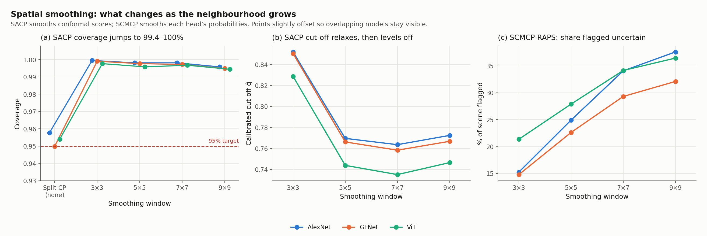
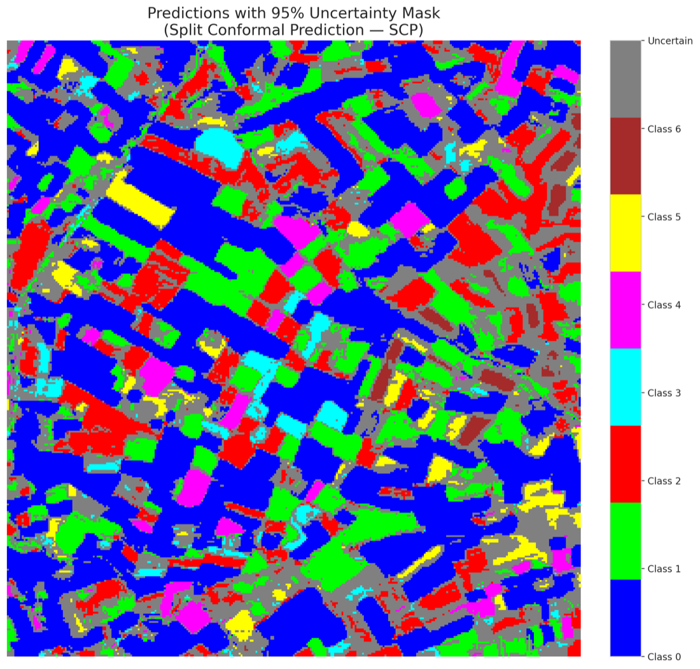
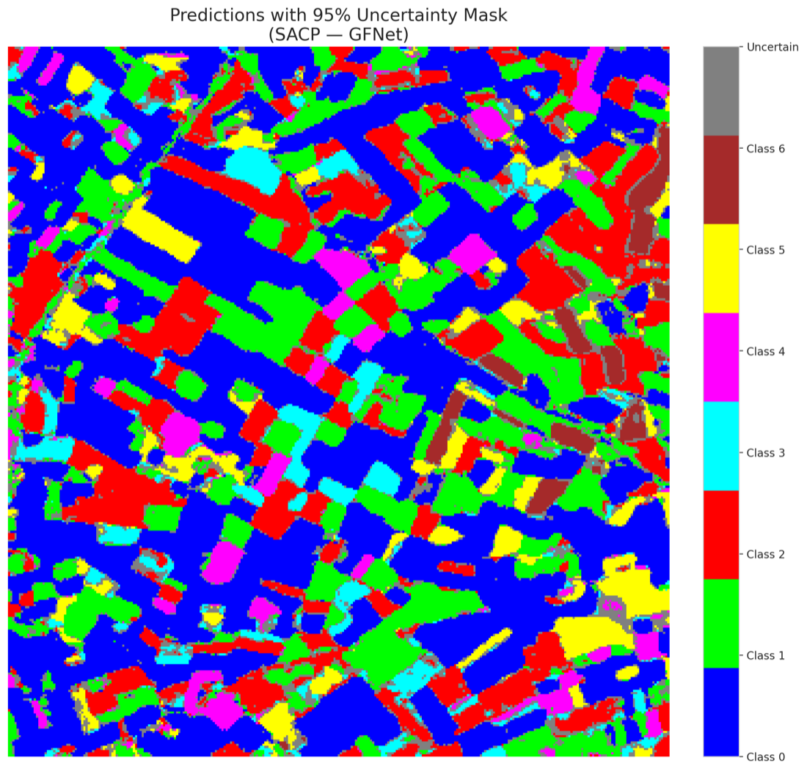
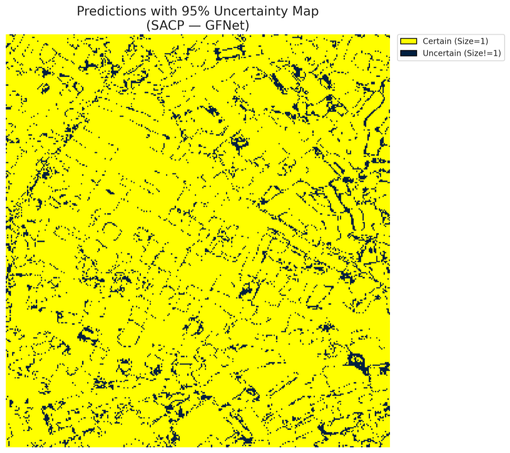
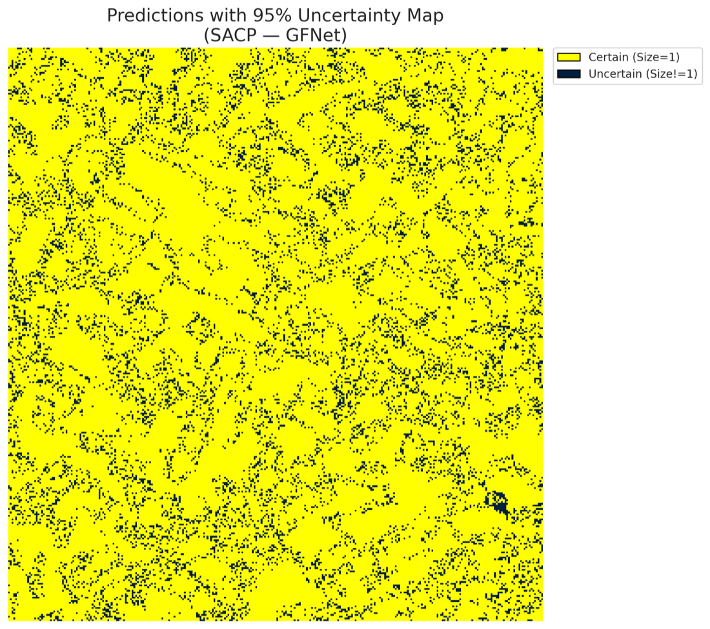

# SACP: spatially-aggregated conformal prediction

[← back to main README](../README.md) · conformal basics in [baseline/](../baseline/README.md#2-conformal-prediction-the-shared-recipe)

| | |
|---|---|
| **What** | Conformal prediction whose scores are **averaged with each pixel's neighbours** before calibration, swept over 3×3, 5×5, 7×7 and 9×9 windows on the three baseline backbones |
| **Key result** | Coverage **0.994–0.9995** (target 0.95), **no empty sets**, ≥ 99.3% single-class sets; the cut-off $`\hat q`$ falls from 0.85 (3×3) to 0.73–0.77 (≥ 5×5) |
| **The lesson** | The over-coverage does not come from the smoothing. It comes from a rule that refuses empty sets: each would-be empty set receives the model's best class, which is right > 99% of the time. Coverage then tracks accuracy, as with [RAPS](../baseline/README.md#raps) |
| **Notebook** | [`Model_sacp_comparison.ipynb`](Model_sacp_comparison.ipynb) |

---

## 1. The idea in plain words

Land cover comes in **parcels**: a pixel's neighbours usually share its class. If a pixel looks doubtful
but its eight neighbours are all confident about class 3, it is probably class 3 too. SACP builds this
into the conformal score: before calibration, each pixel's score for every class is blended with the
average score of its neighbours.

## 2. The maths, step by step

**Step 1: a randomised APS score** for every pixel $`i`$ and class $`k`$ (code: `compute_aps_scores`).
Sort the classes by probability. The score of class $`k`$ is the probability mass ranked above it, plus a
random share $`U_i \sim \text{Uniform}(0,1)`$ of its own probability:

```math
s_{ik} = \sum_{j\,\text{ranked above}\,k} \hat p_{ij} \;+\; U_i\,\hat p_{ik}
```

*In words: a low score means "this class is near the top of the model's list". The random term breaks
ties, which is exactly what the baseline RAPS implementation lacks.*

**Step 2: spatial smoothing** over the window $`\mathcal N_w(i)`$ (code: `spatial_smoothing`, λ = 0.5, one
pass):

```math
\tilde s_{ik} = \lambda\, s_{ik} \;+\; \lambda\,\frac{1}{|\mathcal N_w(i)|}\sum_{j\in\mathcal N_w(i)} s_{jk}
```

*In words: with λ = 0.5 the new score is the plain average of "my score" and "my neighbours' average
score". Only calibration and evaluation pixels enter the neighbourhood (the 4,310-pixel test pool); training
pixels and unlabelled pixels do not.*

**Step 3: calibrate and predict.** $`\hat q`$ is the usual finite-sample 95% quantile of the smoothed
true-class scores of the calibration pixels. The set is

```math
C(x_i) = \{\,k : \tilde s_{ik} \le \hat q\,\}, \qquad
\text{and if } C(x_i)=\varnothing:\ C(x_i) = \{\arg\min_k \tilde s_{ik}\}.
```

*The second rule is the important one: an empty set is replaced by the single most plausible class.*

**Worked example.** A pixel on a field edge has true-class score 0.93 (its own random draw was high) and
eight neighbours averaging 0.40. The smoothed score is ½(0.93 + 0.40) = 0.665, which clears a cut-off of
0.85. Without smoothing (0.93 > 0.85) it would have been excluded.

| Setting | Value |
|---|---|
| Backbones | AlexNet-CNN, GFNet, ViT-UNet (baseline weights) |
| α, λ, passes | 0.05, 0.5, 1 |
| Windows | 3, 5, 7, 9 |
| Calibration / evaluation | 2,155 / 2,155 (50/50 split of the test pool, seed 42) |

---

## 3. Results

| Window | Model | Coverage | Avg. set size | Singletons | Empty | 2+ classes | $`\hat q`$ | Worst class cov. | Runtime |
|:-:|---|--:|--:|--:|--:|--:|--:|--:|--:|
| **3×3** | AlexNet | 0.9995 | 1.0005 | 99.95% | 0.0% | 0.05% | 0.852 | 0.985 | 52 s |
|  | GFNet | 0.9991 | 1.0028 | 99.72% | 0.0% | 0.28% | 0.850 | 0.997 | 49 s |
|  | ViT | 0.9977 | 1.0074 | 99.30% | 0.0% | 0.70% | 0.829 | 0.990 | 60 s |
| **5×5** | AlexNet | 0.9981 | 1.0009 | 99.91% | 0.0% | 0.09% | 0.770 | 0.985 | 48 s |
|  | GFNet | 0.9977 | 1.0028 | 99.72% | 0.0% | 0.28% | 0.766 | 0.985 | 46 s |
|  | ViT | 0.9958 | 1.0046 | 99.54% | 0.0% | 0.46% | 0.744 | 0.981 | 50 s |
| **7×7** | AlexNet | 0.9981 | 1.0009 | 99.91% | 0.0% | 0.09% | 0.764 | 0.985 | 53 s |
|  | GFNet | 0.9972 | 1.0009 | 99.91% | 0.0% | 0.09% | 0.758 | 0.987 | 50 s |
|  | ViT | 0.9968 | 1.0032 | 99.68% | 0.0% | 0.32% | 0.735 | 0.993 | 55 s |
| **9×9** | AlexNet | 0.9958 | 1.0000 | 100.00% | 0.0% | 0.00% | 0.772 | 0.956 | 59 s |
|  | GFNet | 0.9949 | 1.0000 | 100.00% | 0.0% | 0.00% | 0.767 | 0.971 | 56 s |
|  | ViT | 0.9944 | 1.0037 | 99.63% | 0.0% | 0.37% | 0.747 | 0.971 | 60 s |

*__Table 1.__ Sources: [`results/combined_summary_all_windows.csv`](results/combined_summary_all_windows.csv),
[`results/combined_per_class_all_windows.csv`](results/combined_per_class_all_windows.csv).*

<p align="center"></p>

*__Figure 1.__ (a) Coverage, (b) the cut-off $`\hat q`$ and (c) the share of the scene that SCMCP flags,
as the window grows.*

**Reading Table 1 and Figure 1.**
- **Coverage ≈ accuracy, not 95%.** Smoothing does pull scores together, but the 95% cut-off still
  excludes about 5% of calibration pixels' true classes. Those pixels' sets would be empty, so the fallback
  inserts the best class, which these models get right > 99% of the time. Net result: 99.4–99.95%.
- **$`\hat q`$ drops from 0.85 to ~0.76 and then flattens.** Averaging random APS scores narrows their
  spread (the average of uniform draws clusters near the middle), so the 95th percentile moves down. Beyond
  5×5 the neighbourhood of a test-pool pixel contains few extra test-pool pixels (25% of the 17% of the
  scene that is labelled), so the curve flattens.
- **Larger windows slightly reduce coverage** (9×9: 0.994–0.996), and the worst class drops from ≥ 0.985 to
  0.956. Big windows reach across parcel boundaries and import neighbours of another class.
- **Every class is ≥ 0.956**, much fairer than baseline Split CP (worst 0.735). This, too, is mainly the
  fallback at work.

| Split CP (GFNet) | SACP 3×3 (GFNet) |
|:-:|:-:|
|  |  |

| SACP 3×3: certain vs uncertain | SACP 9×9: certain vs uncertain |
|:-:|:-:|
|  |  |

*__Figure 2.__ Full-scene maps (grey / dark = uncertain). Extracted from
[`results/window_3/`](results/window_3/) and [`results/window_9/`](results/window_9/) workbooks.*

**Reading Figure 2.** Compared with Split CP, SACP turns broad grey zones into **coherent parcels with
thin uncertain edges**. On the full scene the smoothing uses every neighbouring pixel, so the effect is
stronger than on the sparse test pool. The 9×9 map greys out more boundary pixels than the 3×3 map,
because each pixel now averages over more of the neighbouring parcel.

<a id="4-caveats"></a>

## 4. Caveats

1. **The guarantee is bent.** Smoothing mixes calibration and evaluation pixels, so their scores are no
   longer exchangeable, and the formal 95% guarantee does not strictly apply.
2. **The empty-set fallback dominates coverage.** It is a sensible product choice ("always give an
   answer"), but it makes coverage track accuracy. Reporting coverage with and without the fallback would
   separate the two effects.
3. **The table and the map measure slightly different procedures.** In evaluation only test-pool pixels
   count as neighbours (about 2 of the 8 in a 3×3 window inside labelled areas). The full-scene map smooths
   over *every* pixel and applies no empty-set fallback (code: `mask_map_full = np.ones(...)`).
4. **AlexNet's split** (seed 10) overlaps the calibration pool ([baseline caveat 1](../baseline/README.md#7-caveats)).

## References

Romano, Sesia & Candès (2020), *Classification with Valid and Adaptive Coverage* (APS); Angelopoulos &
Bates (2023); Lou et al. (2024), *Spatial-aware conformal prediction for trustworthy hyperspectral image
classification*.
