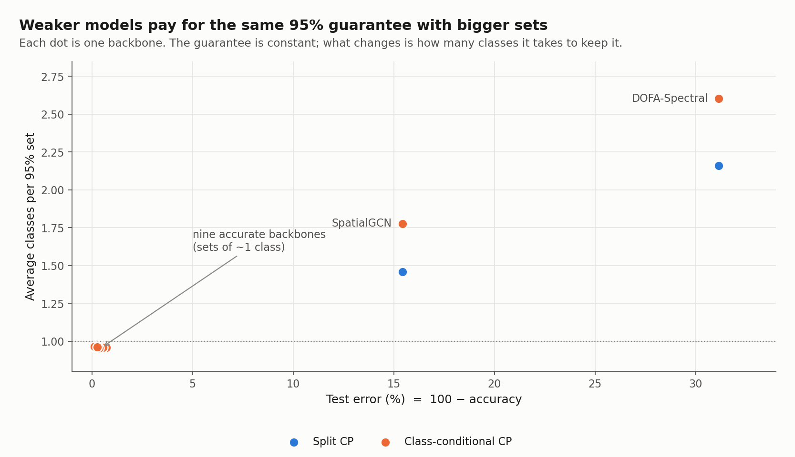
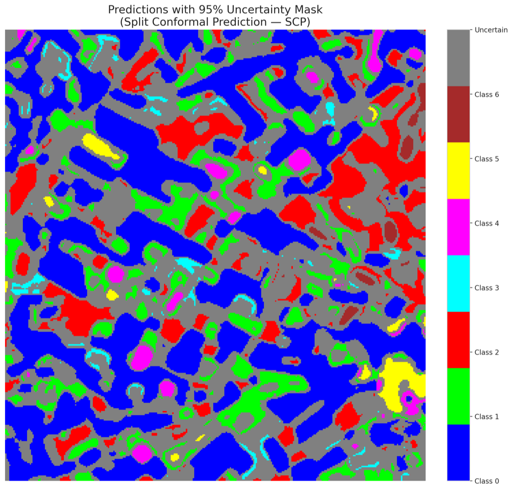
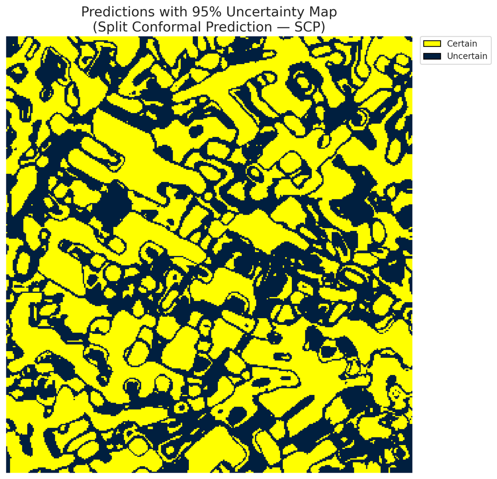
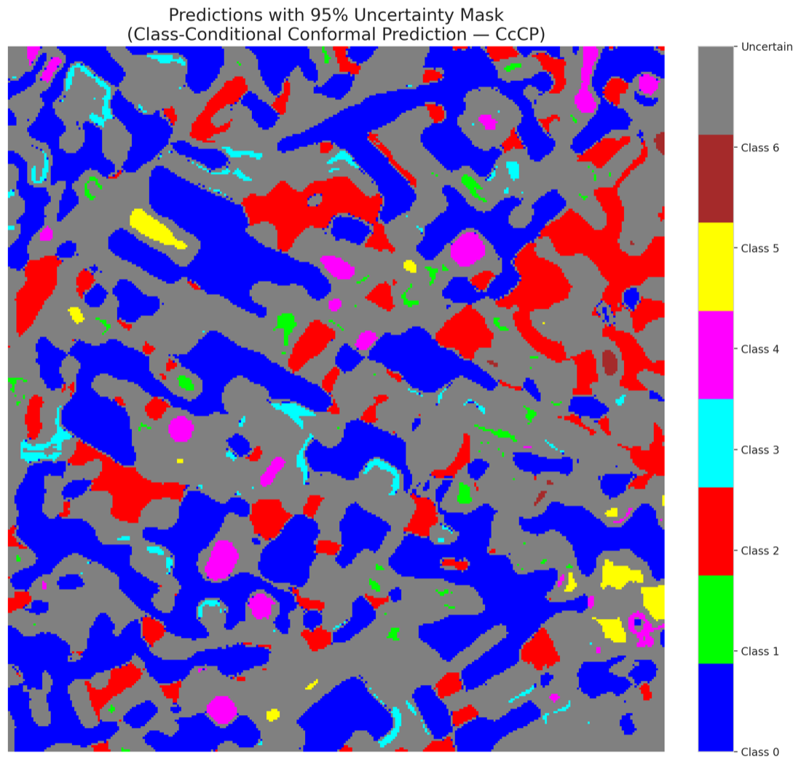

# SpatialGCN: a graph network over the pixel grid, and an imperfect model done right

[← back to main README](../README.md) · conformal methods explained in [baseline/](../baseline/README.md#3-the-five-methods-step-by-step)

| | |
|---|---|
| **What** | A graph convolutional network that treats the 81 pixels of a 9 × 9 patch as nodes on a grid, evaluated with the five baseline conformal methods |
| **Key result** | **84.6%** accurate and well calibrated (ECE 0.060). Conformal sets cover **95.2–96.1%** with **1.46–1.83** classes on average; 38–53% of pixels get two or more candidates, and **no set is empty** |
| **The lesson** | The middle ground between "perfect" and "weak" is where conformal prediction is most useful: most pixels stay single-class, and the hard ones get a short list. Class-conditional CP lifts the worst class from 0.81 to 0.90 |
| **Notebooks** | [`Model_training.ipynb`](Model_training.ipynb) · [`Model_uncertainty_comparison.ipynb`](Model_uncertainty_comparison.ipynb) |

---

## 1. The model in plain words

A graph network sees an image as **nodes connected by edges**. Here every pixel of the 9 × 9 patch is a
node holding its 6 band values, and each node is linked to its 4 direct neighbours (up, down, left,
right). One graph-convolution layer lets every node mix its own features with the average of its
neighbours'. Three layers let information travel three pixels.

```math
H^{(l+1)} = \sigma\!\left(\tilde D^{-1/2}\,\tilde A\,\tilde D^{-1/2}\, H^{(l)}\, W^{(l)}\right)
```

*In words: $`\tilde A`$ is the 81 × 81 neighbour table (with self-loops) and $`\tilde D`$ counts each node's
neighbours, so the product is a fair average over each pixel's neighbourhood. $`W^{(l)}`$ is a learned
mixing matrix and $`\sigma`$ a non-linearity (Kipf & Welling, 2017).* After the last layer the 81 nodes are
pooled into one vector and classified.

| Setting | Value (from `GCN_CFG`) |
|---|---|
| Graph | 81 nodes, 4-connected grid |
| Graph-conv layers | 64 → 128 → 128 units |
| Classifier head | dense 128 → 64 → 7 |
| Recipe | as baseline: 100 epochs, batch 128, lr 3 × 10⁻⁴, dropout 0.25, seed 42 |
| Train time | **1.1 min**, the fastest model in the study |

**Why it is less accurate.** Neighbour averaging is a low-pass filter: after three layers each node is a
blurred mix of its surroundings, and pooling then averages all 81 nodes. Sharp parcel edges and narrow
features are smoothed away. The full-scene map (Figure 4) shows the result: rounded blobs instead of
rectangular fields.

---

## 2. Classification results

| Accuracy | κ | Macro-F1 | NLL | Brier | ECE (15 bins) |
|--:|--:|--:|--:|--:|--:|
| 84.57% | 0.7883 | 0.7825 | 0.4534 | 0.2242 | 0.0597 |

*__Table 1.__ Source: [`results/classification_summary.csv`](results/classification_summary.csv).*

<p align="center"></p>

*__Figure 1.__ Test confusion matrix (labels 1–7).*

**Reading Figure 1.** Label 1 is almost perfect (1,770 / 1,828). The errors flow towards the large
"middle" classes:
- **Label 5 → label 2** (60 of 207): both vegetated, differing mainly in brightness, which smoothing blurs.
- **Label 6 → labels 2 and 7** (42 and 33 of 203): only half of label 6 is right.
- **Label 4 → labels 2 and 3** (59 and 36 of 313).

The macro-F1 (0.78) is well below accuracy (0.85) because the small classes take most of the errors.

---

## 3. Uncertainty results

### 3.1 Coverage and set size

| Model | Method | Coverage | Avg. set size | Singletons | Empty | 2+ classes | Mean per-class cov. |
|---|---|--:|--:|--:|--:|--:|--:|
| **SpatialGCN** | Split CP | 0.952 | 1.46 | 61.9% | 0.0% | 38.1% | 0.905 |
|  | Class-cond. CP | 0.959 | 1.78 | 51.1% | 0.0% | 48.9% | 0.951 |
|  | Clustered CP | 0.955 | 1.65 | 54.4% | 0.0% | 45.6% | 0.927 |
|  | RC3P | 0.961 | 1.83 | 47.4% | 0.0% | 52.6% | 0.953 |
|  | RAPS | 0.953 | 1.48 | 61.2% | 0.0% | 38.8% | 0.905 |

*__Table 2.__ Source: [`results/uncertainty_results/summary_metrics.csv`](results/uncertainty_results/summary_metrics.csv).*

<p align="center"></p>

*__Figure 2.__ Average set size against test error for all backbones. SpatialGCN is the middle point.*

**Reading Table 2 and Figure 2.**
- **All five methods are valid** (0.952–0.961), including RAPS. The true class is ranked first only
  ~85% of the time, so the RAPS score is not degenerate here.
- **The sets are informative.** Split CP leaves 62% of pixels with a single class and gives the other 38%
  two or more (1.46 on average). Compare DOFA-Spectral (2.16) and the near-perfect models (≤ 1).
- **Class-conditional CP and RC3P cost about 0.3–0.4 extra classes per pixel** (1.78 and 1.83). That is
  the price of protecting the weak classes, which the next table shows.

### 3.2 Fairness across classes

| Model | Method | Label 1 | Label 2 | Label 3 | Label 4 | Label 5 | Label 6 | Label 7 | Worst |
|---|---|--:|--:|--:|--:|--:|--:|--:|--:|
| *eval pixels* | | *914* | *454* | *358* | *156* | *104* | *101* | *68* | |
| **SpatialGCN** | Split CP | 0.991 | 0.963 | 0.969 | **0.808** | 0.875 | 0.832 | 0.897 | 0.808 |
|  | Class-cond. CP | 0.958 | 0.963 | 0.964 | 0.974 | 1.000 | 0.901 | **0.897** | 0.897 |
|  | Clustered CP | 0.991 | 0.947 | 0.961 | **0.788** | 1.000 | 0.901 | 0.897 | 0.788 |
|  | RC3P | 0.962 | 0.960 | 0.966 | 0.974 | 0.990 | 0.921 | **0.897** | 0.897 |
|  | RAPS | 0.993 | 0.958 | 0.972 | **0.821** | 0.865 | 0.832 | 0.897 | 0.821 |

*__Table 3.__ Source: [`results/uncertainty_results/per_class_coverage.csv`](results/uncertainty_results/per_class_coverage.csv).*

**Reading Table 3.**
- **Split CP under-covers exactly the confused classes:** label 4 (0.808), label 5 (0.875) and label 6
  (0.832). Those are the three rows of Figure 1 with the most off-diagonal mass.
- **Clustered CP makes label 4 worse (0.788).** It was grouped with classes that are easier for this model
  and inherited their stricter cut-off.
- **Class-conditional CP and RC3P bring every class to ≥ 0.897.** Label 7 (0.897, 61 of 68 pixels) is the
  same small-sample floor seen in [DOFA](../dofa/README.md#32-is-coverage-fair-across-classes).

### 3.3 Where the uncertainty is on the map

| Split CP: class map + uncertain | Split CP: certain vs uncertain | Class-conditional CP |
|:-:|:-:|:-:|
|  |  |  |

*__Figure 3.__ Grey = set holds more than one class. Notebook numbering 0–6 (= labels 1–7). Extracted
from [`results/uncertainty_results/conformal_reports_all_models.xlsx`](results/uncertainty_results/conformal_reports_all_models.xlsx).*

**Reading Figure 3.** Uncertainty forms **wide halos around every predicted blob**. These are the places
where the model's smoothing had to invent a boundary between two classes, and the conformal sets correctly
say "either of these". Blob interiors stay confident. Class-conditional CP widens the halos further around
the weak classes (labels 4–6).

<p align="center"></p>

*__Figure 4.__ Ground truth and SpatialGCN's full-scene prediction.*

---

## 4. Discussion

- **Calibrated probabilities + conformal = useful sets.** SpatialGCN's ECE (0.060) is moderate and its
  errors are structured (between neighbouring classes). Conformal prediction converts that into short,
  meaningful candidate lists rather than abstentions.
- **A design lesson for graph models on patches.** Plain neighbour averaging over-smooths. Edge-aware
  weights (e.g. graph attention) or fewer layers would likely recover parcel boundaries.

## 5. Caveats

- Random-split optimism ([main README §10](../docs/05_limitations.md#10-limitations-and-threats-to-validity)).
- Label 7 coverage rests on 68 evaluation pixels.

## References

Kipf & Welling (2017), *Semi-Supervised Classification with Graph Convolutional Networks*; Ding et al.
(2023), *Class-Conditional Conformal Prediction with Many Classes*; Shi et al. (2024), *RC3P*.
